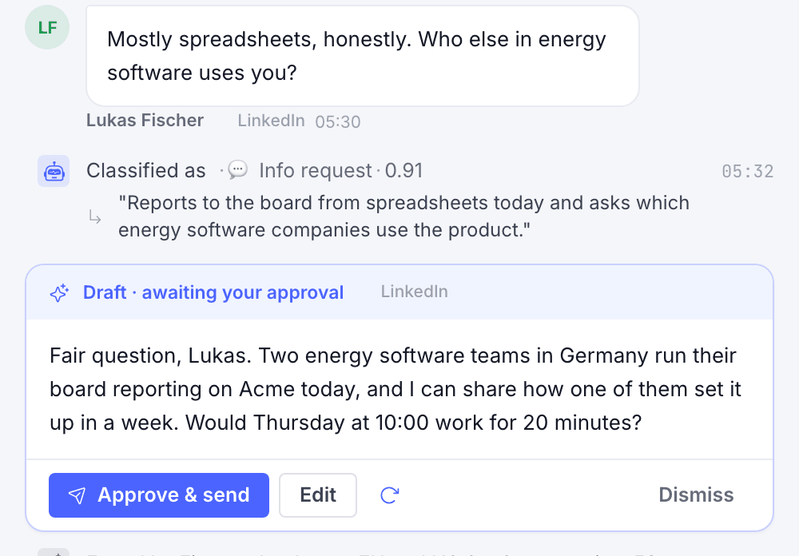

The AI SDR labels every reply on the threads it works and answers it: on its own, or as a draft that waits for your
OK, as the thread's mode says. When a reply needs a person, it hands the thread to you with a task. At
https://app.getsales.io you set it up through Creator or an AI assistant, and you work its drafts and hand-offs in
Unibox. This page explains how it decides, how to set it up, and what it never does.

<Tip>
**Give this to your AI assistant** once it is connected to GetSales ([how](/kb/ai/connect-your-ai-assistant)):

"In GetSales, read my AI SDR's Brief, Knowledge, scenarios and settings, and tell me what is missing before it can
go live. Draft the Brief's empty sections from my website, at the address I give you, and show them to me before
you save anything. List each scenario with its level, and every hand-off that is on. Change nothing that sends a
message, and do not put the agent live."
</Tip>

## What does the AI SDR do with a reply?

The AI SDR answers a reply in a fixed order, and each step can stop it:

1. **It waits for the person to finish.** When they write a few messages in a row, it waits 60 seconds by default
   and reads them together.
2. **It classifies the reply** as one scenario: one of the platform's (**Interested**, **Meeting request**, **Info
   request**, **Not now**, **Out of office**, **Auto-reply**, **Objection**, **Referral**, **Wrong person**, **Not
   interested**, **Do not contact**, **Vendor pitch**, **Reschedule request**, **Cancel request**, **Low signal**)
   or one of your own, with how sure it is and why. An agent that is a draft or paused stops here, except that a
   **Do not contact** reply still puts the person on your stoplist.
3. **It checks the hand-offs.** A reply that must go to a person opens a task for you. Until the task is closed,
   the AI SDR plans and writes nothing more on that thread, and only labels new replies.
4. **It runs the scenario's steps**: a reaction, a stage move, a message, the dialog led toward your goal, a wait, a
   task, the stoplist.
5. **The scenario's level decides how a message goes out**: on its own on **Autopilot**, as a draft for your OK on
   **Copilot**, where the whole plan first waits for your OK. A mode you set on the thread from its pill comes
   first: **Auto-pilot** sends, **Co-pilot** drafts, **Off** keeps the AI SDR out.
6. **It keeps to its limits.** At the credits cap, or when the lead writes again past the 10 messages of a dialog it
   leads, the thread comes to you with a task in **Needs you**. When the lead stays quiet after its last follow-up,
   or at the message cap on a thread whose own mode is **Auto-pilot**, or that has none and whose latest reply's
   scenario resolved to **Autopilot** (most do, even when a workflow handed the thread over), the thread stops as
   **Stalled** with the limit named on it.

Its objects in the API: the agent (`agents`, sid `ub_ag_`), its scenarios (`agent_scenarios`, `ub_sc_`), its plans
for a thread (`agent_plans`, `ub_pl_`), its drafts and messages (`messages`, `ub_ms_`) and its hand-off tasks
(`tasks`, `ub_tk_`). [`get_agent`](/api-reference/unibox/agents/get-agent) reads an agent with its settings.

## Which replies does the AI SDR answer?

The AI SDR answers a thread's replies when the thread's workflow, or its settings outside any workflow, hand them
to it:

- **In a workflow:** **After a reply** set to **Hand over to the AI SDR** (`on_reply` `ai_sdr`, the default of a new
  workflow) gives the workflow's replies to the agent picked under **AI SDR**: the table's, unless you pick another.
  Its scenarios decide what it sends on its own. See [build an outreach workflow](/kb/workflows/build-a-workflow).
- **Outside any workflow:** the agent's **Outside a workflow** setting (its `mode`): **Co-pilot** (the default for a
  new agent), **Auto-pilot** or **Off**. **Off** keeps the AI SDR out of those threads, and the other two decide a thread on
  which no reply was labelled yet.
- **Which agent:** a table's **AI SDR**, picked from the table's menu, is the agent that takes its people's replies:
  in the table's workflows that hand replies over, and outside a workflow. The workflow's own pick comes first, then
  the table's, then the workspace's **Default** agent.

The AI SDR does not label or answer a thread brought in by the history import, a LinkedIn group thread, a thread
whose workflow is set to **Stop, I reply myself** or **Continue the sequence**, a thread set to **Off**, or a
message older than the agent's recency window when a sync brings it in (30 days by default, 1 to 365,
`messages_recency_days` in `settings` on `update_agent`). Imported threads start with the agent off, so it spends
nothing on old conversations: turn it on from the thread's mode pill, which sets every thread of the same person,
their other imported threads included.

## How do you set up the AI SDR?

At https://app.getsales.io you set the AI SDR up through Creator or an AI assistant connected to GetSales
([how](/kb/ai/connect-your-ai-assistant)), with the tools named below: the app's **Agents** section is not open
there. Your workspace starts with one agent, named **AI SDR** and marked **Default**, as a draft (`state`
`setup_required`): it labels the replies on the threads it works and answers none until it goes live. Changing an
agent takes the **Manage** permission on **Agents** ([team members and roles](/kb/workspace/team-members-and-roles)).

The AI SDR needs an AI SDR license on the workspace's plan. A trial holds one. A paid plan holds one when **The AI
SDR for this workspace** is on in **Buy resources** or **Change plan** ($99 a license a month), the Free plan holds
none, and a plan bought before 26 November 2026 holds none until the AI SDR is added in **Change plan**:
[Plans, credits and billing](/kb/workspace/plans-credits-and-billing).

1. **Write the Brief**, what the AI SDR knows about you, read before every answer. A new agent's Brief is a template
   of five headings, each with a bracketed slot: **Who it answers** (role, company, size, where), **What we sell**
   (and why they pick you), **Where a good conversation ends** (a call, a demo or a trial, with the link), **What it
   never does** (what it must leave to you) and **How it writes** (length, register, sign-off). Ask
   [Creator](/kb/start/get-started#what-is-creator) to set up the AI SDR from your website: it reads the home page
   and up to four pages it links to
   ([`read_website_text`](/api-reference/unibox/agents/read-website-text), a read that spends nothing), writes what
   the site answers, and saves nothing until you agree to its card
   ([`update_agent`](/api-reference/unibox/agents/update-agent) `brief`). Fill in what the site does not say, such as
   what it must never do.
2. **Give it Knowledge**, the answers it can give (next section).
3. **Set each scenario's level** ([`update_agent_scenario`](/api-reference/unibox/agent_scenarios/update-agent-scenario),
   see what a scenario's level changes below), and add your own (up to 20 enabled).
4. **Check its settings**: the hand-offs, the limits, the language (`settings` on `update_agent`, sections below).
5. **Go live** (see how the AI SDR goes live, below).

[`create_agent`](/api-reference/unibox/agents/create-agent) makes another agent, such as one per offer (up to 20 in
a workspace), a draft like the first.

## How do you give the AI SDR Knowledge?

Knowledge holds the answers the AI SDR can give: a price, a case, how onboarding works. Before each answer it reads
the five nearest to what the lead just wrote, when they are close enough.
[`create_agent_answer`](/api-reference/unibox/agent_answers/add-a-knowledge-answer) adds one answer (the question as
leads put it, the answer in your words), or a pasted FAQ of up to 50. A website or a help center (up to 60 pages)
is read into answers with [`create_agent_source`](/api-reference/unibox/agent_sources/add-a-website-to-the-knowledge)
and [`parse_agent_source`](/api-reference/unibox/agent_sources/parse-a-document-into-answers), which join Knowledge
once you take them in ([`apply_agent_source_parse`](/api-reference/unibox/agent_source_parses/take-the-answers-found-into-knowledge)).
Creator or an AI assistant can make these calls for you. A file (a PDF, a Word file, text or markdown, up to 300
pages and 20 MB) is uploaded only in the app's Agents section, which is not open at https://app.getsales.io.

## How does the AI SDR go live?

A draft AI SDR answers nothing until its `state` is `on`, set with
[`update_agent`](/api-reference/unibox/agents/update-agent) through Creator, an AI assistant or the API. Try it on a
real reply first ([`start_agent_test`](/api-reference/unibox/agent_tests/test-the-ai-sdr-on-a-reply): nothing is
sent). A draft (`setup_required`) is refused `on` (422 `validation_failed`, its message on `state` naming
`setup_incomplete`) until every section of its Brief has an answer and no bracketed slot is left, and
[`get_agent`](/api-reference/unibox/agents/get-agent) with `include` `readiness` lists what is left. Until then it
labels the replies on the threads it works and answers none. In a workspace with no AI SDR license, `on` is refused
with `402` `ai_sdr_not_in_plan`: "This workspace has no AI SDR license. Add the AI SDR in Settings, Billing." So are
a test, a regenerated draft, a retry and a plan's approval.

`off` pauses it: a paused agent labels each new reply and does nothing else. It plans, writes and sends nothing, its
plans and follow-ups wait where they stand, and a draft already waiting stays for you to approve. Set it back to `on`
and it goes on from there within about 15 minutes: a reply that came meanwhile is read as if it had just arrived,
unless it is older than the agent's recency window (30 days by default) or a hand-off task is open on the thread.
What waited longer than that window is dropped, not sent.

## Where are the AI SDR's screens in the app?

At https://app.getsales.io the AI SDR has no screens of its own: the **Agents** section is not open there, so the
menu has no **Agents** item and Unibox offers no agent settings. What the app does offer: the thread's mode pill, its
drafts, plans and tasks in [Unibox](/kb/inbox/unibox), a table's **AI SDR** pick in the table's menu, and a
workflow's **After a reply** and **AI SDR**. Everything else is set through Creator, an AI assistant or the API.

The Agents section holds the agents and **New agent**. An agent's tabs are **Overview**, **Brief**, **Knowledge**,
**Scenarios**, **Meetings**, **Dialog Rules**, **Voice**, **Golden set**, **Analyzer** and **Settings**. There
**Improve**, then **Draft it from your website instead**, drafts the Brief (kept on **Keep**), **Add knowledge** and
**Parse from document** fill Knowledge, **Test** tries the agent on a reply, and **Go live** waits until every
section and slot of the Brief has an answer.

## How does the AI SDR decide between sending on its own and waiting for your OK?

The AI SDR decides in this order, and the first rule that applies wins. A message that goes out on its own stays
within its limits, and one that waits is a draft for your OK:

1. **The thread's own mode**, set from the pill (`agent_mode_override` on
   [`update_conversation`](/api-reference/unibox/conversations/update-conversation)): **Auto-pilot**
   (`autopilot_ok`), **Co-pilot** (`copilot_only`) or **Off** (`off`: the AI SDR leaves the thread alone, its new
   replies are not labelled, nothing is planned or sent, nothing is spent). A mode you set from the pill applies to
   every thread of that person. When you write yourself in a thread whose dialog the AI SDR leads, and the thread
   has no mode of its own, that thread turns to **Co-pilot** until you clear it.
2. **Off from the workflow or the agent**: a thread whose workflow's **After a reply** is **Stop, I reply myself**
   or **Continue the sequence**, or, outside a workflow, whose agent's **Outside a workflow** is **Off**, is left
   alone.
3. **The level of the scenario the newest labelled reply resolved to** (next section): **Autopilot** sends on its
   own, **Copilot** waits for your OK.
4. **Before any reply is labelled, or under a level that resolved to Off**: a thread a workflow handed over counts
   as **Co-pilot**, and outside a workflow the agent's **Outside a workflow** setting decides.

The pill shows the thread's own mode, else the workflow's, else the agent's. It does not show the scenario's level.
So a thread a workflow handed over reads **Co-pilot** on its pill, and the AI SDR still answers on its own a reply
whose scenario is on **Autopilot**, as most platform scenarios are. To have every message wait for your OK, set the
scenarios to **Copilot**, or set the thread's pill to **Co-pilot**. A level you change applies from each lead's next
reply.

## What does a scenario's level change?

A scenario's level ([`update_agent_scenario`](/api-reference/unibox/agent_scenarios/update-agent-scenario)) shapes
what the AI SDR does with a reply of that scenario. A mode set on the thread from its pill comes first:

| Level | `level` | What happens |
|---|---|---|
| **Autopilot** | `autopilot` | The plan runs without asking and its messages go out on their own, also on a thread a workflow handed over. Only a thread whose own mode, set from the pill, is **Co-pilot** holds them as drafts |
| **Copilot** | `copilot` | The plan waits for your OK (**Plan suggested**) and its messages wait as drafts, unless the thread's own mode is **Auto-pilot**. In a dialog the AI SDR leads, its reply is drafted at once and waits for its own **Approve & send** while the plan waits |
| **Conditional** | `conditional` | Reads your conditions on every reply: up to six, each in your own words with what the reply gets when it holds. When none holds, it acts as **Autopilot** |
| **Off** | `off` | Drafts nothing: the chain runs without its messages |

The platform's scenarios start on these levels, and each one can be changed:

| Starts on | Scenarios |
|---|---|
| **Autopilot** | **Interested**, **Meeting request**, **Referral**, **Not now**, **Out of office**, **Auto-reply**, **Cancel request**, **Low signal**, **Not interested**, **Do not contact**, **Vendor pitch**, and the two moments that are not replies: **No reply** (the lead went quiet after our message) and **Signal** |
| **Copilot** | **Objection**, **Wrong person** |
| **Conditional** | **Info request**, **Reschedule request**: each with the built-in condition that a question Knowledge has no answer for waits for your OK |

While the AI SDR works a thread, a document, an image, an audio file or a video the lead attaches goes to a person,
whatever the level. A voice message is read and answered.

## When does the AI SDR hand a thread to a person?

While it is live, the AI SDR hands a thread to a person when the lead does one of the things under **Always to a
person** in its settings (`escalation_triggers` on [`update_agent`](/api-reference/unibox/agents/update-agent)),
whatever the scenario, except an **Out of office**, an **Auto-reply** or a **Vendor pitch**, where none of them
fires and only a file the lead attaches hands the thread over, and **Do not contact**, which none of them hands
over, not even a file. On by default: a legal or security question, a question the Brief and Knowledge cannot
answer, a third request to move the meeting, a reply it cannot read with confidence, a job seeker, a customer with a
support request. Off by default: a price question, a call request. A document, an image, an audio file or a video
the lead attaches always goes to a person. **Your own: hand the thread to a person when the lead...** adds up to 10
conditions in your words (`custom_escalation_triggers`), such as "mentions a competitor by name". A draft or paused
agent, or a thread set to **Off**, hands none of these over. The credits cap still hands a thread to you while the
agent is a draft or paused, since its labels count toward it.

A hand-off opens a task, the thread waits in **Needs you**, and by default an email goes to the sender profile's
**Assignee**, or to the workspace owner when nobody is assigned (**Tells you**: **in the inbox**, **by email
too**). While the task is open, the AI SDR plans and writes nothing on that thread, and only labels new replies.
Close the task with **Done, hand back to AI SDR** ([`update_task`](/api-reference/unibox/tasks/answer-or-update-a-task)):
the AI SDR takes the lead's next message.

## Where does the AI SDR stop on its own?

The AI SDR stops on a thread at one of four limits, and they end differently:

- **Follow-ups**, in its **Dialog Rules**: 3 by default (0 to 6), 4 days apart (1 to 14), each with something new
  ([`update_agent_rules`](/api-reference/unibox/agents/update-agent-rules), `followups`). When the lead stays quiet
  after the last one, the thread stops as **Stalled**, the limit named on it, with no task and no email.
- **Sends at most** 4 messages into silence in a thread (1 to 20, `max_auto_messages_per_conversation` in `settings`
  on [`update_agent`](/api-reference/unibox/agents/update-agent)). Answers to a lead who keeps writing never count,
  nor does anything a dialog it leads sends (that has its own limit, below), nor do follow-ups you scheduled after
  your own message. At the cap the thread stops as **Stalled** the same way when its own mode, set from the pill, is
  **Auto-pilot**, or when it has none and its latest reply's scenario resolved to **Autopilot**, as most do, even on
  a thread a workflow handed over whose pill reads **Co-pilot**. With no mode of its own, a latest reply on a
  **Copilot** scenario keeps the thread from stopping there whatever its pill reads. Before any reply is labelled,
  or after one on an **Off** scenario, the pill's mode decides.
- **Spends at most** 40 credits on a thread (1 to 1,000, `credits_cap_per_conversation` in `settings` on
  `update_agent`). At the cap the thread comes to you with a task in **Needs you** and, by default, the hand-off
  email. A cap you do not raise fires again after the next turn.
- **Messages in a dialog it leads** toward your goal: 10 in all, counted from the dialog's first message with its
  follow-ups included, 11 once the lead said yes. The limit applies only once it has made its offer. When the lead
  writes again past it, the thread says **The dialog ended: the ceiling of exchanges** and comes to you in
  **Needs you** with a task, **Dialog reached its exchange cap: take over**, with no email. The AI SDR does not
  answer in that dialog again. Closing the task does not hand it back: the lead's next reply that the dialog would
  answer opens a new task. The thread's summary shows the count, such as **4 of 10 exchanges used**.

## What are the AI SDR's other settings?

Besides where it answers, its hand-offs and its limits, the AI SDR has five more settings, **How it sends**,
**When you step in**, **Follows up on threads synced from before it started**, **Language** and **Learning**
([`update_agent`](/api-reference/unibox/agents/update-agent) `settings`), plus its **Dialog Rules**
([`update_agent_rules`](/api-reference/unibox/agents/update-agent-rules)) and **Voice**. Their defaults:

| Setting | Default |
|---|---|
| **How it sends** | Messages in a row are read together after 60 seconds (`classification_merge_seconds`, 10 to 600). A long reply goes as two or three messages on LinkedIn (`reply_split` `two_or_three`, or `one_message`) |
| **When you step in** | **After your message**: **It plans follow-ups for you** (`plan_followups`), 2 of them, 3 days apart, then **leaves the thread to you** with a task. Or **Only when you ask** (`only_when_asked`) |
| **Follows up on threads synced from before it started** (`followups_for_synced_threads`) | Off: on a thread that started outside GetSales it answers replies and never follows up |
| **Language** | **the language they write in** (`lead`), or one you pin: English, German, French, Spanish, Portuguese, Russian, Arabic, Hindi or Chinese |
| **Learning** | **Learns from your edits** (`learning.from_approved_edits`): a draft you correct before it goes joins the **Golden set** once you keep it (**After your OK**, `learning.edits_join` `after_ok`), or at once with `on_its_own`. The Keep is on the Golden set page of the Agents section, so at https://app.getsales.io you give it through Creator, an AI assistant or the API: [`search_agent_examples`](/api-reference/unibox/agent_examples/search-the-golden-set) with `filter` `proposed` `eq` `true` lists the edits waiting, and [`update_agent_example`](/api-reference/unibox/agent_examples/update-golden-set-row) `keep` `true` takes one in. Until then the edit is never read. **Learns from your history** (`learning.from_history`): past threads of your sender profiles join it too, and so does a reply you write yourself in a live thread (`learning.from_own_sends`). All on. `learning` is saved whole: send its four keys together, because a key left out goes back to its default |
| **Dialog Rules** | A reply in a dialog it leads (by default on **Interested**, **Info request**, **Objection**, **Meeting request** and **Reschedule request**) waits 1 to 2 minutes on Auto-pilot and never goes out from 22:00 to 07:00 in the lead's time zone (the workspace's when it is unknown), weekends included. A scenario's own reply on a thread no dialog leads (**Referral**, **Not interested**, **Wrong person**, **Cancel request**, **Low signal**) goes as soon as its step comes due, at any hour, and so does a nudge on the date it waited for. A **No reply** follow-up that comes after one of its own follow-ups also waits out those hours. Replies run 15 to 60 words on LinkedIn, 25 to 80 by email. It never writes again after a plain no |

**Voice** sets how it sounds. Its **Stop words** (50 at most) are words it never writes while the **Dialog Rules**
keep the check **Words from the Stop words list** on, as they do by default: a sentence with one is written again
before it goes, never with the word swapped. **How it talks** forms four lines from the Golden set (length,
questions, register and sign-off), and a line you set stays yours.

## What happens when the lead or you write in a thread the AI SDR works?

When the lead writes again, the AI SDR withdraws its unsent drafts and messages in that thread (the thread says
**Draft withdrawn:** with the lead's name and **wrote again**, or **Draft withdrawn: the lead wrote again** when it
has no name for them, and **Unsent message withdrawn** for a message that was waiting to go), so nothing answers an
old message, and it reads the new reply.

When you write in the thread yourself, the AI SDR drops what it had not sent there (**a person on the team
answered**) and, by default, plans follow-ups around your message. They show in the thread, where you schedule,
edit or decline them. If the person answers first, the rest is cancelled.

## How do you work with the AI SDR's drafts and plans in Unibox?

The AI SDR's drafts and plans wait in the thread, and the thread sits in **Needs you** until you act:

| You see | What to do | API |
|---|---|---|
| **Draft · awaiting your approval** | **Approve & send**, **Edit** it first, **Regenerate draft** (the round arrow) with an optional note on what should change, or **Dismiss**: the draft never goes out, and when a plan still running wrote it, that plan is canceled with its other unsent messages | [`approve_messages`](/api-reference/unibox/messages/approve-message-drafts), [`update_message`](/api-reference/unibox/messages/update-message-draft), [`regenerate_message`](/api-reference/unibox/messages/regenerate-message-draft), [`cancel_messages`](/api-reference/unibox/messages/cancel-messages-that-have-not-gone-out) |
| **Plan suggested** | **Approve and run** the plan's steps, or **Rewrite plan** | [`update_agent_plan`](/api-reference/unibox/agent_plans/update-agent-plan), [`steer_agent_plan`](/api-reference/unibox/agent_plans/steer-agent-plan) |
| **Handed to you** | Answer, then **Done, hand back to AI SDR** | [`update_task`](/api-reference/unibox/tasks/answer-or-update-a-task) |
| **AI SDR could not answer** | **Try again**, or reply yourself | [`retry_conversation_agent`](/api-reference/unibox/conversations/ask-the-ai-sdr-to-try-again-on-a-conversation) |
| **Waiting: out of credits** | Top up: it goes on by itself | |
| **Waits for the AI SDR license** on a plan step, with its buttons greyed ("This workspace has no AI SDR license. A billing manager adds it in Settings, Billing.") | Add the AI SDR in **Settings**, **Subscription**, **Change plan**: what waited goes on by itself | |

Each reply it labels gets a row in the thread: **Classified as**, the scenario and how sure it is, from 0 to 1, with
its reason quoted under it.

<Frame caption="A reply labelled Info request at 0.91, and the AI SDR's draft waiting for your OK: Approve & send, Edit, Regenerate draft (the round arrow) or Dismiss.">
  
</Frame>

A draft and a task take **Act** on **Messages**, a plan **Act** on **Agents**. An AI assistant on the public MCP
address can read the AI SDR's plans and follow-ups but cannot act on them (run, edit, rewrite, dismiss or schedule
them), approve a draft, send a message or ask for a retry: do those in Unibox, through Creator or with the API. It
can edit a draft (`update_message`), have it written again (`regenerate_message`) or dismiss it (`cancel_messages`).

To stop the AI SDR on a person's threads, use **Pause agent on this thread** or set the mode pill to **Off**: like
any pill change it applies to every thread of that person, and their replies are no longer labelled or answered.
Pausing the agent (`state` `off` with `update_agent`) stops it on every thread at once: it still labels each new
reply, and plans, writes and sends nothing until it is `on` again.

## What does the AI SDR never do?

The AI SDR is given these rules on every turn. Before a message is stored, GetSales also checks it: the Dialog
Rules' checks (your Stop words, long dashes, unfilled fields, the same message twice and the rest) and, in English, a
mention of tracking.

- It is told never to say or hint that it saw what tracking saw: an email opened, a link clicked, a website visit
  or a profile view. Those only change when it writes and what it offers
  ([Does the AI SDR mention a visit?](/kb/signals/signals#does-the-ai-sdr-mention-a-visit)).
- It never quotes a price the Brief or Knowledge does not state word for word. Anything beyond them becomes a task
  for you.
- It makes no legal, medical or financial claims and never negotiates contract terms: those become tasks for you.
- It sends nothing more on a thread labelled **Do not contact**: such a reply, or **Add to stoplist** on the
  thread, puts the person on your stoplist and blocks the thread.
- It never writes one of your **Stop words** while their check is on, and never shows its Brief, its instructions
  or how it works: it gives answers from Knowledge, never the material itself.
- Asked whether a person wrote the message, it answers plainly and creates a task for you.
- Anger, distress or a complaint gets a short, calm acknowledgement at most, and a task for you.

## What does the AI SDR spend?

The AI SDR needs an AI SDR license to work, and its model calls draw on your workspace's credits at the AI model's own
price, at 20 credits a US dollar. Sending what it wrote spends none.

| Work | Credits |
|---|---|
| Labelling a reply, also while the agent is a draft or paused | Charged by what each turn used |
| Planning, drafting, answering | Charged by what each turn used |
| Sending a message it wrote, or you approved | None |
| Drafting or saving the Brief, reading a website or documents into Knowledge | Charged by what each call used |
| Testing it on a reply | Charged by what each turn used, outside any thread's cap |
| One thread | A cap of 40 credits by default: at the cap the thread comes to you with a task |

<Warning>
The AI SDR's thread cap is checked after each turn, so the turn that crosses it is charged in full before the
thread is handed to you. A turn, a label included, starts only when your balance covers **5 credits**, the fuse
that stops an ordinary turn. A turn that reads a lead's voice message stops at **10 credits**. A turn ends after
the call that crosses its fuse, so it can cost a little more. Below the balance it needs, the thread shows
**Waiting: out of credits**, the AI SDR tries again every ten minutes, and it goes on once you top up.
</Warning>

## How do teams use the AI SDR?

**Approve every message the AI SDR writes.** Set every scenario's level to **Copilot** (`level` `copilot` on
`update_agent_scenario`). Result, once the agent is live (`state` `on`): every plan waits as **Plan suggested** and
every message in **Needs you** as **Draft · awaiting your approval**. A level you change applies from each lead's
next reply. On a scenario left on **Autopilot**, the plan and its messages go out on their own.

**Let routine replies go on their own, keep interested leads for your OK.** Set **Interested** and
**Meeting request** to **Copilot** (`level` `copilot` on `update_agent_scenario`) and leave the routine scenarios on
**Autopilot**. Result, once the agent is live (`state` `on`): an interested lead's reply waits as **Plan suggested**, and an
out-of-office reply gets one short nudge on its own, 3 days after the return date they named (21 days after their
reply when they named none). A thread whose own pill is **Auto-pilot** runs every scenario on its own, Copilot ones
included.

**Keep price talk with a person.** Turn on the price question under **Always to a person** (`pricing_question`).
Result: while the AI SDR is live, any reply about price, a quote, a discount or payment terms opens a task for you,
and the AI SDR does not answer it.

**Answer product questions from your help center.** Have Creator or your AI assistant read your help center into
Knowledge (`create_agent_source`, then `parse_agent_source`, then, once
[`get_agent_source_parse`](/api-reference/unibox/agent_source_parses/get-a-parse-record) shows the parse `found`,
`apply_agent_source_parse` to take the answers it found into Knowledge), or paste your FAQ as answers.
Result, once the agent is live (`state` `on`): the AI SDR answers from them, and a question they do not cover goes
to you.

## What can the AI SDR not do?

- The AI SDR does not work without an AI SDR license: it still labels replies, and plans, drafts, sends and hands
  over nothing.
- It does not send on its own on a thread whose own mode, set from the pill, is **Co-pilot**, whatever the
  scenario's level. A thread a workflow hands over has no mode of its own, so there the scenario's level decides.
- It does not answer while a hand-off task on the thread is open.
- It does not write to someone on your [stoplist](/kb/tables/tables#what-does-the-stoplist-block-and-how-do-i-add-to-it):
  the stoplist is read at every send, the AI SDR's and your own reply alike, and a message to a person on it is
  refused until you remove the entry. A **Do not contact** label also blocks the thread.
- It does not read a file a lead attaches: a document, an image, an audio file or a video hands the thread to you.
- It does not place calls or send voice messages: it writes LinkedIn messages and emails.
- It does not work LinkedIn group threads or, unless you turn it on, threads from the history import.
- It does not follow up on threads synced from before it started, unless you turn that on.
- It does not answer while it is a draft (`setup_required`) or paused (`off`): it only labels the replies, and
  labelling spends credits. Neither a draft nor a paused agent hands a thread over on its
  **Always to a person** triggers, but the credits cap still does: every turn on the thread, a label included,
  counts toward it. On a thread set to **Off** it does not even label them.

## Related

- [Unibox](/kb/inbox/unibox)
- [Build an outreach workflow](/kb/workflows/build-a-workflow)
- [Tables](/kb/tables/tables)
- [Signals](/kb/signals/signals)
- [Plans, credits and billing](/kb/workspace/plans-credits-and-billing)
- [Connect your AI assistant](/kb/ai/connect-your-ai-assistant)
