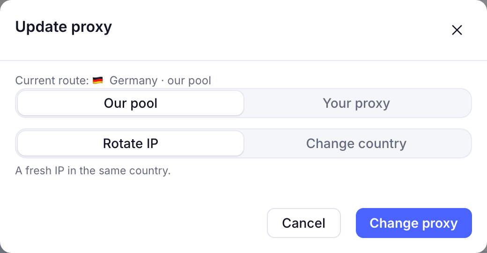

Every LinkedIn account connected through the cloud browser runs in a browser of its own: one browser, one account, one proxy, kept apart from every other account. The browser keeps the account's LinkedIn session, so nobody signs in again for each send, and the proxy gives the account one steady place it connects from.

## What is a sender profile's cloud browser?

A sender profile's cloud browser is the browser its LinkedIn account runs in, on GetSales's servers. It is made for the sender profile when you [connect the LinkedIn account](/kb/sender-profiles/connect-linkedin), and it works as follows:

- **One browser, one account.** The browser serves that one LinkedIn account, its session is isolated from every other account's, and an account has one browser.
- **Signed in once, by a person.** Whoever holds the password signs in to LinkedIn inside the browser. GetSales never stores the password.
- **It runs on our side.** Nothing needs to stay open on your computer: sends and syncs reach the browser on their own.
- **It keeps its proxy country** until you change it. A managed proxy that stops answering may be given a fresh IP in the same country.

## What does the LinkedIn account card show?

The account card at the top of a sender profile's **LinkedIn** tab shows, from the top:

- The account's name and a **Cloud browser** badge (**Platform browser** for an account connected on your own proxy).
- Its status, **Syncing** while the account's first sync runs and **Active** once it works ([the other statuses](/kb/sender-profiles/troubleshooting#what-does-each-linkedin-status-mean)), then **Synced** and how long ago (**Syncing history** while a history sync runs), then where its sync hours stand now: **In sync hours, until** a time, or **Outside sync hours, resumes** a day and time.
- A chip for each LinkedIn plan the account has (**Premium**, **Sales Navigator**, **Recruiter**) with the InMail credits left on it.
- The **Manage** menu, and these rows:

| Row | What it shows |
|---|---|
| **Session** | How the account was connected: **Platform browser** for the cloud browser on a managed proxy, **Platform browser, my proxy** for the cloud browser on your own proxy. A later proxy change does not change it: the **Proxy** row shows the proxy in use |
| **Import** | How far back, and whose conversations, Unibox imports from the account. The pencil changes it |
| **Proxy** | The country and the source: **our pool** (a managed proxy), or **your proxy** with its protocol, address and port. The pencil opens **Update proxy** |
| **Sync** | The account's sync hours with their time zone, then **default intervals** or **custom intervals**. The pencil opens **Sync settings** |

On a working account, **Manage** offers **Open in cloud browser**, **Stop**, **Update proxy** and **Detach LinkedIn** among its entries, plus a **Lift hold:** entry with the action's name for each LinkedIn action on hold ([what a hold is](/kb/sender-profiles/smart-limits-and-warmup#why-is-a-linkedin-action-on-hold-and-when-does-it-resume)). On a signed-out account, **Log back in** takes the place of **Open in cloud browser**. On a stopped browser, **Start** takes the place of **Stop**. On a browser that failed, **Restart** does, and the menu has no **Open in cloud browser**.

**Open in cloud browser** (`can_open_cloud_browser`), **Stop**, **Start** and **Restart** (`can_update_linkedin_accounts`) and **Update proxy** (`can_change_proxy`) are greyed out for a member without that permission and name the one to ask a workspace admin for. **Update proxy** is also greyed out until the card has read the browser. **Detach LinkedIn** is never greyed out: for a member without `can_manage_sender_profiles` it is refused after the confirm.

<Frame caption="The account card of a working LinkedIn account: Active, Synced 36 minutes ago, In sync hours, until 20:00, a Premium chip with 15 InMail, the Manage menu open, and the Session, Import, Proxy and Sync rows.">
  
</Frame>

## How do you open a LinkedIn account's cloud browser?

To see a LinkedIn account as LinkedIn shows it, open the sender profile's **LinkedIn** tab, click **Manage** and choose **Open in cloud browser** (it takes `can_open_cloud_browser`). The browser opens inside the app, in the **Cloud browser** window, for up to an hour, and **Done** hands it back. Opening it confirms and changes nothing, and the account keeps working behind it. When the account is signed out, the same menu offers **Log back in** instead: [Why a LinkedIn account says Reconnect needed](/kb/sender-profiles/troubleshooting#why-does-a-linkedin-account-say-reconnect-needed).

The cloud browser also opens on a phone, laid out for it. Signing in is easier on a computer. To paste from your computer into the cloud browser, click **Allow copying to the clipboard** when the app offers it. If your browser blocked it, the app says **Copying to the clipboard is blocked, update your browser settings**: allow clipboard access for the app in your browser's site settings.

## Which proxy does a LinkedIn account use?

A LinkedIn account connected through the cloud browser uses one proxy at a time: the one picked when it was connected, until someone changes it in **Update proxy**. GetSales may also move a browser whose managed proxy stops answering to another one in the same country. The proxy comes from one of two sources, and the LinkedIn tab's **Proxy** row shows the country and the source.

| Source | What it is | The **Proxy** row reads |
|---|---|---|
| Managed proxy | A residential proxy GetSales provides in the country you pick. Nothing to set up | the country, then **our pool** |
| Your own proxy | A proxy you run or rent, on HTTP, SOCKS4 or SOCKS5, checked before it is used | the country, then **your proxy** and its protocol, address and port |

The proxy's country is the country the cloud browser connects to LinkedIn from. Pick the country the account really works from and keep it. When **Change country** is picked for a browser on a managed proxy, **Update proxy** shows a warning about moving the account to another country.

Over the API, and on the MCP at the full address `https://mcp2.getsales.io/mcp` (the one Creator uses) or at `https://mcp2.getsales.io/mcp/sender-accounts`, [`list_sender_profile_linkedin_proxy_countries`](/api-reference/unibox/sender_profiles/list-linkedin-connect-countries) lists the countries with a managed proxy free now, and [`start_sender_profile_linkedin_connect`](/api-reference/unibox/sender_profiles/start-a-linkedin-connect-for-a-sender-profile) takes `proxy_country_code` or `custom_proxy_config`. An assistant connected at `https://mcp2.getsales.io/mcp/public` ([Connect your AI assistant](/kb/ai/connect-your-ai-assistant)) does not get these two tools: there, a LinkedIn connect is left to the app.

## How do you change a LinkedIn account's proxy?

A LinkedIn account's proxy changes in the app, on the sender profile's **LinkedIn** tab, by a member with `can_change_proxy`:

<Steps>
<Step title="Open Update proxy">

Click **Manage** and choose **Update proxy**, or click the pencil on the **Proxy** row. The dialog shows the **Current route**.

</Step>
<Step title="Pick the change">

With **Our pool**, choose **Rotate IP** (**A fresh IP in the same country.**) or **Change country** and pick the **Country**, from the countries with a free managed proxy. **Rotate IP** is offered only to a browser on a managed proxy. On **Change country**, **Change proxy** stays greyed out (**Pick the country to move this browser to first.**) until another country is picked. With **Your proxy**, fill in its details ([below](#how-do-you-use-your-own-proxy)).

</Step>
<Step title="Save">

Click **Change proxy**. A running browser restarts on the new proxy: **Proxy changed. The browser restarted on it.**

</Step>
</Steps>

A browser someone stopped stays off: **Proxy changed. The browser was off and stays off until you start it.** A browser that was down on a fault starts on the new proxy by itself. If a browser that was running, or down on a fault, does not come back on the new proxy, the app says **Proxy changed, but the browser did not come back. Start it again from Manage.** If its start is not confirmed yet, the app says the proxy changed and that the card shows in a minute whether the browser came up. If the change itself is not confirmed, it may still have gone through: the dialog closes, and the app asks you to check the proxy on the card in a minute before you change it again.

<Frame caption="Update proxy for a browser on a managed proxy in Germany, with Our pool and Rotate IP picked: A fresh IP in the same country.">
  
</Frame>

## How do you use your own proxy?

Your own proxy is set by clicking **Bring my own proxy** when you connect the account, or by picking **Your proxy** in **Update proxy**:

| Field | What goes in it |
|---|---|
| **Protocol** | **HTTP**, **SOCKS4** or **SOCKS5** (the default) |
| **Host and port** | The proxy's address and port |
| **Username**, **Password** | Optional: only when the proxy asks for them |

In **Update proxy**, a browser already on your own proxy opens with its details filled in and an empty **Password** that reads **kept as is**: left empty, it keeps the stored password as long as the host and the username stay the same.

**Check connection** tests the proxy and shows the country it really exits in (or **Country unknown**), its exit IP and how many milliseconds it took to answer. The connect and **Change proxy** buttons run the same check first, so a proxy that does not answer creates and changes nothing:

| The check says | What to fix |
|---|---|
| **The proxy rejected these credentials** | The username or the password |
| **Connection refused, check host, port and credentials** | The address or the port, or whether the proxy accepts connections from outside |
| **The proxy did not answer in time** | The proxy is down or too slow: check it with its provider |
| **TLS handshake failed on the proxy** | The protocol or the port does not match what the proxy expects: check both with its provider |
| **Could not connect, check host, port and credentials** | Any other refusal: the address, the port or the credentials |
| **The check did not run. Try again in a moment.** | Nothing about the proxy: the check itself failed on our side. Run it again: the connect and **Change proxy** check the proxy again before they write |
| **Enter host and port first** | The host is missing or shorter than 3 characters, or the port is missing or not between 1 and 65535 |

**Use a managed proxy instead** switches back to a managed proxy.

## What does stopping a LinkedIn account's browser do?

Stopping a LinkedIn account's browser pauses the account without detaching it. On the sender profile's **LinkedIn** tab, open **Manage**, choose **Stop** and confirm **Stop** in **Stop the browser?**: the card reads **Stopped**, nothing is sent from the account and no sync runs until the browser is started again, and scheduled sends wait for it. **Start** in the same menu brings it back. Both take `can_update_linkedin_accounts`. A start that does not bring the browser up says **The browser did not start. The card says what is wrong: fix it, then start it again.**

A browser that stopped because something went wrong offers **Restart** instead. Fix what the card names first: [When a sender profile needs attention](/kb/sender-profiles/troubleshooting).

## What are a LinkedIn account's sync hours?

Sync hours are the days and hours in which GetSales reads a LinkedIn account's inbox, invitations and network. They are set in the **Sync settings** sheet, which the pencil on the **Sync** row of the sender profile's **LinkedIn** tab opens: **Sync hours** on one side, **How often** on the other. Reading and changing them takes `can_manage_sender_profiles`.

- **A new account syncs Monday to Friday, 08:00 to 20:00**, in the workspace's time zone (**Settings**, **General**, **Timezone**). Change the days and hours whenever you like, or fill the week with **Mon to Fri, 8 to 20**, **Every day, 8 to 20** or **Any time**.
- **The hours keep the time zone they were saved in.** The **Sync** row names it. After the workspace's time zone changes, the sheet says the hours are stored in the old one, and **Save** moves them to the new one.
- **Sync hours govern syncs, never sends.** Sends follow each workflow's own window and the account's [daily limits](/kb/sender-profiles/smart-limits-and-warmup).
- **With no days on, syncs run at any hour.** LinkedIn syncing cannot be switched off. To stop an account working, stop its browser.
- **A new account's first sync runs straight through**, whatever the hours say.

<Frame caption="Sync settings at the defaults: Sync hours Mon to Fri, 08:00 to 20:00, times in Europe/Amsterdam, and How often with Messages and Connections every 3 h, Sent invites and Received invites every 12 h, Followers 24 h, Subscription 6 h and Profile 22 h.">
  
</Frame>

## How often does a LinkedIn account sync?

A LinkedIn account runs each kind of sync on its own interval, inside its sync hours. Under **How often** in the **Sync settings** sheet (the pencil on the **Sync** row of the sender profile's **LinkedIn** tab), each interval goes from its shortest up to a week:

| Sync | Default | Shortest |
|---|---|---|
| **Messages** | 3 h | 15 min, real-time |
| **Sales Navigator**, **Recruiter** | 2 h | 15 min |
| **Connections** | 3 h | 1 h |
| **Sent invites**, **Received invites** | 12 h | 1 h |
| **Followers** | 24 h | 1 h |
| **Subscription** | 6 h | 1 h |
| **Profile** | 22 h | 22 h |

**Messages** at 15 minutes is real-time: the browser stays awake during the sync hours, so new LinkedIn messages reach Unibox as they arrive, and the pass every 15 minutes catches anything that did not. The app also labels 15 minutes **real-time** on the Sales Navigator and Recruiter inboxes and keeps the browser awake for them the same way, but their new messages come in on the 15-minute pass: only the regular LinkedIn inbox is pushed as messages arrive. Outside the sync hours the browser rests, and the next opening wakes it. The Sales Navigator and Recruiter inboxes are listed only when the account has those licences. **Subscription** reads the account's LinkedIn licences and InMail credits, and **Profile** is the daily check behind the account's [warmup](/kb/sender-profiles/smart-limits-and-warmup#how-does-the-warmup-score-set-a-linkedin-account%E2%80%99s-limits). An interval shorter than the shortest is not offered. Once any sync runs off its default, the **Sync** row reads **custom intervals**.

## What do the cloud browser and proxies not do?

- **No password is stored:** the sign-in happens in LinkedIn itself, in the browser.
- **No proxy for mailboxes:** a mailbox has no proxy setting in GetSales. Proxies are for LinkedIn accounts.
- **No API or MCP tool for the browser or its sync settings:** opening it, stopping and starting it, changing its proxy, and its sync hours and intervals are in the app only. Over the API, a proxy is picked only when a connect starts.
- **No LinkedIn connect at the public MCP address:** an assistant connected at `https://mcp2.getsales.io/mcp/public` cannot list proxy countries or start a connect.
- **Sync hours never hold back a send**, and no setting turns LinkedIn syncing off.

## Related

- [Connect a LinkedIn account](/kb/sender-profiles/connect-linkedin)
- [Smart limits and warmup](/kb/sender-profiles/smart-limits-and-warmup)
- [When a sender profile needs attention](/kb/sender-profiles/troubleshooting)
