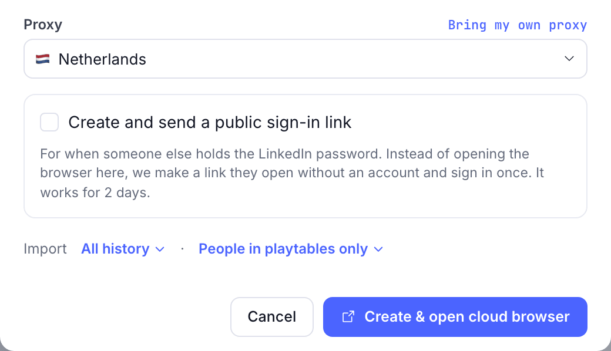

A sender profile sends on LinkedIn through one account, signed in once in a cloud browser that belongs to that sender profile alone. The password is typed into LinkedIn itself, in that browser, and GetSales never stores it.

<Tip>
**Give this to Creator**, the assistant inside the app, to set up a LinkedIn account that someone else signs in to: it does everything except the sign-in itself. An assistant connected at the public address ([Connect your AI assistant](/kb/ai/connect-your-ai-assistant)) cannot: it leaves LinkedIn connects to the app.

"In GetSales, create a sender profile for Ella Brandt. List the LinkedIn proxy countries in stock and pick Germany if it is there. Start a LinkedIn connect for that sender profile with a sign-in link emailed to ella@acme.example, and tell me where the link went and until when it works. Do not send anything."

Creator does not watch the sender profile on a timer: ask it later whether the LinkedIn account is connected.
</Tip>

## What do you need before connecting a LinkedIn account?

Connecting a LinkedIn account to a sender profile needs:

- **A sender profile.** On [https://app.getsales.io/sender-profiles](https://app.getsales.io/sender-profiles), click **New profile**, fill in **First name** and **Last name**, click **Create profile**: [Sender profiles](/kb/sender-profiles/sender-profiles).
- **A free LinkedIn sender profile in the plan.** Each connected LinkedIn account takes one, and so does a connect still waiting for a sign-in, until it ends. When all are in use, the connect is refused with `402` `linkedin_sender_profiles_full`: **All 10 LinkedIn sender profiles of this workspace's plan are in use** (your plan's number in place of 10). Add more in **Settings**, **Subscription**. A workspace whose plan holds none, after a trial or a plan ended, is refused with the same `402` and **This workspace's plan has no LinkedIn sender profiles. Pick a plan in Settings, Billing.**
- **The LinkedIn email and password**, and the phone or inbox LinkedIn sends its verification codes to. If someone else holds them, use a [sign-in link](#how-does-someone-else-sign-in-to-a-linkedin-account).
- **A computer, ideally.** The cloud browser opens on a phone too, but LinkedIn's sign-in is easier with a keyboard and a large screen.

## How do you connect a LinkedIn account and sign in yourself?

You connect a LinkedIn account yourself from its sender profile: click **Connect** in the sender profile's LinkedIn column (or **Connect LinkedIn** on its **LinkedIn** tab), pick the proxy country, click **Create & open cloud browser**, and sign in to LinkedIn in the cloud browser that opens. The session then saves itself, the browser closes, and the account's [first sync](#what-does-the-first-sync-of-a-linkedin-account-do) starts, during which nothing is sent. Through the API the same connect is [`start_sender_profile_linkedin_connect`](/api-reference/unibox/sender_profiles/start-a-linkedin-connect-for-a-sender-profile), and its answer's `connect_url` opens that cloud browser. Creator starts one only for someone else's account, by emailing them a [sign-in link](#how-does-someone-else-sign-in-to-a-linkedin-account), and an assistant at the public MCP address cannot start it.

<Steps>
<Step title="Open Connect LinkedIn account">

On [https://app.getsales.io/sender-profiles](https://app.getsales.io/sender-profiles), click **Connect** in the sender profile's LinkedIn column. Or open the sender profile, switch to its **LinkedIn** tab and click **Connect LinkedIn**. The **Connect LinkedIn account** dialog opens on the **Cloud browser** tab.

<Frame caption="The Connect LinkedIn account dialog's form: the Proxy country with Bring my own proxy, the sign-in link box left unticked, the Import line at its defaults, and Create & open cloud browser.">
  
</Frame>

</Step>
<Step title="Pick the proxy country">

Under **Proxy**, pick the country the account really signs in from, and keep it: LinkedIn sees the account connect from there. The list holds only the countries where a managed proxy is free right now, and GetSales fills it in from your own country or time zone when it has a managed proxy there. **Bring my own proxy** uses a proxy of yours instead ([how](/kb/sender-profiles/cloud-browser-and-proxies#how-do-you-use-your-own-proxy)).

</Step>
<Step title="Choose what the inbox imports">

The **Import** line sets which conversations come into Unibox: [What the Import line imports](#what-does-the-import-line-of-a-connect-import). The defaults, **All history** and **People in playtables only**, suit most accounts. With the second, a new conversation with anyone outside your playtables stays out of Unibox, live messages included, until you add them to a table.

</Step>
<Step title="Create the browser and sign in">

Click **Create & open cloud browser**. GetSales creates a browser on that proxy, then opens it inside the app, which usually takes another 20 to 40 seconds. Sign in to LinkedIn there, and pass any check LinkedIn asks for, such as a code sent to the account's email or phone. Once LinkedIn shows you signed in, the session saves itself and the browser closes. If you are signed in and nothing happens, point at the (i) mark after **Session auto-save:** at the bottom of the window and click **I signed in** in its note. If GetSales has not seen the sign-in yet, it asks first (**We haven't detected your LinkedIn login yet**): click **Yes, I signed in** only when LinkedIn shows you signed in, because a browser saved signed out fails to start and you sign in again.

</Step>
<Step title="Let the account come in">

The cloud browser says **Your LinkedIn session is saved**: click **Got it, close**. The sender profile's LinkedIn tab shows the account once GetSales has checked and set it up, and its [first sync](#what-does-the-first-sync-of-a-linkedin-account-do) starts.

</Step>
</Steps>

## What does the Import line of a connect import?

The **Import** line of a connect sets which of the account's LinkedIn conversations come into Unibox and onto people's activity, from its past and from now on:

- **How far back:** **All history** (the default), **Last year**, **Last month**, **New messages only** or **Custom date**.
- **Whose:** **People in playtables only** (the default) or **All conversations** (in the menu, **Only with people in my playtables** and **All conversations**). With the first, conversations with people already in your playtables come in. A new conversation with anyone else stays out of Unibox, live messages included (a thread already in Unibox keeps syncing), and someone you add to a playtable later brings theirs in.

Both change later on the LinkedIn tab's **Import** row. An earlier date, or all history, imports the older messages then. A later date, or people only, deletes nothing and only limits what comes in next. Through the API, the connect takes `history_since` (a `YYYY-MM-DD` day, `now`, or nothing for all) and `history_scope` (`all`, or `playtable_people`, the default when it is left out).

## How does someone else sign in to a LinkedIn account?

When a colleague or a client holds the LinkedIn password, they sign in themselves on a sign-in link, without a GetSales account of their own:

1. In the **Connect LinkedIn account** dialog, pick the proxy country and tick **Create and send a public sign-in link**.
2. To have GetSales email the link, type their address in **Send it to**, or leave it empty to copy the link yourself.
3. Click **Create & send link** (or **Create & get link**). The dialog shows **Sign-in link ready**, where the link went, the link with **Copy** and the date it works until. Click **Done**.
4. They open the link and sign in to LinkedIn once, and the account connects on its own.

<Warning>
**A sign-in link works for 2 days.** Anyone who has it can open the account's browser until it expires, so send it only to the person who signs in.
</Warning>

Through the API or Creator, the same is [`start_sender_profile_linkedin_connect`](/api-reference/unibox/sender_profiles/start-a-linkedin-connect-for-a-sender-profile) with `public_link: true` and `public_link_email`. Its answer carries the link (`connect_url`), `connect_url_expires_at` and `sent_to_email`, the address the link was mailed to (null when nothing was mailed).

## What does the sender profile show while a connect waits for a sign-in?

Right after you start a LinkedIn connect, the sender profile's LinkedIn tab shows a card that reads **Sign-in pending** and **Waiting for sign-in**, with one note: **A sign-in link is out and works until** the link's end date, when you made a sign-in link, or **Sign in to LinkedIn in the cloud browser dialog; if you closed it, connecting again opens the same browser.** when you sign in yourself. The card has no buttons, and it shows only on the page and in the browser tab where the connect started, for up to 15 minutes: a reload or another page drops it. After that the tab reads **LinkedIn is not connected** again, while the connect keeps waiting and a link that is out keeps working. The list's LinkedIn column shows **Connect** all along. When the account lands while the card is up, the app says **LinkedIn account connected**.

To open the browser yourself or make another sign-in link, click **Connect LinkedIn** again with the same proxy country: GetSales reuses the waiting browser, and a link already out keeps working while the connect waits. Another proxy country makes a new browser, and the earlier link stops working.

## How long does a LinkedIn connect wait for a sign-in?

A LinkedIn connect waits 24 hours for a sign-in, or as long as the sign-in link that is out on it works (2 days), whichever is later. Then an hourly check gives its browser back, and the next connect starts over with a new browser. Starting a connect again while one waits, with the same proxy country, reuses its browser, never a second one, and the 24 hours count again from then.

## What does the first sync of a LinkedIn account do?

The first sync reads the account's history from LinkedIn once it is in: its conversations, its invitations and its connections, and the Sales Navigator and Recruiter inboxes when the account has those licences.

- It runs straight through, whatever the account's [sync hours](/kb/sender-profiles/cloud-browser-and-proxies#what-are-a-linkedin-account%E2%80%99s-sync-hours) say.
- **Nothing is sent from the account until it finishes, and a workflow step that comes due before then fails.** Start workflows on this sender profile once the first sync is through.
- A large account is read at a measured pace on purpose, so its first sync can take a day or more.
- When it finishes, the account's daily limits are set from its warmup score (how old the account is, the invitations and messages it sent in the last 30 days, how often LinkedIn refused its actions or people blocked it in that time, how many LinkedIn sessions it has open and how complete its profile is): [How the warmup sets a LinkedIn account's limits](/kb/sender-profiles/smart-limits-and-warmup#how-does-the-warmup-score-set-a-linkedin-account%E2%80%99s-limits).

## How do you check that a LinkedIn account is connected?

A connected LinkedIn account shows in three places:

- On the LinkedIn tab, the account card reads **Active**, with **Syncing history** beside it while its past conversations come in, then **Synced** and how long ago.
- In the list, the sender profile's LinkedIn column shows the account with no warning mark.
- Under **Auto tasks and daily limits**, the account's limit rows appear right after the connect, at starting numbers. They are set for the account when its first sync finishes.

Through the API, [`search_sender_profiles`](/api-reference/unibox/sender_profiles/search-sender-profiles) shows `linkedin_account_sid` set and `linkedin_status` `active`.

## Why does a LinkedIn connect fail?

A LinkedIn connect fails when the plan has no LinkedIn sender profile free, no managed proxy is free in the country picked, the cloud browsers are busy or cannot be reached, the account is already connected in another workspace or on another sender profile, your browser blocks pasting into the cloud browser, or LinkedIn restricted the account:

| What you see | What it means and what to do |
|---|---|
| **All 10 LinkedIn sender profiles of this workspace's plan are in use** | Every LinkedIn sender profile of the plan is taken, by a connected account or by a connect still waiting for a sign-in, and a detached account keeps its place for now: add more in **Settings**, **Subscription** |
| **This workspace's plan has no LinkedIn sender profiles. Pick a plan in Settings, Billing.** | The plan holds no LinkedIn sender profiles, as after a trial or a plan ends: pick a plan in **Settings**, **Subscription** |
| **No proxy is free in that country right now. Pick another country, or route the browser through your own proxy.** | Pick another country, or click **Bring my own proxy** |
| **All cloud browsers are busy right now. Nothing went wrong on your side, try again in a few minutes.** | Wait a few minutes, then click **Try again** in the cloud browser |
| **Couldn't connect to the cloud browser** | Click **Try again** in the cloud browser. If it keeps failing, write to support@getsales.io with the sender profile's name |
| The cloud browser said **Your LinkedIn session is saved**, but minutes later the account is still not on the sender profile | The account is already connected in another workspace (it works in one workspace at a time: remove it there) or already on another sender profile of this workspace (detach it there: its LinkedIn tab, **Manage**, **Detach LinkedIn**). Then click **Connect LinkedIn** again |
| **Copying to the clipboard is blocked, update your browser settings** | Pasting from your computer into the cloud browser is blocked: allow clipboard access for the app in your browser's site settings, or type instead of pasting |
| LinkedIn restricted the account | Clear the restriction with LinkedIn on your own device first, then connect again |

Anything else: [When a sender profile needs attention](/kb/sender-profiles/troubleshooting).

## What does GetSales never do when it connects a LinkedIn account?

- GetSales **never stores the LinkedIn password** and never signs in for you: a person signs in, in the browser.
- It **never connects one LinkedIn account twice**: one account sits on one sender profile and works in one workspace.
- It **never sends during the first sync.**
- It **never moves the account to another country by itself**: the proxy country stays as picked until someone changes it.

## Next

- [Smart limits and warmup](/kb/sender-profiles/smart-limits-and-warmup): how many actions a day the account takes, and how it eases in.
- [Cloud browser and proxies](/kb/sender-profiles/cloud-browser-and-proxies): the browser, its proxy and its sync hours.
- [Connect a mailbox](/kb/sender-profiles/connect-a-mailbox): add email to the same sender profile.
