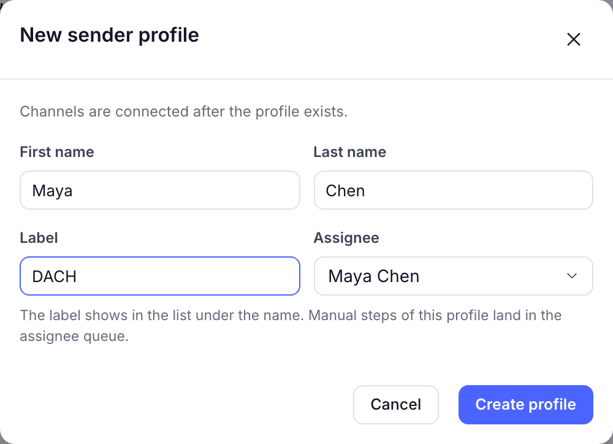

A sender profile is the identity your team sends as: a person's name, one LinkedIn account, and the mailboxes it sends email from. Workflows, the inbox and the AI SDR all send as a sender profile, so every message a prospect gets, and every reply they send back, belongs to one.

## What is a sender profile?

A sender profile is the GetSales record of one person your team sends as (an entity of the Unibox API, sid `ub_sp_...`). It holds that person's name, at most one LinkedIn account and any number of mailboxes. Every outbound message leaves as a sender profile:

- **A workflow** sends from the sender profiles it is given, and [pins one of them to each person](/kb/workflows/build-a-workflow#which-sender-profile-sends-to-each-person), so a prospect keeps hearing from the same sender unless a **Rotate sender** step, a restart or a deletion hands them on (a restart, such as **Restart from top**, picks a sender profile again).
- **Unibox**, the inbox, replies as the sender profile the conversation belongs to.
- **The AI SDR** drafts and sends as that same sender profile.

A sender profile has no sending hours and no status of its own. A workflow carries the sending window, and each channel, the LinkedIn account and every mailbox, carries its own status and its own [daily limits](/kb/sender-profiles/smart-limits-and-warmup).

## What does a sender profile hold?

A sender profile's parts, as the app and the API name them:

| In the app | In the API | What it is |
|---|---|---|
| **First name**, **Last name** | `first_name`, `last_name` | Who the messages come from. The app asks for both, the API takes `first_name` (last name optional) or `name` |
| LinkedIn account | `linkedin_account_sid` | At most one, signed in once in a cloud browser of its own: [Connect a LinkedIn account](/kb/sender-profiles/connect-linkedin) |
| Mailboxes | `mailboxes` | Any number, on the workspace's email server, which comes with an email package (none on the trial). An email step sends from the active ones in turn: [Connect a mailbox](/kb/sender-profiles/connect-a-mailbox) |
| **Label** | `label` | A word of your own (a client, a team, a market), shown in the list under the name and used to filter it |
| **Assignee** | `assignee_user_sid` | The teammate who works it: its manual steps, the AI SDR's hand-offs and live website visit alerts reach them. With **Nobody**, manual steps go to the team's queue, alerts to the workspace owner |
| **Variables** tab | `variables` | Its **Signature** (`variables.signature`, quoted as `{{sender.signature}}`) and its values of the team's sender variables, such as a calendar link a message quotes as `{{sender.calendar_link}}` |
| Licence marks | `linkedin_has_sn`, `linkedin_recruiter_status` | Sales Navigator on the account, and Recruiter's state, read from LinkedIn |

## How do you create a sender profile?

A sender profile is created empty, and its channels are connected after it exists. Creating sender profiles is never limited by the plan: only connecting a channel takes a place.

<Steps>
<Step title="New profile">

On [https://app.getsales.io/sender-profiles](https://app.getsales.io/sender-profiles), click **New profile**.

</Step>
<Step title="Name it">

Fill in **First name** and **Last name**, and optionally a **Label**. **Assignee** starts as you: pick a teammate, or clear it to leave **Nobody**.

</Step>
<Step title="Create it, then connect its channels">

Click **Create profile**. The new sender profile reads **No channels yet** until you connect its [LinkedIn account](/kb/sender-profiles/connect-linkedin) or a [mailbox](/kb/sender-profiles/connect-a-mailbox) from its **LinkedIn** and **Email** tabs.

</Step>
</Steps>

Through the API, [`create_sender_profile`](/api-reference/unibox/sender_profiles/create-sender-profile) does the same and can also bind an account the workspace already holds, and [`update_sender_profile`](/api-reference/unibox/sender_profiles/update-sender-profile) edits the name, label, assignee, variables and signature (`variables.signature`).

<Frame caption="New sender profile, under Channels are connected after the profile exists: First name and Last name (both required), an optional Label, and the Assignee, who starts as whoever creates the profile. The hint says the label shows in the list under the name and the profile's manual steps land in the assignee's queue.">
  
</Frame>

## Where does a sender profile's signature go?

A sender profile's signature is written in the **Signature** box of its **Variables** tab ("Built in: it cannot be deleted or renamed."): text with bold, italic and links, up to 8,192 characters of HTML. It belongs to the sender profile, not to a mailbox, so every mailbox of the sender profile signs with the same one.

The signature goes into an email only where you place it ("Goes into an email where you place it: the Signature verb in a reply, the chip in a step."):

- **In Unibox**, **Insert signature** under the composer puts it under the reply you are writing: [Unibox](/kb/inbox/unibox).
- **In a workflow**, **Insert signature** in a **Send email** step's body puts a **Signature** chip (`{{sender.signature}}`) where the caret is, and each email is signed by the sender profile it leaves from: [Build a workflow](/kb/workflows/build-a-workflow#what-does-a-send-email-step-need).

An email with neither goes out unsigned, and a LinkedIn message is never signed. Until 26 November 2026 a signature was a mailbox's setting and was added to every email from it. Since then a **Send email** step that is to be signed needs the **Signature** chip in its body, and the signature is filled in on the sender profile.

Over the API it is `variables.signature` on [`update_sender_profile`](/api-reference/unibox/sender_profiles/update-sender-profile), and `include_signature` on [`send_message`](/api-reference/unibox/messages/write-send-or-reply-to-a-message).

## Can an AI assistant create or edit a sender profile?

Creator, the assistant inside the app, can: it has [`create_sender_profile`](/api-reference/unibox/sender_profiles/create-sender-profile), [`update_sender_profile`](/api-reference/unibox/sender_profiles/update-sender-profile) and [`delete_sender_profile`](/api-reference/unibox/sender_profiles/delete-sender-profile), and runs each one on your approval. An assistant connected at the public address `https://mcp2.getsales.io/mcp/public` ([Connect your AI assistant](/kb/ai/connect-your-ai-assistant#what-can-the-assistant-not-do)) has none of the three. It lists sender profiles and reads what each sent ([`search_sender_profiles`](/api-reference/unibox/sender_profiles/search-sender-profiles), [`read_sender_profile_stats`](/api-reference/playtables/sender_profiles/sender-profile-stats)), and leaves creating, editing and deleting them, and connecting their accounts, to the app and to Creator.

## What does the Sender profiles page show?

The Sender profiles page, [https://app.getsales.io/sender-profiles](https://app.getsales.io/sender-profiles) (**Sender Profiles** in the sidebar), lists every sender profile of the workspace. Each row shows the name and label, a chip per channel (the LinkedIn account, with Sales Navigator and Recruiter chips when it has them, and one chip for the mailboxes) with what it sent in the **Stats period** you pick (the last 24 hours by default, or 7, 14 or 30 days, or a range), what waits in its queues, the **Assignee** and the **Last action**. A chip wears a red mark when its channel needs a person and a grey pause mark when the account is stopped. A counter wears an amber pause mark while its action is on hold today, the mail chip turns grey when every mailbox's sending is paused, and a missing channel shows **Connect**. Filters: **All**, **Needs attention**, **LinkedIn** and **Email**, the assignee and label pickers, and a search by name, account or address. The list's numbers come from [`read_sender_profile_stats`](/api-reference/playtables/sender_profiles/sender-profile-stats).

## What does a sender profile's drawer show?

A click on a sender profile's row on [https://app.getsales.io/sender-profiles](https://app.getsales.io/sender-profiles) opens its drawer, with five tabs:

| Tab | What it shows |
|---|---|
| **Overview** | Over its own period (the last 30 days by default, picked on the tab, not the list's **Stats period**): touches and replies, the funnel from **Reached** to **Positive** by channel, and, for a member with `can_view_workflows`, **Who shares this sender profile**. Then the workspace's **Website visits** and the account's **Profile views** this week, and the **Latest activity** |
| **LinkedIn** | The account card and its status, **Manage**, the proxy, import and sync rows, the warmup, the daily activity against the limits, and **Auto tasks and daily limits** |
| **Email** | One card per mailbox, with its status, today's sends and its settings |
| **Variables** | The sender profile's **Signature** and its values for the team's sender variables |
| **Activity** | What the sender profile did, newest first |

**Edit profile** and **Delete profile** sit in the drawer's menu and in the row's menu. The Overview's numbers, day by day with the share of each workflow, come from [`get_sender_profile_performance`](/api-reference/playtables/sender_profiles/sender-profile-performance).

## What statuses can a sender profile's LinkedIn account show?

A sender profile's statuses belong to its channels: the LinkedIn account has one (`linkedin_status`, with the cause in `linkedin_status_reason`), and each mailbox has its own. The LinkedIn tab's account card reads:

| LinkedIn card reads | `linkedin_status` | Means |
|---|---|---|
| **Syncing** | `active`, with `initial_sync` set on [`read_sender_profile_limits`](/api-reference/unibox/sender_profiles/read-sender-profile-caps) | The account's first sync runs ("This account is syncing.", with about how long it takes). Nothing is sent from it until the sync ends: a step due meanwhile waits and goes out afterwards |
| **Active** | `active` | The account works |
| **Reconnect needed** | `reconnect_required` | LinkedIn signed the account out: someone signs in again |
| **Needs your action** | `disconnected` or `stalled` | A cause only you can fix, named on the card |
| **We're on it** | `disconnected` or `stalled` | A cause on our side: nothing to do |
| **No activity** | `stalled` | Nothing came from the account for a full day of its sync hours, and no cause is known yet |
| **Disconnected** | `disconnected` | The account cannot send for a cause the card has no words for yet: **Nothing sends until the account is back** |
| **Stopped** | `stopped` | Someone switched the browser off on purpose: nothing sends until it is started again |

An action held at its limit does not change the card, which stays **Active**: in the list, the LinkedIn chip's card reads **On hold** for it. Which statuses mark a sender profile red: [Which sender profiles count under Needs attention?](#which-sender-profiles-count-under-needs-attention)

## What statuses can a sender profile's mailbox show?

Each mailbox of a sender profile has its own status (`status` on the mailbox), on its card of the **Email** tab:

| Mailbox card reads | `status` | Means |
|---|---|---|
| **Syncing** | `connecting` | Just connected: its mail is being read for the first time. It sends nothing until that is done and turns **Active** by itself. A due **Send email** step waits for it, for up to 24 hours |
| **Active** | `active` | Sends and receives |
| **Sending paused** | `sending_paused` | Receives, does not send. A person paused it, or GetSales did: the mail provider refused 3 of its emails under its policy within 24 hours, or the provider's own daily sending quota for it is spent, a pause that lifts by itself after 24 hours. The mailbox's own **Daily send limit** never pauses it |
| **Reconnect needed** | `reconnect_required` | The provider ended the sign-in: reconnect it |
| **Disconnected** | `disconnected` | Someone disconnected it and its sign-in was removed: reconnect it |
| **Subscription needed** | `subscription_required` | The plan no longer covers the mailbox |
| **Deleted** | `deleted` | The mailbox was removed: **Detach** it, or connect the same address again from **Add mailbox**, which brings it back. Until it is detached it keeps its red mark and still takes one of the plan's inboxes. As the sender profile's last channel it cannot be detached: connect another channel first, or delete the sender profile |

What to do about each: [When a sender profile needs attention](/kb/sender-profiles/troubleshooting).

## Which sender profiles count under Needs attention?

A sender profile counts under **Needs attention**, and wears a red mark in the list, on its channel's tab in the drawer and in the sidebar's mark on **Sender Profiles**, when its LinkedIn card reads anything but **Active** or **Stopped**, when its Recruiter chip reads **Signed out** (Recruiter asks for its password again), or when one of its mailboxes reads **Reconnect needed**, **Disconnected**, **Subscription needed** or **Deleted**. An action held at its limit does not count: the LinkedIn card stays **Active**, and in the list the LinkedIn chip's card reads **On hold** for it. A mailbox whose sending is paused does not count either, nor does one that reads **Syncing**, nor a stopped account. The filter is [https://app.getsales.io/sender-profiles?filter=attention](https://app.getsales.io/sender-profiles?filter=attention).

## Who can send as a sender profile?

Workflows, Unibox, the AI SDR and teammates send as a sender profile:

- **Workflows.** A workflow sends from the sender profiles it is given. When several workflows use one sender profile, its daily limits are split between them by priority: [How limits are shared between workflows](/kb/sender-profiles/smart-limits-and-warmup#how-are-a-sender-profile%E2%80%99s-limits-shared-between-workflows).
- **Unibox and the AI SDR**, in the conversations that belong to the sender profile ([Unibox](/kb/inbox/unibox), [AI SDR](/kb/inbox/ai-sdr)).
- **Teammates.** A member with Messages Act (`can_act_conversations`) replies as any sender profile of the workspace. Managing sender profiles takes Sender profiles View and Manage (`can_view_sender_profiles`, `can_manage_sender_profiles`: create, edit, connect, detach, delete), Cloud browser Open (`can_open_cloud_browser`), Proxy Change (`can_change_proxy`) and LinkedIn accounts Update (`can_update_linkedin_accounts`: stop and start a browser). **New profile** and the browser entries under **Manage** are greyed out for a member without the permission and name it. Other actions stay clickable and are refused. [Team members and roles](/kb/workspace/team-members-and-roles).

## How many sender profiles does a plan hold?

A plan holds any number of sender profiles: creating one never takes a place. It sets two numbers for the whole workspace, and connecting a channel is what takes a place:

- **LinkedIn sender profiles:** how many LinkedIn accounts can be connected at once. Each sender profile with a LinkedIn account takes one.
- **Email inboxes:** how many mailboxes can be connected at once, across all sender profiles. Each email package of the plan is one dedicated email server for the workspace, and a new mailbox lands on a server that is ready and has an inbox free, so a workspace with no email package (the trial, the Free plan) connects no mailbox: [Connect a mailbox](/kb/sender-profiles/connect-a-mailbox#where-does-a-new-mailbox-land).

A new connect beyond them is refused with `402` and the reason `linkedin_sender_profiles_full` (**All 10 LinkedIn sender profiles of this workspace's plan are in use. Detach a LinkedIn account you no longer need, or add LinkedIn sender profiles in Settings, Billing.**) or `email_inboxes_full` (**All 100 inboxes of this workspace's plan are in use. Detach a mailbox you no longer need, or add inboxes in Settings, Billing.**), with the plan's own numbers. In **Add mailbox**, the email refusal reads **Every inbox your plan holds is in use. Add inboxes, or detach a mailbox you no longer need.**

## Does a detached LinkedIn account or mailbox still take a place?

No. A LinkedIn account or mailbox that was connected through GetSales is removed when you detach it, or when the sender profile that held it is deleted: its place in the plan is free again, and to use it again you connect it again. The confirm says so: "One connected through GetSales is removed, and one LinkedIn sender profile of your plan is free again." What you brought from a gtm-api workspace of your own that you linked stays connected there, and can be attached again with no new sign-in: [`attach_sender_profile_linkedin`](/api-reference/unibox/sender_profiles/attach-a-linkedin-account-to-a-sender-profile) or [`attach_sender_profile_mailbox`](/api-reference/unibox/sender_profiles/attach-a-mailbox-to-a-sender-profile) with a free row of [`list_sender_profile_available_accounts`](/api-reference/unibox/sender_profiles/list-available-channel-accounts). A LinkedIn connect still waiting for its sign-in holds a place until it lands or is given up. To keep a mailbox and its conversations, move it to another sender profile instead of detaching it: [Connect a mailbox](/kb/sender-profiles/connect-a-mailbox#how-do-you-pause-make-primary-or-detach-a-mailbox).

## What happens to sender profiles when a trial ends without a plan?

When a trial ends without a paid plan, the workspace moves to [the Free plan](/kb/workspace/plans-credits-and-billing#what-is-the-free-plan), which holds no LinkedIn sender profiles and no inboxes. Its sender profiles stay, and nothing goes out from them: a workflow's LinkedIn steps fail as they come due (`subscription_required`), and so do its email steps (`sender_profile_has_no_mailbox`). A failed step stops that person's journey and does not wait for a plan: it goes out only when you **Retry** it once a plan covers the accounts. A LinkedIn connect is refused with **This workspace's plan has no LinkedIn sender profiles. Pick a plan in Settings, Billing.**, **Add mailbox** connects no mailbox, and tables and workflows keep running. The same happens when a paid plan ends. Plans, the trial and prices: [Plans, credits and billing](/kb/workspace/plans-credits-and-billing).

## What happens when you detach a channel or delete a sender profile?

- **Detach LinkedIn** (under **Manage** on the LinkedIn tab, or [`detach_sender_profile_linkedin`](/api-reference/unibox/sender_profiles/detach-the-linkedin-account-from-a-sender-profile)) takes the account off the sender profile, which stays and can take another account. An account connected through GetSales is removed with it, and its place in the plan is free again. Its queued LinkedIn steps stay with the sender profile: if another account is connected before they come due, they go out from it, and a step that comes due with no account fails.
- **Detach** on a mailbox ([`detach_sender_profile_mailbox`](/api-reference/unibox/sender_profiles/detach-a-mailbox-from-a-sender-profile)) does the same for one mailbox, and frees its inbox in the plan. A mailbox that is the sender profile's last channel cannot be detached (`409` `last_channel_account`): move it to another sender profile, or delete the sender profile.
- **Delete profile** (the drawer's menu, or [`delete_sender_profile`](/api-reference/unibox/sender_profiles/delete-sender-profile)) removes the sender profile, after the confirm **Threads keep their history. Queued sends from this profile stop.** Its LinkedIn account and its mailboxes that were connected through GetSales are removed with it, and their places in the plan are free again. Its conversations, messages and tasks stay. Each workflow person pinned to it moves, at their next send, to another live sender profile of that workflow. With none left, or in a play, the send fails.

## What does a sender profile not do?

- A sender profile holds **one LinkedIn account at most**, and a LinkedIn account sits on one sender profile at a time and works in one workspace at a time.
- It has **no sending hours and no time zone** of its own: sends follow each workflow's window, and a day is the workspace's.
- It has **no status of its own**: only its channels do.
- GetSales **does not sell, rent or lend LinkedIn accounts**: a sender profile connects a LinkedIn account that you, a teammate or a client already holds and signs in to.
- GetSales **emails the assignee**, or the workspace's owner when there is none, when a LinkedIn account is signed out or restricted or a mailbox needs reconnecting, and again when it works: [When a sender profile needs attention](/kb/sender-profiles/troubleshooting). A developer can subscribe to the `sender-profiles.health-changed` webhook, for the LinkedIn channel only, and to `sender-profiles.limit-reached` and `sender-profiles.limit-released` for its daily caps ([Webhook events](/guides/webhook-events)).

## How do teams use sender profiles?

- **One SDR on LinkedIn and email.** Create one sender profile for them, connect their LinkedIn account and two or three mailboxes, and give it to the workflows they run: LinkedIn steps go out from the account, email steps from the mailboxes in turn, and every reply lands in Unibox under their sender profile. The mailboxes need an email package of a paid plan: on the trial the sender profile sends on LinkedIn only.
- **An agency sending for a client's founder.** Create a sender profile in the founder's name with the client as its **Label**, send the founder a [sign-in link](/kb/sender-profiles/connect-linkedin#how-does-someone-else-sign-in-to-a-linkedin-account) so they sign in to LinkedIn themselves, and make the account manager its **Assignee**: manual steps and the AI SDR's hand-offs reach the account manager.
- **A shared team inbox without shared passwords.** Teammates reply from Unibox as any sender profile of the workspace, and none of them needs the LinkedIn or mailbox password. To keep a client's sender profiles away from the rest of the team, give the client a workspace of its own.

## Related

- [Connect a LinkedIn account](/kb/sender-profiles/connect-linkedin)
- [Connect a mailbox](/kb/sender-profiles/connect-a-mailbox)
- [Smart limits and warmup](/kb/sender-profiles/smart-limits-and-warmup)
- [Cloud browser and proxies](/kb/sender-profiles/cloud-browser-and-proxies)
- [When a sender profile needs attention](/kb/sender-profiles/troubleshooting)
- [Build an outreach workflow](/kb/workflows/build-a-workflow#which-sender-profile-sends-to-each-person): which sender profile sends to each person
- [Unibox](/kb/inbox/unibox)
- [AI SDR](/kb/inbox/ai-sdr)
