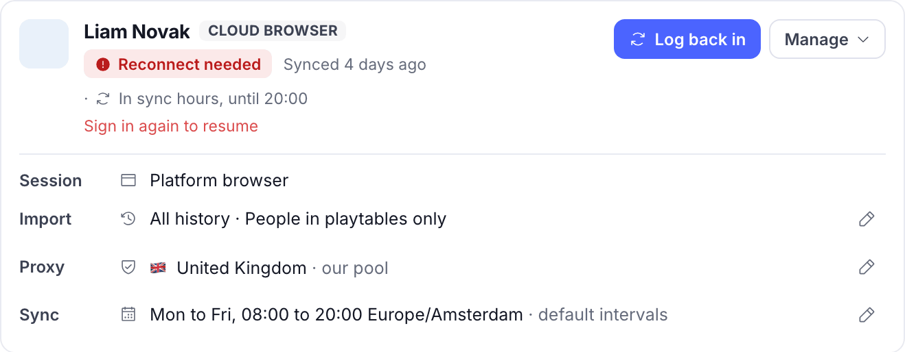

A sender profile that needs a person wears a red mark: in the list, on the tab of the channel in trouble, and on the **Sender Profiles** icon in the sidebar (hover it for the count). Its card says what is wrong in one line. Find that line below.

## How do you find the sender profiles that need attention?

The sender profiles that need a person are under the **Needs attention** filter of the list: [https://app.getsales.io/sender-profiles?filter=attention](https://app.getsales.io/sender-profiles?filter=attention), where the Dashboard's **To fix** also leads. Open one and switch to the tab with the mark, **LinkedIn** or **Email**: its card names the trouble. The filter counts every LinkedIn status but **Active** and **Stopped**, a Recruiter that is signed out, and a mailbox that reads **Reconnect needed**, **Disconnected**, **Subscription needed** or **Deleted**. It leaves out an action on hold, which ends by itself, and a mailbox whose sending is paused. A pause GetSales made after the mail provider blocked the mailbox does not end by itself and wears no red mark: look for **Sending paused** on the **Email** tab ([Why did a mailbox stop sending?](#why-did-a-mailbox-stop-sending)).

While one channel is in trouble the other keeps working: a sender profile whose LinkedIn account is signed out still sends its email steps, and the other way round.

## Does GetSales tell anyone when a sender profile breaks?

GetSales emails the person a sender profile is assigned to, or the workspace's owner when it has no assignee, when a channel breaks or comes back: a LinkedIn account that was signed out ("Maya Chen was signed out of LinkedIn"), restricted by LinkedIn or paused for a cause on your side, a Recruiter that needs a sign-in, a mailbox that needs reconnecting ("Reconnect maya@acme.example"), and the same account or mailbox once it works again or is ready to send. A mail about trouble leaves ten minutes after it began, and only if the trouble still holds. A paused mailbox, an action on hold, **We're on it** and **No activity** send none. Each person turns these mails off under **Settings**, **Notifications**, **Channels**.

A developer can have a webhook call them too: `sender-profiles.health-changed` fires when a sender profile's LinkedIn status or its cause changes, with `linkedin_status` and `linkedin_status_reason`, and `sender-profiles.limit-reached` and `sender-profiles.limit-released` fire when a daily cap of its LinkedIn account closes and opens again. A mailbox fires no event. See [Webhook events](/guides/webhook-events).

## What does each LinkedIn status mean?

A sender profile's LinkedIn card reads one of seven statuses. The table gives each with the `linkedin_status` and the cause in `linkedin_status_reason` behind it, and who acts:

| The LinkedIn card reads | `linkedin_status` | Cause in `linkedin_status_reason` | Who acts |
|---|---|---|---|
| **Active** | `active` | none | Nobody |
| **Reconnect needed** | `reconnect_required` | `logged_out`, `login_failed` | You: sign in again |
| **Needs your action** | `disconnected` or `stalled` | `browser_linkedin_session`, `browser_linkedin_restricted`, `browser_proxy_failed`, `browser_other_workspace`, `browser_client_investigation`, `browser_profile_unavailable`, `subscription_required`, and others the card names | You, as the card says |
| **We're on it** | `disconnected` or `stalled` | `browser_support_investigation`, `browser_unreachable`, `sync_failed` | Us: nothing to do |
| **No activity** | `stalled` | `heartbeat_stale` | You: look at the account |
| **Disconnected** | `disconnected` | a cause the app has no words for yet: **Nothing sends until the account is back** | You: **Log back in**, then support if it stays |
| **Stopped** | `stopped` | `browser_stopped` | Whoever stopped it: **Start** |

An action on hold does not change the card: the account stays **Active** ([Why a LinkedIn action is on hold](#why-is-a-linkedin-action-on-hold)).

## Why does a LinkedIn account say Reconnect needed?

**Reconnect needed** means LinkedIn signed the account out (`reconnect_required`, cause `logged_out`: **Sign in again to resume**), or the last sign-in did not save (`login_failed`: **The last sign-in did not go through. Sign in again to resume**). **Needs your action** with **LinkedIn signed the account out or asks to confirm it is you. Log back in and pass the check** takes the same fix. Only a new sign-in brings the account back: a proxy change does not.

1. On the sender profile's **LinkedIn** tab, click **Log back in** (also under **Manage**). The account's cloud browser opens in the app.
2. Sign in to LinkedIn. If LinkedIn asks to confirm it is you, enter the code it sends to the account's email or phone. The session saves itself once LinkedIn lets you in. If nothing happens, point at the (i) mark after **Session auto-save:** at the bottom of the window, click **I signed in** in its hint (and **Yes, I signed in** if asked), then wait for **Your LinkedIn session is saved**.
3. The account reads **Active** again, and new steps go out under its [daily limits](/kb/sender-profiles/smart-limits-and-warmup). Workflow steps that came due while it was signed out failed at once and do not go out by themselves: click **Retry** on them in the step's task list, which the **Failed** count on the step opens in the workflow builder ([When a workflow does not send](/kb/workflows/troubleshooting)).

<Frame caption="A signed-out LinkedIn account on the LinkedIn tab: the card reads Reconnect needed and Sign in again to resume, and Log back in opens its cloud browser to sign in again.">
  
</Frame>

## How does someone else sign a LinkedIn account back in?

A signed-out LinkedIn account whose password someone else holds is signed back in on a [sign-in link](/kb/sender-profiles/connect-linkedin#how-does-someone-else-sign-in-to-a-linkedin-account), because **Log back in** in the app opens the browser on your own screen only. Ask Creator, the assistant inside the app, to start a LinkedIn connect for the sender profile with a sign-in link emailed to the account's owner, or call [`start_sender_profile_linkedin_connect`](/api-reference/unibox/sender_profiles/start-a-linkedin-connect-for-a-sender-profile) with `public_link_email` over the API. An assistant connected at `https://mcp2.getsales.io/mcp/public` cannot: that address leaves LinkedIn connects to the app. On a sender profile that already has its account, that link signs the same account back in (the answer's `mode` is `relogin`), and it works for 2 days. The app itself has no button that sends such a link.

## What do you do when LinkedIn restricted the account?

A restricted LinkedIn account reads **Needs your action** with **LinkedIn restricted this account. Resolve it with LinkedIn, then restart the browser** (`browser_linkedin_restricted`). LinkedIn has taken the account away until its owner clears it with LinkedIn, by an identity check, an appeal or a wait. GetSales cannot do that for you.

1. The account's owner signs in to LinkedIn on their own device and follows what LinkedIn asks.
2. Once the account works on LinkedIn again, open **Manage** and choose **Restart**. If the card then reads **Reconnect needed**, [sign in again](#why-does-a-linkedin-account-say-reconnect-needed).

## What do you do when the account's proxy does not answer?

A LinkedIn account whose proxy fails reads **Needs your action** with **The browser's proxy does not answer, so the browser cannot start. Fix or replace the proxy, then restart the browser** (`browser_proxy_failed`).

- **Your own proxy:** check it with its provider, then open **Manage**, **Update proxy**, and fix its details or switch back with **Use a managed proxy instead**: [how](/kb/sender-profiles/cloud-browser-and-proxies#how-do-you-change-a-linkedin-account%E2%80%99s-proxy).
- **A managed proxy:** open **Update proxy** and choose **Rotate IP**, a fresh IP in the same country.

The change starts the browser on the new proxy (**Proxy changed. The browser restarted on it.**). If it reads **Proxy changed, but the browser did not come back. Start it again from Manage.**, open **Manage** and choose **Restart**.

## What do you do when the account is connected in another workspace?

A LinkedIn account connected in two workspaces reads **Needs your action** with **This LinkedIn account is connected in another workspace, and an account works in one workspace at a time. Remove it there, then restart the browser** (`browser_other_workspace`). Remove the account from the other workspace, then open **Manage** and choose **Restart** here.

## Why did the account's browser stop after repeated errors?

A LinkedIn account's browser that keeps failing is stopped, and the card says whose problem it is:

- **Needs your action**, with a line that the browser stopped after repeated errors in its browser profile or its proxy (`browser_client_investigation`): check the proxy first ([when the proxy does not answer](#what-do-you-do-when-the-account%E2%80%99s-proxy-does-not-answer)), then open **Manage** and choose **Restart**.
- **We're on it**, with **The account's browser stopped after repeated errors on our side** (`browser_support_investigation`) or **Our servers could not start the account's browser, so nothing ran** (`browser_unreachable`): the problem is ours, and the mark clears by itself once the browser runs again. Nothing to do. If it stays for more than a day, write to support@getsales.io with the sender profile's name.

## Why does a LinkedIn account show No activity?

**No activity** (`stalled`, cause `heartbeat_stale`) means nothing came from the account through a full day of its sync hours, and no cause is known yet. The account is connected and its sends are not held: GetSales has just not seen it do anything.

1. Open **Manage** and choose **Open in cloud browser** to see what LinkedIn shows: a sign-in page, a check or a warning.
2. If LinkedIn shows its sign-in page, wait for the card to read **Reconnect needed**, then [sign in again](#why-does-a-linkedin-account-say-reconnect-needed). If LinkedIn shows the feed, nothing is wrong: the mark clears once the account sends or syncs again.
3. Check that a workflow actually uses this sender profile and has people to send to: [When a workflow does not send](/kb/workflows/troubleshooting).

## Why is a LinkedIn action on hold?

A LinkedIn action on hold reached a limit for now. In the list, the card of the sender profile's LinkedIn chip reads **On hold**, with a line for each held kind among connection requests, messages and profile visits, such as **Connection requests: daily limit reached, resumes tomorrow at 03:00.** Held InMails show on the **Sales Navigator** chip of an account that has Sales Navigator, and for any account on the **Send InMail** row under **Auto tasks and daily limits** on the LinkedIn tab. Other actions keep going, and the LinkedIn tab's card stays **Active**.

| Reason | What happened | What to do |
|---|---|---|
| **daily limit reached** | The action used its daily limit: the pacing doing its job | Nothing. It resumes at midnight in the workspace's time zone |
| **LinkedIn limited this action** | LinkedIn itself refused it: blocked for 1 hour (connection requests), 3 hours (messages and InMails) or 24 hours (any other action), and its limit may be lowered. A security check LinkedIn shows during a sync blocks every action for 6 hours | Nothing clears it early. Lower the action's **Target** (with Smart limits off, its **Daily limit**) rather than pushing into the same wall |
| **account limit reached** | Another hold on the action | Wait, or end it early with **Manage**, **Lift hold** |

## When does a held LinkedIn action resume?

A held LinkedIn action resumes by itself, and what waited goes out on its own. On the LinkedIn tab, under **Auto tasks and daily limits**, the held action reads **Held until** or **Blocked by LinkedIn until** a time. **Lift hold** never ends a LinkedIn block, and an action whose daily limit is used up is held again at once. When LinkedIn keeps refusing connection requests, the account is at a limit of LinkedIn's own, whatever its daily limit says: give it time. [What happens when LinkedIn refuses an action](/kb/sender-profiles/smart-limits-and-warmup#what-happens-when-linkedin-refuses-an-action).

## Why can't the account send InMails?

An account sends InMails only with LinkedIn Premium (Sales Navigator includes it) and InMail credits left. The licence chips on the LinkedIn tab show the credits left and when they were last read: every 6 hours by default, inside the account's sync hours. With none left, InMails cannot go out until the licence renews its credits on its monthly cycle. With no Premium, the account cannot send InMail at all.

## Why does a mailbox say Reconnect needed or Disconnected?

A mailbox reads **Reconnect needed** when its provider ended the sign-in, for example after a password change or an admin revoking access, and **Disconnected** when someone disconnected it and its sign-in was removed.

1. On the **Email** tab, open the mailbox and click **Reconnect**.
2. In the tab that opens, sign in with Google or Microsoft, or enter the IMAP and SMTP details again (**Finish reconnecting in the opened tab.**). After a Google or Microsoft sign-in, the tab ends on a **Mailbox connected** page: close it.

The card goes back to **Active**. While a mailbox is down, email steps send through the sender profile's other active mailboxes.

## What do you do with a mailbox that reads Deleted or Subscription needed?

A mailbox that reads **Deleted** was removed: **Detach** it, or connect the same address again from **Add mailbox**, which brings it back ([`detach_sender_profile_mailbox`](/api-reference/unibox/sender_profiles/detach-a-mailbox-from-a-sender-profile) over the API). A sender profile's last channel cannot be detached (`409` `last_channel_account`: **This is the profile's last channel. Delete the profile instead**), so when the deleted mailbox is its only channel, connect a LinkedIn account or a new mailbox first ([Connect a mailbox](/kb/sender-profiles/connect-a-mailbox)), or delete the sender profile. **Subscription needed** means the plan no longer covers the mailbox: [Plans, credits and billing](/kb/workspace/plans-credits-and-billing). Neither sends: email steps go through the sender profile's other active mailboxes.

## What does a mailbox that reads Syncing need?

Nothing. A mailbox reads **Syncing** from its sign-in until its first sync ends ("Reading this mailbox's mail for the first time. Sending from it starts when that is done."), then turns **Active** by itself, and it is not counted under **Needs attention**. "The mail provider is slowing the sync down. It goes on by itself." means the same. An email step due meanwhile waits, for up to 24 hours.

## Why did a mailbox stop sending?

A mailbox that reads **Sending paused** stays connected and keeps receiving replies: only its sending stopped. It is not an alert. Email steps due meanwhile wait and go out after **Resume sending**. Someone clicked **Pause sending**, or GetSales paused it on its own:

| Why GetSales paused it | What comes next |
|---|---|
| The mail provider refused 3 different emails of the mailbox under its policy within 24 hours | It stays paused until someone resumes it with a reason |
| The provider said the mailbox's daily sending quota is spent | It resumes by itself after 24 hours |

1. Before resuming a provider block, find out why the provider refused the emails: an old or unverified list, or content the provider treats as spam, is the usual cause.
2. Click **Resume sending**. For a pause GetSales made, the dialog asks **Why is it safe to send again?**: write the reason, for example that the list that bounced is removed, and sending resumes. A pause someone made resumes without a reason.

Through the API: [`resume_sender_profile_mailbox_sending`](/api-reference/unibox/sender_profiles/resume-sending-from-a-sender-profile-mailbox), with `reason` for a pause GetSales made.

## Why does the Recruiter chip say Signed out?

The **Recruiter** chip reads **Signed out** with **LinkedIn Recruiter asked for the password again.** when LinkedIn Recruiter wants its own sign-in. The LinkedIn account still sends: only its Recruiter waits. Open **Manage**, **Open in cloud browser**, and sign in to Recruiter there. The mark clears at the account's next subscription check, every 6 hours by default inside the account's sync hours (a new account: Monday to Friday, 08:00 to 20:00 in the workspace's time zone), or sooner, the next time the account's browser starts.

## What does GetSales never do when a sender profile needs attention?

- **Email anyone about a paused mailbox or an action on hold.** Those marks are in the app only, and the webhook event `sender-profiles.health-changed` covers the LinkedIn channel alone.
- **Sign a LinkedIn account back in by itself.** Only a new sign-in does, in the app or on a sign-in link: a proxy change does not.
- **Let an assistant reconnect a mailbox.** No MCP tool does it, Creator's included: click **Reconnect** in the app.
- **Clear a LinkedIn restriction or end a LinkedIn block early.** **Lift hold** ends only a hold GetSales set.
- **Resume a mailbox it paused after a provider block.** A person resumes it, with a reason.

## When should you write to support?

Write to support@getsales.io with the sender profile's name and what its card says when:

- **We're on it** stays for more than a day.
- **Disconnected** with **Nothing sends until the account is back** does not clear after **Log back in**.
- A connect fails again and again with **The browser could not start**.
- The card says something this page does not cover.
