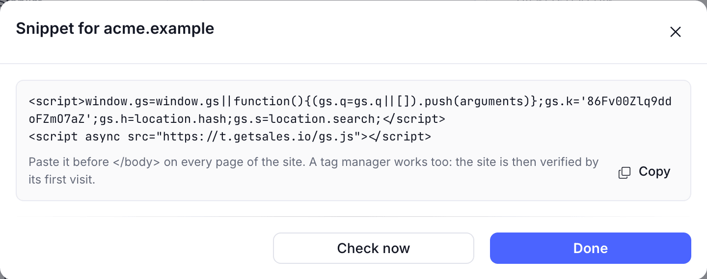
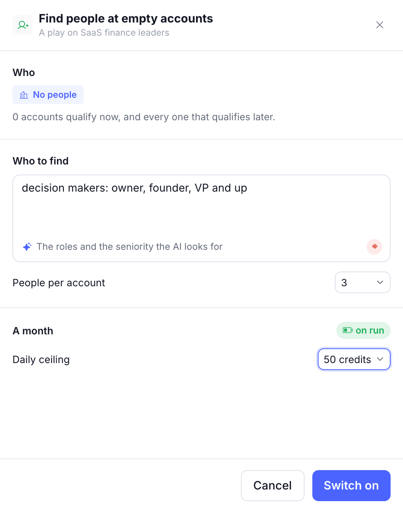

Signals shows what the people and companies you work with do, on your website, on LinkedIn and by email, and
lets a play on a table answer it: pause a journey and ask you, add someone to a workflow, congratulate, like a post,
or find another contact.

<Tip>
**Give this to your AI assistant** (with the [GetSales connector](/kb/ai/connect-your-ai-assistant)) to set up a
site:

"Using the GetSales connector: register acme.example for website signals at the Companies level. Before you
register it, show me the consent duty I am confirming and wait for my yes. Then give me the snippet to paste, and
read the playbook of my table 'SaaS finance leaders' with how many people or accounts qualify for each play now.
Do not switch any play on."
</Tip>

## What does Signals track?

Signals tracks events of three kinds, each a signal type you can show or hide:

| Kind | Signal types |
|---|---|
| Website | Site visit, Key page, Form, Custom event |
| LinkedIn | Accept, Reply, InMail reply, Invitation, Follow, Reaction (to your message), Deleted message, Profile view, Connection removed, Blocked us, Post, Birthday, Work anniversary, Job change |
| Email | Email open, Link click, Email reply, Bounce, Unsubscribe, Spam complaint |

A signal is about someone the workspace already holds: a person or a company in one of your tables, or a person
in a thread. A visitor nobody holds stays an **Unknown visitor**, and GetSales never creates a person from a
visit.

Every signal comes from your own site, your sender profiles' LinkedIn accounts and mailboxes, or the profile and
posts reads of your table's columns and workflow steps: no funding, hiring or technology data, no bought intent
data.

## Where do signals show up?

Signals has its own page, **Signals** in the sidebar (https://app.getsales.io/signals), for members with the
Signals View permission. The badge on it counts the new signals of the types you asked to be told about.

- **Needs me** holds what waits for you: the drafts and questions of plays in Ask me mode.
- **All signals** is the whole feed, and **Kinds** narrows it: **Posts**, **Moments** (birthdays, work
  anniversaries and job changes), **Website visits**, **LinkedIn** and **Email**. Each event card shows what a
  play did with it, and the feed filters by **Needs me**, **All**, **Done** and **Not covered**, and by table,
  workflow, play and sender profile.
- **Website visits** (https://app.getsales.io/signals/website) is a table with two tabs. **Visits** has one row
  per person, company or unknown visitor by its latest signal, with the pages opened, the time on the site and
  the place, and filters by **People** or **Companies**, table, site, **Key page**, **Country** and
  **Attribution** (what named the visit: **Link**, **Identified**, **Device**, **Manual**, **Company link**,
  **Company network** or **Unattributed**). **Visitors** lists the browsers behind the visits.
  **Website settings** opens Settings, Website.

<Frame caption="Website visits on its Visits tab: one row per person, company or unknown visitor by its latest signal. Here four companies, each last seen on a Key page, with the pages, the time on the site and the city under Details.">
  
</Frame>

Each person sets their own types under the sliders button (**Signal types and notifications**): per type **Show**
and **Tell me** (only a shown type is told), whose sender profiles count, and a toast while you work elsewhere (the
morning digest and Slack listed there are not available yet). By default the feed hides Bounce and tells you about
Key page, Form, Accept, Invitation and Blocked us.

A signal is also a fact on the person or the company, so it shows on their timeline too. Signals has no plan of
its own: it works in every workspace that is not suspended. Over the API or MCP the feed is
[`search_activities`](/api-reference/playtables/activities/search-activities) with `filter.type` `{in: [...]}` set
to the signal types. Without that filter it returns the whole ledger, which also holds facts that are not signals:
your own sends, what your sender profiles did (likes, comments, profile visits), workflow, note and manual task
facts, and record, stage and enrichment changes. The visits are
[`search_website_session_owners`](/api-reference/signals/website_session_owners/search-website-session-owners) (who
visited) and [`search_website_sessions`](/api-reference/signals/website_sessions/search-website-sessions).

## How do I add my website to Signals?

A site is added in **Settings**, then **Website** (https://app.getsales.io/settings/website). Adding or changing a
site needs the Signals Manage permission.

1. Click **Add a site**.
2. Under **Site**, enter the **Host**, such as `acme.example`. A pasted address is reduced to its bare host (the
   scheme, the path and a leading `www.` go). Leave **Subdomains** on to count hosts under the domain too.
3. Under **Key pages**, keep the four defaults or paste your real addresses: **Pricing** `/pricing*`, **Book a
   demo** `/demo*`, **Sign up** `/signup*` and **Contact** `/contact*`. Each row is a key, a label and a path
   pattern (`*` stands for anything). **Add a page** adds one, up to 20.
4. Under **Identification**, choose **What a visit names**: **Companies** (the default) or **People**
   ([the difference](#what-is-the-difference-between-companies-and-people)).
5. Read the duties under it and tick **I confirm that my site collects this consent and my privacy policy says
   so** ([what it means](#what-do-i-confirm-about-consent)).
6. Click **Add site**. The site starts **Waiting for the script** (links to it get a code once the script is
   seen there), and the dialog turns into **Snippet for acme.example**: click **Copy**.
7. Paste the snippet before `</body>` on every page of your site. A tag manager works too.
8. Click **Check now** ([how the check works](#how-do-i-check-that-the-snippet-is-installed)).

<Frame caption="Add a site filled in: the Host acme.example with Subdomains on, the four default Key pages, What a visit names set to Companies and the consent confirmation ticked, ready for Add site.">
  
</Frame>

A host can be registered once per workspace: "This host is already registered in the workspace." A workspace can
hold any number of sites.

Over the API or MCP: [`create_website_site`](/api-reference/signals/website_sites/create-website-site) (it needs
`confirm_identification: true`, and takes the four default key pages when `key_pages` is left out),
[`get_website_site`](/api-reference/signals/website_sites/get-website-site) for the snippet, then
[`verify_website_site`](/api-reference/signals/website_sites/verify-website-site).

## What is the difference between Companies and People?

A site's level decides what a visit names. A site starts at **Companies**, and you change the level on the site in
Settings, Website. Over the API or MCP,
[`update_website_site`](/api-reference/signals/website_sites/update-website-site) changes the level (`identification`)
and the site's other settings, among them consent, link codes, live alerts, key pages and ignored addresses, and
`enabled: false` switches the site off. A switch to `people` needs `confirm_identification: true` in the same call.

| | Companies (the default) | People |
|---|---|---|
| What a visit shows | The company of the person you wrote to, never the person | The name of the person you wrote to |
| How the visitor is recognized | The company code in your link, a person's code turned into their company, or the visitor's network when it belongs to a company you already hold | The person's code in your link (which also recognizes their later visits from that browser), an email given to an identify call or a form and matched to a person you hold, a returning device when it is distinctive, a link you make by hand, and, when none of these names a person, the network as at Companies |
| Device attributes | None collected | Collected to recognize a returning device, unless the site's device setting under **Privacy** is **Off** (or **After consent**, until the visitor consents) |
| Facts written | The visit and its key pages, on the company | The visit, key pages, forms and tracked events, on the person. A visit only the network named stays the company's |
| Linking a visitor to a person by hand | Refused: "This site is set to Companies, so its visits name nobody." | **Link to person** |

At both levels only people and companies the workspace already holds are named. Plays act on people, so **On a
website visit** needs the site at People.

## What do I confirm about consent?

Before a site starts naming anyone, you confirm your duties for it, because you run the tracking on your site and
GetSales does not collect consent for you. The text you confirm, at Companies:

> The tracking on your site is yours to run lawfully: visitors from the EU, the EEA and the UK have to consent
> first (set Consent to Required and connect your banner), and your privacy policy has to say that you track
> visits.

At People it ends "...that you track visits and recognize visitors by name." You tick **I confirm that my site
collects this consent and my privacy policy says so**. The site keeps the latest confirmation with who made it and
when.

- **Consent** on the site is **Not required** by default. Set it to **Required** when your visitors must consent
  first: nothing is then stored in the browser until your banner calls `gs('consent', true)`. Visits still arrive
  and the code in your link still names who came, but the browser is not remembered.
- A browser that sends Global Privacy Control counts as consent withheld, in either mode.
- Switching a site to People asks you to confirm again (**Before you turn this on**). Switching to Companies is
  immediate.
- A site whose confirmation does not cover its level gets no code in its links until you confirm: "Links to this
  site get no code until you confirm your duties for it."

## How does the snippet work?

The snippet is two lines your site loads on every page. It carries the site's key, 20 characters that name the
site and are not a secret:

```html
<script>window.gs=window.gs||function(){(gs.q=gs.q||[]).push(arguments)};gs.k='YOUR_SITE_KEY';gs.h=location.hash;gs.s=location.search;</script>
<script async src="https://t.getsales.io/gs.js"></script>
```

Copy your own from the site's **Snippet** button rather than typing it.

<Frame caption="Snippet for acme.example: the two lines to paste before </body> on every page of the site, Copy, and Check now to verify the install.">
   on every page of the site. A tag manager works too: the site is then verified by its first visit. Then a Copy button, and Check now and Done at the foot." />
</Frame>

Once loaded, the script:

- Reads the code your link carried and removes it from the address bar at once, so a copied link does not pass
  it on.
- Reports each page view, including route changes in a single-page app, and the time the page was in front.
- Keeps a visitor cookie for 13 months (Safari limits it to 7 days), where the site's consent rules allow it.

If your site sends a Content Security Policy, allow `https://t.getsales.io` in `script-src` and `connect-src`.
Otherwise the browser blocks the script or its reports and no visit arrives, while **Check now** still finds the
key in your page.

## What can my site tell the script?

Four calls tell the script more. At Companies GetSales keeps no email, name or form field a visitor types (an email
on your own domains only marks the visit internal), so these calls name a visitor, and a form or an event becomes a
fact, only at People:

| Call | What it does |
|---|---|
| `gs('identify', {email, name, company})` | Names the visitor by an email, matched to a person you hold |
| `gs('form', name, {email})`, or `data-gs-form="demo"` on a form | Records a form and reads its email |
| `gs('event', name, props)` | Records a custom event. Only a name registered on the site (up to 50) becomes a fact |
| `gs('consent', true)` or `gs('consent', false)` | Lets the script store in the browser, or stops it, at either level |

An email that matches nobody stays on the visitor, and nobody is created.

## How do I check that the snippet is installed?

**Check now**, on the snippet step and on the site, fetches your site's home page and up to 5 key pages and looks
for this site's key. Found, the site turns **Receiving**. The answers:

- "The script is on acme.example: receiving."
- "The script was not found on acme.example. Installed through a tag manager? The first visit verifies the site
  instead."
- "acme.example did not answer. Check the address and try again."
- "The page on acme.example carries another site's script."

A site installed through a tag manager is verified by its first visit: the first hit from the site's own host
turns it **Receiving** at once, and brings a **Not seen since** site back. GetSales checks every site that is not
off again each day at 04:15 UTC. A **Receiving** site turns **Not seen since** only when a check misses the script
and no hit has come for longer than its quiet limit: 24 hours for a site with 7 or more hits in the week before, 7
days for a quieter one. A site that does not answer has to fail two checks in a row. The workspace owner and the
person who added the site are then told by email.

## Why does my site show no visits?

A site shows no visits when its status or its traffic stops them. Its status word and the line under its host say
which:

| Status | What it means | What to do |
|---|---|---|
| **Waiting for the script** | "Nothing received yet: is the snippet before `</body>`?" | Paste the snippet on every page, then **Check now** |
| **Receiving** | The script is on the page, and visits arrive | Nothing, or wait for the first visit |
| **Not seen since** | The checks stopped finding the script, the site stopped answering, or the visits stopped | Put the snippet back, or check the host |
| **Off** | "Switched off: nothing is received and no link is coded." | Switch **Receiving** back on |

Visits that never become a signal, by design:

- A visit from a host that is not the site's, or from a subdomain while **Subdomains** is off.
- A visit from an address in **Ignored addresses** (your office or VPN, up to 50), and anyone who gives an email on
  your own domains: both count as internal.
- Bots, and more than 60 hits a minute from one visitor. More than 600 hits a minute from one address are refused.
- A visitor nobody in the workspace holds: the visit is recorded and stays an **Unknown visitor**.

## What is the code in my links?

GetSales adds a short code to every link your messages carry to one of your sites, so a click names who came. By
default a LinkedIn message carries it as `#g_7Xk` and an email as `?gs=7Xk`. At People the code is the person's,
at Companies their company's.

- **Coded**: every workflow step and play that sends text (a LinkedIn message, an InMail, an invitation note, an
  email) and every message sent from Unibox, the AI SDR's included. Only links to your own sites are touched, and a
  workflow email changes the link's address, never its visible text.
- **Not coded**: links while **Codes in links** is off (under **Team switches**, or on the site), links to a site
  that is not **Receiving** or not confirmed for its level, a thread with no linked person, at Companies a person
  with no company, and a text the code would push over its step's limit (an invitation note's 300 characters).

**Code in LinkedIn links** and **Code in email links** choose the form on each site: **Fragment** (`#g_code`, never
reaches a server, the LinkedIn default) or **Query** (`?gs=code`, survives a click tracker's redirect, the email
default).

## What happens when a known person is on my site?

When a person you hold opens a key page on a site at People, whoever works their thread hears it while they are
still on the site. The site's **Live alert** decides when: **Key pages** (the default), **Any known person** (any
visit) or **Off**.

- An in-app notice goes to the sender profile's assignee, else the workspace owner, at most once an hour per
  person and recipient.
- With **Task on the thread** on (the default), each open thread of the person also gets a task to call them, due
  now, at most one an hour per thread, which expires after 30 minutes unless you pick another **Task expiration**
  (15 minutes to 30 days, or **No expiration**). When the person has no open thread, no task is opened and the
  workspace owner gets the notice.
- The lead never sees any of it, and nothing is sent to them.

A visit at Companies has no thread: the workspace owner gets the notice instead, at most once an hour per company.

## Who viewed my sender profiles?

GetSales reads the "Who viewed your profile" list of each sender profile once a day, when its LinkedIn account has
Premium, Sales Navigator or an active Recruiter licence (a free account is skipped). A viewer you already hold
becomes a **Profile view** signal ("Viewed our profile"), and again after 30 days away. Anonymous viewers never
reach the feed. The switch is **Collect who viewed your sender profiles** under **Team switches**, on by default.
[`update_signal_settings`](/api-reference/signals/signal_settings/update-signal-settings) leaves a sender profile
out, and
[`search_profile_view_sightings`](/api-reference/signals/profile_view_sightings/search-profile-view-sightings)
reads the sightings.

## Where do job changes come from?

A **Job change** signal comes from one of two places:

- A re-read of a person's LinkedIn profile column that finds a new title or company: by **Keep data fresh**, by a
  workflow step or by a column run.
- Your sender profiles' LinkedIn networks, read once a day at 06:10 UTC, while a **Congratulate** or **On a job
  change** play is switched on.

## What is a play, and how do I switch one on?

A play is a packaged move over one table's signals, on the table's **Plays** tab
(`https://app.getsales.io/playtables/{table_sid}/plays`). Each row names what the play does, counts **Who
qualifies now**, sums up its **Action** and says under **Runs** where it stands: **Not set up**, **Runs every
morning** (with the next run and what the last one did) or **Stopped**. Its one button follows: **Set up**,
**Stop** or **Play**.

<Frame caption="A table's Plays tab: each play with what it does, Who qualifies now, its Action and, under Runs, where it stands. Keep data fresh is switched on (Runs every morning, Stop), and the others read Not set up, with Set up.">
  
</Frame>

1. Click **Set up** on a play. Its drawer asks **Who**: the whole table or a view ("Whoever joins the view joins
   the play") on the five plays over the table's facts. An account or people play shows its signal and how many
   qualify now, and takes every one that qualifies later. Then what the play does (a find people play asks **Who
   to find**, the roles and the seniority the AI looks for, and **People per account**, up to 25) and, on
   **Congratulate**, **Engage with posts** and an **On a website visit** set to **Add them to a workflow**, the
   **Mode**: **Ask me** or **Automatic**. **On a job change** shows no Mode: it asks while set to **Pause the
   journey and ask me** and acts at once on its other two choices.
2. The drawer prices **A month** in credits (a find people play reads "on run") and, on the plays that spend,
   offers a **Daily ceiling**: **No ceiling** (the default) or 25 to 2,500 credits.
3. Click **Switch on**.

<Frame caption="Setting up Find people at empty accounts: Who is its signal, No people, then Who to find, People per account 3, A month reading on run and a Daily ceiling, here 50 credits, before Switch on.">
  
</Frame>

**Run once now**, in the row's menu, shows what it would do first ("As of now it matches 40 and would act on 12;
about 12 credits"), then runs. The same menu holds **Settings** and **Reset**, which puts a playbook play back to
its defaults and **Not set up**, keeping what it already found or enrolled. **Stop** pauses a play, keeps its
settings and cancels nothing under way, and **Play** switches it back on. **Save as a play** saves a view's filter as
a play of its own, listed under **Saved from views** with **Delete** in place of **Reset**. Setting up or changing
a play needs the People Manage permission, and **Run once now** People Act.

Over the API or MCP: [`list_play_catalog`](/api-reference/playtables/plays/list-play-catalog),
[`create_play`](/api-reference/playtables/plays/create-play),
[`update_play`](/api-reference/playtables/plays/update-play) and
[`delete_play`](/api-reference/playtables/plays/delete-play) (**Reset** or **Delete**), priced with
[`estimate_credits`](/api-reference/playtables/playtable_fields/estimate-credits) (a `play` action).
`cadence: "daily"` with `enabled: true` switches a play on, as **Switch on** does: a play created without a
cadence is `manual`, and a manual play refuses `enabled: true` alone (422 `validation_failed` on `enabled`).
`enabled: false` stops it. [`run_play`](/api-reference/playtables/plays/run-play) runs a play now. An assistant at
the public MCP address lacks it (it acts on a channel), so a person runs it in the app, or Creator after a preview
and your yes.

## When does a play run?

A switched-on play runs within a minute of **Switch on**, then every morning at 07:00 in the workspace's time zone
(**Settings**, **General**, **Timezone**, or UTC when none is set).

- **Congratulate**, **On a job change**, **Engage with posts** and **On a website visit** also act about 30 seconds
  after a signal they answer lands.
- Each run of those four takes the signals that landed in the last 2 days and that the play has not acted on yet,
  newest first, at most 500. So the first run after **Switch on** also answers what landed in the 2 days before
  it. An older signal is never acted on, and a post older than 7 days is passed.
- A find people or workflow play takes at most 500 accounts or people a run, and a find people play hands each
  account to its search once.
- In **Ask me** the drafts and questions wait in Signals, **Needs me**. A like from **Engage with posts** goes at
  once in either mode. Each event then shows Done, Waiting for you, or why the play passed, such as its weekly cap
  for the person.

## Which plays are there?

The playbook holds thirteen plays in six groups: **Data** (Keep data fresh), **Moments of the network**
(Congratulate, On a job change), **Social** (Engage with posts), **Website** (On a website visit), **Accounts** (six
find people plays) and **People** (Re-engage dormant people, Reach the untouched):

| Play | What it does | Needs |
|---|---|---|
| **Keep data fresh** | Re-reads LinkedIn profiles every 7 days and company pages every 90 by default, so every other play reads fresh facts | Enrichment columns on the table |
| **Congratulate** | Birthdays, work anniversaries and job changes your sender profiles see: a message or a workflow, each moment its own, and drafts wait for you by default | Sender profiles with LinkedIn connected, and a person connected to one |
| **On a job change** | A person in a workflow changes title or company: pause and ask (the default), remove them from every workflow, or move them to another | A job change signal, and a workflow for a move |
| **Engage with posts** | Likes each new post of the people in the audience, and can comment with AI under your brief (off by default), at most 2 acts a week per person by default, a like and a comment each counting | Posts read by a Latest posts column or a workflow's like or comment step, and a sender profile with LinkedIn connected |
| **On a website visit** | A person of the table visits your site: pause the journey and ask (the default), or add them to a workflow | A site at People with the snippet installed |
| **Find people at empty accounts**, **Top up thin accounts**, **Find the decision maker** | Finds up to 3 people per account by default and adds them to the table | Companies on the table, and no sender profile |
| **Find another contact at silent accounts**, **Find another contact where nobody replied**, **Top up exhausted accounts** | Finds up to 5 people per account by default where nothing came back in 30 days, where nobody wrote back in 30 days, or where everyone known is closed | Companies on the table, and no sender profile |
| **Re-engage dormant people**, **Reach the untouched** | Adds people touched before and quiet for 180 days, or the people of accounts nobody ever contacted, to the workflow you pick. One already in it is skipped, and one who finished it starts again | A workflow, picked once in Set up |

**On a website visit** acts on every visit while **Pages that count** is empty, and a form always counts. A
**Congratulate** message goes as the sender profile connected to the person, who is passed when none can send ("no
sender profile connected to Anna can send"). A like or a comment goes as the connected sender profile, else the one
picked under **When nobody is connected, act as**, else the first that can.

## What does a play spend?

Only **Keep data fresh**, **Engage with posts** and the find people plays spend credits, and each can carry a
**Daily ceiling**:

- **Keep data fresh**: each re-read at its column's price, an Enrich lead read 1 credit at Basic or 3 at Advanced,
  an Enrich company read 1 or 2. A row read by a step, by hand or by another play within its period is not read
  again.
- **Engage with posts**: a like with a reaction you pick is free. The AI's pick of the reaction (the default) and an
  AI comment cost one AI call per post. **Check for new posts** (daily by default) re-reads each person's posts
  through the table's Latest posts column at 2 credits a read, when the table has one.
- **Find people** plays: 1 credit for each account where somebody is found and nothing where nobody is, as in the
  [Find people column](/kb/tables/find-people-at-companies#what-does-find-people-cost), plus 1 credit once to look up
  an account's LinkedIn id when its row holds only its page or website, and, once, the cost of building the search
  from the play's words: one AI call and 1 credit for each term it looks up.
- **Congratulate**, **On a job change**, **On a website visit** and the workflow plays spend nothing. A
  Congratulate message counts against the sender profile's daily limits, and a workflow's own steps spend what
  they spend.

## What does a play's Daily ceiling do?

A play's **Daily ceiling** caps the credits that one play spends in its day, 07:00 to 07:00 in the workspace's time
zone, across every run of that day. You set it per play in its drawer: **No ceiling** (the default), or 25, 50,
100, 250, 500, 1,000 or 2,500 credits. Over the API, `daily_credit_limit` takes any whole number from 1 up (null is
no ceiling). A read or an account that does not fit waits for the next day.

On **Engage with posts** a post whose AI call does not fit (the AI's pick of the reaction, the default, or an AI
comment) is passed whole, its like included, and a later run with room for it takes it again only while its signal
landed in the last 2 days and the post is no older than 7 days.

A find people play counts 1 credit for every account it hands to its search, found or not, so a ceiling of 50 hands
over at most 50 accounts a day. The 1 credit that looks up an account's LinkedIn id, and the AI call and term
lookups that build the play's search, are charged when the search runs and do not count against the ceiling. So a
find people play can spend more than its ceiling: up to 2 credits for an account whose row holds only its page or
website, and the search's AI call and term lookups on top on the day the search is built.

## Does the AI SDR mention a visit?

No. The [AI SDR](/kb/inbox/ai-sdr) reads the thread's signals, a visit among them, as private context, and is told
never to reveal or imply what tracking saw: an email opened, a link clicked, a visit to your site or a page of it,
a profile viewed. A signal may change when it writes and what it offers, never what the text says.

- Before an AI SDR message is stored, GetSales checks English text for such a mention and refuses it
  (`reveals_tracking`): the agent rewrites the message or hands a task to a person. A message in another language
  rests on the instruction alone, and a message a person types is never checked.
- A form the lead sent may be mentioned: they told you themselves.
- A visit after your last message with no reply since can lead the AI SDR to propose a next move, unless a workflow
  still owns the thread, and that move always waits for a person's approval. A visit to a key page is a person's
  cue (the live alert), not the AI SDR's.
- An **Engage with posts** comment is written from the post and your brief only.

## What does Signals not do?

- Signals does not create a person or a company from a visit, and it names nobody the workspace does not already hold.
- It does not collect consent for you: your banner and your privacy policy do.
- It does not track activity on other sites, funding, hiring or technology, and buys no intent data.
- No play acts on a company's visit: plays act on people, so find the company's people first.
- The **Inbound table** setting on a site is stored and does nothing yet: a visitor nobody holds is not added to a
  table by itself.
- The Signals page does not send a morning digest by email or Slack alerts.

## Related

- [Tables](/kb/tables/tables): where the people and companies a signal names live
- [Find people at companies](/kb/tables/find-people-at-companies): the search the find people plays run
- [Find emails and enrich](/kb/tables/find-emails-and-enrich): the columns **Keep data fresh** re-reads
- [Build an outreach workflow](/kb/workflows/build-a-workflow): the workflows a play adds people to
- [Team members and roles](/kb/workspace/team-members-and-roles): the Signals and People permissions
- [Plans, credits and billing](/kb/workspace/plans-credits-and-billing)
