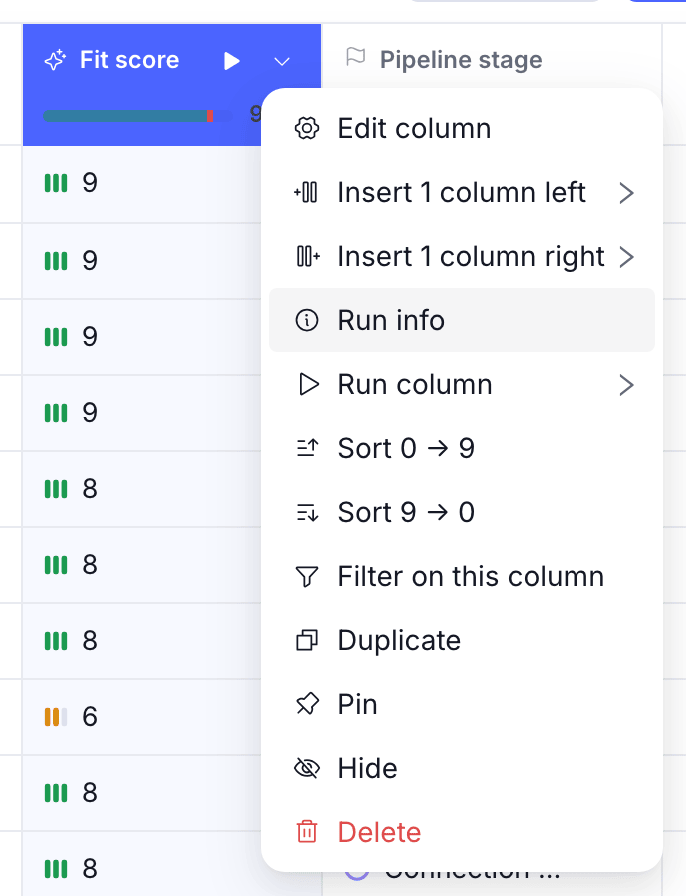

A **Use AI** column asks a model about each row and writes the answer into the cell, with the reason
behind it. A formula or a template computes a column from the row's own data, at no cost. Both read
the same variables: the table's columns and the person's and the company's own fields.

## What does a Use AI column do?

A Use AI column (`action_ai_research`) works one row at a time. It fills your prompt with the row's
values, asks the model, and stores the answer in the cell with a reason of one to three sentences and a
confidence grade. With **Web research (agent)** the model also searches the web for each row, up to 5
searches, and may take several steps before it answers.

| Grade | What it means |
|---|---|
| **High confidence** | The sources state the answer outright |
| **Medium confidence** | Inferred from partial evidence |
| **Low confidence** | A guess, worth verifying before you use it |

In the grid the grade is a meter of three bars at the head of the answer: three green for High, two
amber for Medium, one red for Low, with the words on hover.

A Use AI column writes one output, `response`, or several outputs you define, kept together in one
cell. It writes, rewrites, classifies, scores or researches, one row at a time: a first line, a fit
score from 1 to 10, an industry, a yes or no.

API and MCP: [`create_playtable_field`](/api-reference/playtables/playtable_fields/create-playtable-field)
with `type: action_ai_research`.

## How do I add a Use AI column?

A Use AI column is added from **New column** on the People or Companies tab, set up in its drawer, and
saved with a choice of what to run:

<Steps>
  <Step title="Open New column">
    On the **People** or **Companies** tab, click **+ Column** and pick **Use AI** under **Actions**.
  </Step>
  <Step title="Describe the job, or write the prompt">
    The drawer opens on **Generate**. Under **What would you like AI to do?**, say what you want in
    each row, then click **Generate**: AI writes the prompt, picks the columns it reads, decides
    whether it needs the web and sets the outputs and the run settings. Generating is an AI call and is
    charged. To write it yourself, open **Configure** and fill **Prompt**: type `/` to insert a column
    or a field of the person or the company.
  </Step>
  <Step title="Check the use case and the model">
    **Use case** is **Create or modify content** for an answer from the row's own data, or **Web
    research (agent)** to search the web for each row. **Model** picks the model, and **Compare models**
    shows each model's price per row of this table, with and without web search. Only the Claude
    models can search the web.
  </Step>
  <Step title="Define the outputs">
    Under **Define outputs**, a new column has one output, `response`, as **Text**, **Number**,
    **Date**, **Checkbox** or **URL**. **Add output** asks for several values at once. **Output
    format**, **JSON schema** takes a schema of the answer instead.
  </Step>
  <Step title="Choose when it runs, and save">
    Under **Run settings**, **Auto-run** is off on a new column, and **Add run condition** keeps the
    column to the rows that pass a rule. Save with **Save and don't run**, **Save and run first 5
    rows** or **Save and run rows that haven't run or have errors**.
  </Step>
</Steps>

To give one value of a multi-output answer a column of its own, open a cell, find the value and
click **Add as column**.

## How do I try a Use AI column on one row first?

A Use AI column can be tried on single rows before it runs on the table. While the column's drawer is
open, the grid shows a **Preview** column: click **Try this column on this row** on a row, and the
model answers with **Why:** and its confidence, the button showing that row's price. The preview writes
nothing to the table and is charged as one row. **Run again** asks the model again and is charged
again. A row the preview marks **Will not run** fails the run condition and costs nothing.

API and MCP: [`preview_playtable_field_run`](/api-reference/playtables/playtable_fields/preview-playtable-field-run).

## When does a Use AI column run?

A Use AI column runs only when something starts it. **Run column** opens from the play button beside
the column's name or from the column's header menu:

| How | What runs |
|---|---|
| **Auto-run** on | Every new row a source of the tab's own kind adds, a CSV import included, as it arrives (checked every minute): people from a source of people on the People tab, companies from a source of companies on the Companies tab. The companies a source of people links to the Companies tab, people moved in from another table, rows you add by hand and the rows already there when you switch it on wait for a run you start |
| **Run column**, **Run all N rows that haven't run** | The cells that never ran, the run condition checked again |
| **Run column**, **Run all N rows with errors** | The cells that failed |
| **Run enrichment**, in the strip under the column's name on hover | The cells that never ran and the cells that failed, in one run |
| **Run column**, **Run first 5 rows** | The first 5 rows, finished ones included |
| **Run column**, **Choose number of rows to run** | The **Run column** window: **Rows to run** and an optional **Starting from row** |
| Toolbar, **Actions**, **Run rows** | Every action column of the tab, on all rows, the selected ones or a number of rows, finished ones included |
| A right-click on the grid, **Run N cells** or **Run N rows** | The cells picked, or every action column on the rows picked, finished ones included |
| A workflow's **Run column** step | The cell of each person who reaches the step, on the People tab: the journey waits until the cell settles, and a failed cell does not stop it. A finished cell runs again, and is charged again, only with **Re-run done cells** on |

<Frame caption="The header menu of the Use AI column Fit score, with Run column among its items. Each cell holds a score after its confidence meter: three green bars for High, two amber for Medium.">
  
</Frame>

Each choice shows its estimate before it runs, in the menu or in the **Run column** window, and a run
you start in the app stops at the top of that estimate: the row that meets the cap ends **Run stopped at its budget**,
and the rows the run had not reached go back to what they showed before it. **Run first 5 rows**,
**Choose number of rows to run**, **Run rows**, **Run N cells** and a cell's own **Run** run finished
cells again and charge them again.

API and MCP: [`estimate_credits`](/api-reference/playtables/playtable_fields/estimate-credits), then
[`create_playtable_run`](/api-reference/playtables/playtable_runs/run-a-table-job:-enrich-export-import-bulk-edit)
with `type: enrich` and `max_budget`, and `config.auto_run` on the column through
[`update_playtable_field`](/api-reference/playtables/playtable_fields/update-playtable-field).

## What happens when columns and runs wait for each other?

A column whose prompt or condition reads another action column, such as a first line that waits on a
fit score, waits on each row while that column's cell there is queued or running, as when both columns
run in one **Run rows** or both are on **Auto-run** as rows arrive, and runs once that cell has
finished. A cell nobody has started is not waited for: the column reads it empty, and a row whose
condition reads it ends **Condition not met**, since an empty value fails every check except
`is_empty`.

A second run on a busy column waits its turn. Up to 25 runs can wait behind busy columns, and one more
is refused (`limit_exceeded` on `waiting_runs_per_team`). A wait longer than 20 minutes plus 10 seconds
for each cell ahead is cancelled: **Run cancelled: the column stayed busy for too long**. A workspace
runs up to 10 runs at once, imports, exports and bulk edits included: a run started past that on a
column that is not busy is refused (`limit_exceeded` on `active_runs_per_team`) until one ends, and
**Auto-run** starts no run while 9 are running, so the tenth stays free for a run you start.

## How do I keep a column to the rows that matter?

A run condition (**Only run if**) keeps an action column to the rows that pass a rule, and a row that
fails it costs nothing. Under **Run settings**, tick **Add run condition**, describe the rule in your
own words, for example "only rows where the company domain is filled and the ICP score is at least
70", and click **Generate**: AI turns it into a **Condition formula** you can read and edit, or write
the formula yourself. Generating is an AI call and is charged. The line under it counts how many rows
will run, on up to 100 rows, and the **Preview** column marks each row **Will run** or **Will not run**.

A row that fails the condition ends **Condition not met** (`run_condition_not_met`). It does not run
again by itself when its data changes: **Run all N rows that haven't run** checks it again. A row where
every column the prompt reads is empty ends the same way. The rule is kept in words and as a formula
(`config.nl_condition` and `config.run_condition`).

## How do formulas and templates work?

A formula or a template computes a basic column (Text, Number, Date and the others) from the row, at no
cost. Open the column's settings, and in **Formula** pick a mode:

| Mode | You write | Example |
|---|---|---|
| **Template** | Text with variables, exactly like a message. Type `/` to pick a column | `Hi {{people.first_name}}, saw {{company.name}} is hiring` |
| **Formula** | An expression over the row. **Syntax** lists what it takes | `record.score >= 70 ? "hot" : "cold"` |

Variables read the table's columns as `record.<column>`, the person's fields as `people.<field>` and
the company's as `company.<field>`. In a template an empty variable renders empty, and a lone variable
keeps its value's type. A formula's result is converted to the column's type, and a deeper value is
read with `.` and `[0]`, as in `record.enrich.emails[0]`.

A formula column recomputes when a cell it reads changes. Changing the formula recomputes every cell
of the column, cells edited by hand included: the app asks **Recompute all cells?** first, and a column
that would take more than 5 minutes to fill asks before it starts. **Fill again** in a formula column's
header menu fills it again from the first row, free.

API and MCP: [`create_playtable_field`](/api-reference/playtables/playtable_fields/create-playtable-field)
with `payload.template` or `payload.formula` on a basic column, and
[`backfill_playtable_field`](/api-reference/playtables/playtable_fields/fill-playtable-field-again)
fills it again.

## How do I give one value of an answer its own column?

**Add as column** on a cell of a Use AI or Enrich column pulls one value out: **Add as new column** or
**Map to an existing column**. The new column is a formula over that cell, filled for every row at once
and kept current after each run. Mapping onto a column that holds data asks first, since the formula
overwrites it now and on future runs.

API and MCP: [`create_playtable_field`](/api-reference/playtables/playtable_fields/create-playtable-field)
with a basic column whose `payload.template` is that one value's variable, such as
`{{record.<column>.<path>}}`.

## How do I stop a Use AI run?

Stop one column from its header menu, **Stop**, or the whole table with **Stop all** in the toolbar.
The dialog says what will happen before you confirm: queued cells go back and are not charged, cells
already running finish and are charged, and **Auto-run** turns off on the columns that had it on.
Switch it back on in the column's settings. Changing a column's settings never re-runs its finished
cells: the new settings apply to the next runs.

API and MCP: [`cancel_playtable_runs`](/api-reference/playtables/playtable_runs/stop-playtable-runs).

## What does a Use AI column cost?

A Use AI row is charged by what its model reads and writes, and by each web search it makes. Before you
save, the drawer shows the range per row, read on a sample of the table's rows. Every row is then
charged its real price when it runs. **Generate** and a condition generated from words are AI calls,
charged at their model's rate, and each preview is charged as one row. Formulas, templates, **Add as
column** and a row that fails its condition cost nothing. A run you start in the app stops at the top
of its estimate. A run started by **Auto-run** or by a workflow's **Run column** step has no budget:
only the column's daily credit limit (`config.daily_credit_limit`, set over the API) and the workspace
balance stop it. **Settings**, **Usage** shows what was spent, and on what.

## Why did a Use AI cell fail?

A Use AI cell that fails shows its reason, and the reason says what to change:

| The cell shows | Token | What it means | What to do |
|---|---|---|---|
| **Answer isn't JSON**, **Answer isn't a number**, **Answer isn't an option** or **Answer doesn't match the outputs** | `ai_output_not_json`, `ai_output_not_numeric`, `ai_output_not_in_options`, `ai_output_not_matching_schema` | The model answered, but not in the shape the column expects. The call is charged | Make the prompt say what to return, or loosen the outputs |
| **No web search** | `web_search_not_supported` | The model picked cannot search the web | Pick a Claude model, or use **Create or modify content** |
| **Model unavailable** | `model_not_in_catalog` | The model is not offered any more | Pick another model in the column's settings |
| **Timed out** | `timeout` | The model took longer than 120 seconds, or 240 with web search | Run the cell again |
| **Daily limit reached** | `daily_credit_limit_reached` | The column spent its daily credit limit | With **Auto-run** on it continues after 00:00 UTC, otherwise run the cell again tomorrow |
| **Out of credits** | `allowance_exhausted` | The workspace balance ran out during the run: this row failed, the run stopped, and the rows it had not reached went back to what they showed before it | Top up, then run the rows with errors and the rows that haven't run: **Run enrichment** in the strip under the column's name runs both at once |
| **Run stopped at its budget** | `budget_exhausted` | The run reached the top of its estimate before this row: the run stopped, and the rows it had not reached went back to what they showed before it | Run the rows with errors and the rows that haven't run: **Run enrichment** in the strip under the column's name runs both at once |

API and MCP: [`search_playtable_field_values`](/api-reference/playtables/playtable_field_values/search-playtable-field-values)
counts a column's cells by status and finds the ones that failed.

## How do teams use AI columns?

Teams use AI columns to score rows, to write only where it pays off, and to fill text at no cost:

| Goal | How | Result |
|---|---|---|
| Score each lead's fit | A Use AI column "Fit score": the prompt reads `{{company.name}}` and asks for a score from 1 to 10 with one sentence why, output **Number** | A sortable score with its reason and confidence on every row |
| A first line only for good fits | A second Use AI column with **Only run if** the score is at least 7 | Run together with the score (**Run rows**, or both on **Auto-run**), it waits for each row's score, and rows under 7 cost nothing |
| A greeting with no AI cost | A Text column in **Template** mode: `Hi {{people.first_name}}` | Filled for every row at once, free, updated when the name changes |

## What do AI columns not do?

A Use AI column runs only when something starts it, and a formula never calls a model:

- **Auto-run** does not fire on rows you add by hand, on rows already in the table, on people moved in
  from another table, or on the companies a source of people links to the Companies tab: start a run.
- A Use AI column does not run again by itself when the row changes, and a skipped row stays skipped
  until a run checks it again.
- A column does not wait for a cell it reads that nobody has started: it reads that cell empty.
- A formula or a template never calls a model and never costs credits.
- The Use AI drawer has no daily credit limit: it is set over the API (`config.daily_credit_limit`).
- **Delay run** under **Run settings** is not saved with the column: a row runs as soon as its run
  reaches it.
- Changing a prompt does not re-run the rows already answered.

<Tip>
Copy this to your AI assistant, connected to GetSales over MCP:

"Using the GetSales MCP server at `https://mcp2.getsales.io/mcp/public`, add a Use AI column named
Fit score to the People tab of my table TABLE NAME. Prompt: score from 1 to 10 how well the person's
company fits OFFER, with one sentence why, and output a number. Preview it on three rows and show me the
answers with their reasons and cost. Then estimate the whole column, tell me the range, and wait for
my yes before you run it with the estimate's maximum as its budget."
</Tip>

## Related

- [Find emails and enrich](/kb/tables/find-emails-and-enrich): columns that read profiles and find addresses
- [Tables](/kb/tables/tables): column kinds, and what spends credits
- [Build an outreach workflow](/kb/workflows/build-a-workflow): use a column's answer in a message
