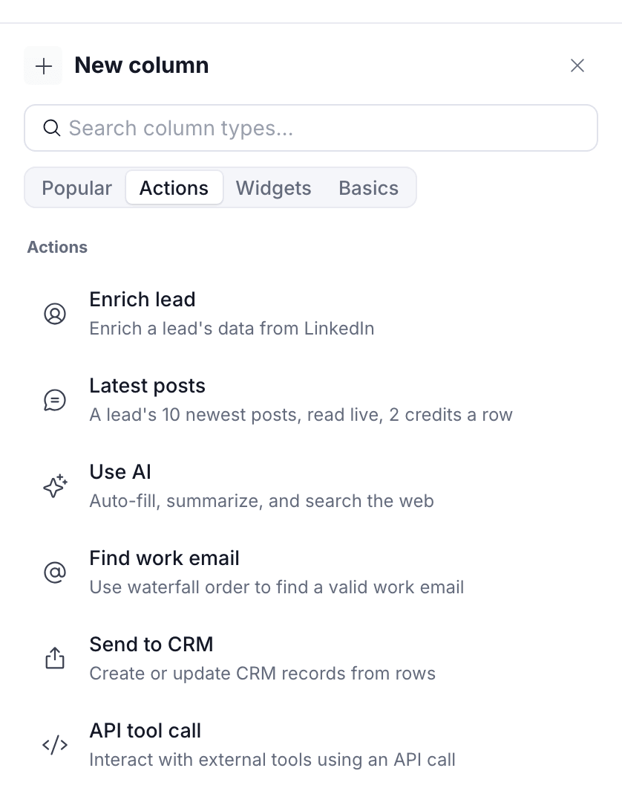

A table holds the people and companies you work with, one row each, with a column for every piece of
data about them. Data sources fill it, action columns enrich it, and workflows reach its people.

## What is a table in GetSales?

A table, called a playtable in the app and the API (`playtable`, sid prefix `pt_tb_`), holds the
people and the companies of one audience. **Playtables** in the sidebar, at
`https://app.getsales.io/playtables`, lists them. The tab bar at the foot of a table switches between
its parts, and **Data sources**, **People**, **Companies** and **Workflows** show their counts:

| Tab | What it holds |
|---|---|
| **Overview** | The table at a glance: people reached, replies, wins, the pipeline flow and the latest activity |
| **Data sources** | The searches, files, webhooks and segments that fill the table, each with its state |
| **People** | One row per person |
| **Companies** | One row per company: the companies of the table's people, and companies added on their own |
| **Workflows** | The outreach workflows that reach the table's people |
| **Plays** | Moves that answer the signals of the table's people |

A table opens on **People** when it has people, on **Companies** when it holds companies alone, and on
**Data sources** while it is empty. Create one with **New playtable** on the Playtables page (a
**Name**, an optional **Description** and the table's **AI SDR**), or with **Build it with Creator** to
have Creator lay out the table, its sources and its columns from your words. A table's name is unique in
the workspace: `create_playtable` with a name already in use answers with that table (`already_exists`)
and creates nothing.

<Frame caption="A table's People tab: one row per person and a column for each piece of data about them, under the toolbar, with the tab bar at the foot, where Data sources, People, Companies and Workflows show their counts.">
  
</Frame>

API and MCP: [`create_playtable`](/api-reference/playtables/playtables/create-playtable),
[`search_playtables`](/api-reference/playtables/playtables/search-playtables).

## Why is a person in only one table?

A person is in exactly one table of the workspace, so two tables never work on the same person at
once. When a data source finds someone who is already in another table, it does not add them a second
time: the record ends `duplicate` and the import results name the table they are in. A person is
recognised by their LinkedIn identifiers and their email addresses.

To bring that person into the new table, switch on **Move here if already saved** in the source, or
move them later from the source's import results. To move people yourself, select their rows, then
**Actions**, **Move to another table**. A move takes the person's own data, pipeline stage, owner and
history along. Their values in the old table's columns are cleared, their journeys in the old table's
workflows end, and a running workflow of the new table whose **From a view** or **By filter** source has
**Auto-add** on takes them in when they match: at once after **Move to another table** or `move_person`,
at its next 10-minute check after a move by a data source.

API and MCP: [`move_person`](/api-reference/playtables/people/move-person),
[`move_data_source_duplicates`](/api-reference/playtables/data_source_items/move-data-source-duplicates).

## How does a company end up in several tables?

A company can sit in several tables at once, with its own cells in each table. When a person comes
in, their company is matched by its LinkedIn page, then its domain, then its exact name, created when
the workspace does not have it yet, and added to this table's **Companies** tab. So a company column
runs once per company, for all of its people.

A company is never moved between tables, only added to one more. Deleting a company removes it from
every table. Two company rows that turn out to be the same company are flagged **Duplicate**, and
**Merge into primary** moves the people of one onto the other.

API and MCP: [`create_company`](/api-reference/playtables/companies/create-company),
[`merge_companies`](/api-reference/playtables/companies/merge-companies),
[`detach_company_playtable`](/api-reference/playtables/companies/detach-company-from-playtable) takes a
company out of one table and keeps it in the others.

## What do the Duplicate and Stoplist badges on a row mean?

A row's badge says why the row is held back. A person's `status` is `ok`, `duplicate`, `stoplisted`,
`no_contact_data` (no LinkedIn identifier and no email yet) or `failed_validation`. A company's `status`
takes the same values except `no_contact_data`.

| Badge | What it means |
|---|---|
| **Duplicate** | Another record of the workspace has the same identity. The row is left out of enrichment runs and workflows. **Make this the primary** swaps which of the two is the main record, on a person's row and on a company's |
| **Stoplist** | The row matches an entry of your stoplist and never enters a workflow |

A row on the stoplist stays in the table, marked. Add to the stoplist in **Settings**, **Stoplist**
(`https://app.getsales.io/settings/stoplist`), or select rows and pick **Actions**, **Add to
Stoplist**: [what the stoplist blocks](#what-does-the-stoplist-block-and-how-do-i-add-to-it).

API and MCP: [`make_person_primary`](/api-reference/playtables/people/make-person-primary),
[`make_company_primary`](/api-reference/playtables/companies/make-company-primary),
[`create_stoplist_entry`](/api-reference/playtables/stoplist_entries/create-stoplist-entries).

## What does the stoplist block, and how do I add to it?

The stoplist is the workspace's list of identifiers never to reach out to (`stoplist_entry`, sid prefix
`sl_sl_`). A person or a company that matches an entry stays in its table, marked **Stoplist**
(`stoplisted`). A matching person enters no workflow while the entry stands (they wait at the door as
**Blocked at entry**), and a journey already running waits as **Blocked** until the entry is removed. An
entry is one value of one kind:

| Kind | `identifier_type` | Example | Blocks |
|---|---|---|---|
| **LinkedIn member ID** | `ln_member_id` | 698599037, or a profile URN | The person, whatever a row calls them |
| **Email** | `email` | jane@acme.com | The person with this work or personal email |
| **Domain** | `domain` | acme.com | The company with this domain, and every person with an email at it |
| **LinkedIn nickname** | `ln_nickname` | janecooper, or the profile URL | The person with this LinkedIn profile |
| **Company page** | `company_ln_nickname` | acme-corp, or the page URL | The company with this LinkedIn page |

A value is normalized on the way in: a URN becomes the member ID, a link its slug (the link itself is
not kept), an email lowercase. A new entry marks the rows it matches in every table, and a record a data
source brings later that matches is still created, marked **Stoplisted**. Ways to add:

- **Settings**, **Stoplist**, **Add to stoplist**: pick the kind, then paste the values, one per line.
  Values the kind does not accept stay in the box.
- **Import CSV** on the same page: one column of one kind, read in your browser. A toast counts
  **Importing stoplist: N of M**, then shows **Stoplist import finished** with **Added: N, already
  listed: N.** and how many values were not accepted. Closing the tab stops the import, and running the
  same file again finishes it, skipping what is already listed.
- On a table, select rows, then **Actions**, **Add to Stoplist**, with an optional **Reason**: a
  person's member ID, emails and LinkedIn profile, or a company's domain and LinkedIn page.
- By itself: an email unsubscribe or a spam complaint puts the address on the stoplist, and so do a
  reply the [AI SDR](/kb/inbox/ai-sdr) labels **Do not contact** and **Add to stoplist** on a thread in
  [Unibox](/kb/inbox/unibox).

<Note>
The paste box takes up to 5,000 values, and a longer list goes through **Import CSV**. One CSV import
takes up to 200,000 values in a file up to 20 MB, and a bigger file is refused before anything is sent.
</Note>

**Remove** on an entry's row takes it off: the people and companies it blocked are checked again and
lift unless another entry still matches them. Adding and removing entries in Settings or from a table
needs the Stoplist Manage permission. The stoplist keeps people out of workflows, not out of tables,
and it does not stop a message you or the AI SDR write on a Unibox thread: only the thread's **Do not
contact** label does.

API and MCP: [`create_stoplist_entry`](/api-reference/playtables/stoplist_entries/create-stoplist-entries)
(one kind and 1 to 500 values a call, a value already listed comes back with `already_exists`),
[`search_stoplist_entries`](/api-reference/playtables/stoplist_entries/search-stoplist-entries)
(`value.eq` answers whether a value is blocked),
[`delete_stoplist_entry`](/api-reference/playtables/stoplist_entries/delete-stoplist-entry).

## Which columns can a table have?

Each tab of a table has its own columns: click **+ Column** in the toolbar to open **New column**,
with the tabs **Popular**, **Actions**, **Widgets** and **Basics**. A column's `category` is `scalar`
(the basics), `widget` or `action`.

| Kind | Columns | What they do | Credits |
|---|---|---|---|
| **Basics** | Text, Number, Currency, Date, URL, Checkbox, Select, Multi-select, Image | Hold what you type, paste or import, or compute it from the row with a formula or a template | None |
| **Widgets** | Work email, LinkedIn, Company, Tags, Notes, Workflows, AI SDR, Activity, Pipeline stage and more | Show the record's own data and where it stands | None |
| **Actions** on People | Enrich lead, Latest posts, Use AI, Find work email, [Send to CRM](/kb/integrations/connect-your-crm#how-do-i-send-people-and-companies-to-my-crm), API tool call | Run per row and write their answer into the cell | By action, none for Send to CRM |
| **Actions** on Companies | Enrich company, Use AI, Find people, [Send to CRM](/kb/integrations/connect-your-crm#how-do-i-send-people-and-companies-to-my-crm), API tool call | Run per row and write their answer into the cell | By action, none for Send to CRM |

<Frame caption="New column on the People tab, Actions: the six action columns, each with its line. An action column runs per row and writes its answer into the cell.">
  
</Frame>

A new table's **People** tab starts with **Data source**, **LinkedIn**, **Work email** and **Pipeline stage**, and its
**Companies** tab with **Data source**, **Website**, **LinkedIn**, **People** and **Pipeline stage**. A table made
before 26 November 2026 keeps the People columns it had. An empty People or Companies tab keeps its toolbar and its
grid: **Add** rows under the header adds rows by hand, and **Add from a data source** opens the Data sources tab. A
tab shows each widget column once: **New column** greys a widget the tab already has ("The column has already been
added"), and **Duplicate** is off on a widget column.
Select several column headers to group them under a name, pin a column to keep it in view, or hide it.

API and MCP: [`create_playtable_field`](/api-reference/playtables/playtable_fields/create-playtable-field).

## What are the limits of a table?

A table takes up to 100 columns on each tab and up to 1 MB in a cell, and has no limit on rows.

<Note>
A tab holds up to 100 columns: a 101st column is refused until you delete one. A cell holds up to
1 MB, and a result larger than that is not stored. There is no limit on the number of rows. You can
select up to 10,000 rows one by one, or select all with no limit. A view keeps up to 3 sorts.
</Note>

## How do views, filters, search and exports work?

A view is a saved way to look at one tab of a table: its columns, their order and width, up to 3
sorts and a filter. Each tab has a **Default view**, which cannot be deleted, and **Save current as
new view** keeps the current layout under a name.

- **Filter** combines rules over any column with And, Or and Not. Its **Run status** section finds the
  cells that failed, never ran or were skipped by their condition.
- **Search people, companies…** finds matches and steps through them. Search never hides rows.
- The rows chip sets a window of the view, a **Starting row** and a **Row limit**. Runs and exports
  started from the toolbar keep to the window.
- **Actions**, **Export to CSV** writes the rows of the view, with its filter, sort and window, and
  its visible columns.
- **Actions**, **Delete selected rows** keeps the people who are in an active workflow.

Click the row number to **Open card**: the person or company with everything the table and Unibox
know about them.

API and MCP: [`create_playtable_view`](/api-reference/playtables/playtable_views/create-playtable-view),
[`create_playtable_run`](/api-reference/playtables/playtable_runs/run-a-table-job:-enrich-export-import-bulk-edit)
with `type: export`.

## What moves a person or a company to another pipeline stage?

A pipeline stage says where a person (a lead) or a company (an account) stands in your funnel, shown in
the **Pipeline stage** column (`pipeline_stage_sid`). GetSales moves a person forward by itself as
outreach happens and parks a silent one on **Unresponsive**, while the AI SDR, a workflow step and you
can move them to any stage. A company takes its stage from its people.

| What moves a person | How |
|---|---|
| GetSales, as outreach happens (**Automatic**) | A new person starts on **New Contact**. An invite sent moves them to **Connection Request Sent**. A LinkedIn message, an InMail or an email sent moves them to **Initial Outreach**. An accepted invite, an opened message or email, a **Visit profile** step, an invitation from them or a visit to your website moves them to **Engaged (No Reply)**. A reply moves them to **Replied**. Forward only, in the pipeline's order: a late accept never takes a person back from Replied or from an outcome stage |
| The pipeline's clock | Once a day, a person on an Approaching or Engaging stage with no journey in flight, no live AI SDR plan and 30 days with none of the facts above and no stage change moves to **Unresponsive**. The next such fact moves them to the stage it names |
| The [AI SDR](/kb/inbox/ai-sdr) | A reply's scenario can move the person to an outcome stage, from **Soft Interest** to **Not interested** |
| A workflow | A **Set field** step on **Pipeline stage** moves the person to the stage it names, or clears it |
| You | Pick any stage, forward or back, in the row's **Pipeline stage** cell, with **Move to** in the Pipeline stage drawer, or on the stage bar above a [Unibox](/kb/inbox/unibox) thread |

No play moves a stage. A company's stage is worked out again whenever one of its people moves: the
first of **Opportunity** (one of them on a Positive stage), **Engaging**, **Approaching**, **Nurture**,
**Lost** (one of them said a real no) and **New** that its people's categories reach, in that order, and
**No Active Contacts** when none of them counts. Stoplisted people and people on a stage of the
Disqualified category (**Wrong Decision Maker**, **Disqualified**) do not count. A company you move by
hand keeps that stage, **pinned by hand**, until **Back to derived** in its Pipeline stage drawer. A
company moved to **Disqualified** stays there: data sources do not collect it again and Find people
skips it.

API and MCP: [`move_pipeline_stage_objects`](/api-reference/playtables/pipeline_stages/move-objects-into-a-pipeline-stage)
moves 1 to 1,000 people or companies into a stage, in any direction, and pins a company.
[`reset_pipeline_stages_derivation`](/api-reference/playtables/pipeline_stages/reset-company-stage-derivation)
gives companies back their people's stage.

## Which pipeline stages are there, and how do I change them?

A workspace has two pipelines, **Leads** and **Accounts**, edited in **Settings**, **Pipeline stages**
(`https://app.getsales.io/settings/stages`) and seeded with the workspace's first person. Each stage
(`pipeline_stage`, sid prefix `cr_ps_`) has a name, a place in the order and a **Category**, the bucket
the funnel counts it in: Cold, Approaching, Engaging, Positive, Nurturing (`nurture`), Negative or
Disqualified.

| Pipeline | Stages, in order, with their category |
|---|---|
| **Leads** | New Contact (Cold), Connection Request Sent and Initial Outreach (Approaching), Engaged (No Reply) and Replied (Engaging), Soft Interest, Strong Interest, Meeting Requested, Meeting Scheduled and Closed-Won (Positive), Not Now and Unresponsive (Nurturing), Wrong Decision Maker and Disqualified (Disqualified), Not interested (Negative) |
| **Accounts** | No Active Contacts and New (Cold), Approaching, Engaging, Opportunity (Positive), Nurture (Nurturing), Lost (Negative), Disqualified |

- **New stage** adds a custom stage with a **Name** and a **Category** at the end of its pipeline. A
  name is unique in its pipeline, whatever its case, and a taken one is refused (`409`
  `duplicate_rejected`).
- **Move up** and **Move down** reorder a stage. The order is the funnel GetSales moves people forward
  along.
- **Edit** renames a stage. The seeded stages are system stages: you can rename and move them, but they
  keep their category and cannot be deleted.
- **Delete stage**, on a custom stage only, asks **Move them to**: everyone on it moves to the stage you
  pick.
- A custom account stage is reached only by a move by hand.

Changing the stages needs the People Manage permission, and moving a person or a company People Act.

API and MCP: [`search_pipeline_stages`](/api-reference/playtables/pipeline_stages/search-pipeline-stages),
[`create_pipeline_stage`](/api-reference/playtables/pipeline_stages/create-pipeline-stage),
[`update_pipeline_stage`](/api-reference/playtables/pipeline_stages/update-pipeline-stage) (a system
stage takes a new name and order only),
[`delete_pipeline_stage`](/api-reference/playtables/pipeline_stages/delete-pipeline-stage) with
`replace_pipeline_stage_sid`.

## Which actions in a table spend credits?

In a table, credits are spent by AI searches, post engagement reads on our managed infrastructure, Check
on save, the Use AI, Find work email, Enrich lead, Enrich company, Latest posts and Find people columns,
an API tool call column at its tool's price, and three kinds of play: Keep data fresh, Engage with posts
and the find people plays. [Send to CRM](/kb/integrations/connect-your-crm#how-do-i-send-people-and-companies-to-my-crm)
columns, basic columns, formulas and widgets are free.

| Action | Credits |
|---|---|
| AI search | 0.5 a page of results that returns somebody, nothing for an empty page, plus building the filter from your words: one AI call and 0.1 for each term it looks up |
| Check on save on a source | One AI call per 20 records, priced on the source before you save |
| Post engagement read on our managed infrastructure | From 0.5 a page of 50 people, free when one of your sender profiles reads it |
| Find people | 0.1 a company where somebody is found, plus 0.1 once when the company's LinkedIn id must be looked up, nothing for a company where nobody is found |
| Find work email | The finder's price for each address found (Hunter 0.5, Findymail 0.4, Anymailfinder 1.46), plus each check at the verifier's rate |
| Enrich lead | Free from saved data and when one of your sender profiles' LinkedIn accounts reads the row. On our managed infrastructure: 0.1 a row at Basic, 0.5 at Advanced |
| Enrich company | Free from saved data and on your own LinkedIn account. On our managed infrastructure: 0.1 a row at either level |
| Latest posts | Free when one of your sender profiles' LinkedIn accounts reads it. On our managed infrastructure: 0.1 a row, plus 0.1 when the person's LinkedIn id must first be looked up from their profile link |
| Use AI | What the model reads and writes for each row, shown before you run |
| API tool call | Its tool's price |

Free: basic columns, formulas and templates, widgets, Send to CRM columns, CSV, webhook and CRM segment
rows, sender searches on your own sender profiles, exports, moves, the stoplist and pipeline stages.
What a play spends: [Signals](/kb/signals/signals#what-does-a-play-spend). Plans and prices:
[Plans, credits and billing](/kb/workspace/plans-credits-and-billing).

API and MCP: [`estimate_credits`](/api-reference/playtables/playtable_fields/estimate-credits) prices a
run before it spends, [`search_credit_ledger_entries`](/api-reference/playtables/credit_ledger_entries/search-credit-ledger-entries)
lists what was spent.

## What happens when the workspace runs out of credits?

When the workspace runs out of credits, the cell that needed them ends `allowance_exhausted` (**Out of
credits**), its run stops, and each source that spends credits pauses with the same reason. On an Enrich or Latest posts column
in a workspace with a LinkedIn account of its own, the cell ends and the run goes on, since the next row may be free. A top-up
alone restarts nothing: press **Resume import** in the source's menu and run the stopped cells again.
The one exception is a Find people search paused for credits: it starts again by itself as soon as its
Find people column (once there are credits) or a find people play hands it a new company. The
**Credits** item in the sidebar shows the balance, what was used this period and the next refill.

Find people, API tool call and Latest posts columns also take a **Daily credit limit** of their own,
counted per UTC day (through the API, `config.daily_credit_limit` on any action column). On a column
whose auto-run is on, a cell past the limit waits as **Daily limit reached. Continues after** a time and
goes on by itself after 00:00 UTC. On any other column, it ends **Daily limit reached**
(`daily_credit_limit_reached`) and runs again only when you run it.

API and MCP: [`update_data_source`](/api-reference/playtables/data_sources/update-data-source) with
`status: active` resumes a source.

## What happens when you archive, duplicate or delete a table?

Archive, Duplicate and Delete sit in a table's menu on the Playtables page.

| Action | What happens |
|---|---|
| **Archive** | The table leaves the list and keeps its people, columns, views and history. Its live workflows and its sources pause, its plays switch off, cells queued to run by themselves wait, and a run already going finishes first. **Unarchive** brings the table back and lets the waiting cells run, but resumes none of the rest: turn them on again yourself |
| **Duplicate** | A copy named after the table with "(copy)" at the end: every column of both tabs with its settings, the views, the AI SDR, and the workflows as drafts with no audience. No rows, sources or plays are copied |
| **Delete** | The table goes with its people, columns, cells and views. Its companies stay in the workspace, and its sources pause and detach. Delete is blocked while people are in active journeys, a workflow reads the table's views, or a run is going, and it cannot be undone from the app |

API and MCP: [`archive_playtable`](/api-reference/playtables/playtables/archive-playtable),
[`duplicate_playtable`](/api-reference/playtables/playtables/duplicate-playtable),
[`delete_playtable`](/api-reference/playtables/playtables/delete-playtable).

## How do teams use tables?

Teams use one table per audience, fill it from companies or people, and keep some people out of its
workflows:

| Goal | How | Result |
|---|---|---|
| A list of people at the companies you target | An AI search for companies on the Companies tab, then a [Find people](/kb/tables/find-people-at-companies) column | People land on the People tab, linked to their company, as the companies arrive |
| The same setup for a second audience | **Duplicate** the table, then add a data source to the copy | The columns, views and AI SDR are ready, the workflows wait as drafts with no audience until you add a source and publish them, and only the rows are new |
| Customers and partners never contacted | Put their domains and profiles on the stoplist | They stay in tables, marked **Stoplist**, and never enter a workflow |

## What does a table not do?

A table sends nothing, puts nobody into a workflow by itself, never shares a person with another table
of the workspace, cannot drop a company from just one table in the app, never hides rows by search, does
not run a column's auto-run on the rows already in the table, and exports CSV only:

- A table sends nothing: a workflow sends, to the table's people. Adding people to a table puts them
  into a workflow only through that workflow's sources or a play. A running workflow whose **From a
  view** or **By filter** source has **Auto-add** on takes in everyone who comes to match, checked every
  10 minutes (people moved in with **Move to another table**, at once). **Actions**, **Add to
  workflow** takes the people you pick, and a play such as **Reach the untouched** adds the people it
  matches to the workflow it names. With none of these, people added to a table wait outside every
  workflow. See [Build an outreach workflow](/kb/workflows/build-a-workflow).
- A person is never in two tables of a workspace at once.
- The app has no way to take a company out of one table while keeping it in others. The API and MCP do
  it with [`detach_company_playtable`](/api-reference/playtables/companies/detach-company-from-playtable),
  which also deletes that table's cells for the company.
- Search finds rows but never hides them. A filter does.
- A column's own auto-run takes every row that enters its tab once it is on: a row a data source adds, a row you
  add by hand or over the API once it holds an email or a LinkedIn profile (a company: a domain or a LinkedIn
  page), and a person moved in from another table. It does not take the rows already there, the companies a people
  source links to the Companies tab, a company a source finds already in the workspace, or a row on the stoplist.
  Start a run for those.
  Columns also run without a click when a switched-on play reads through them, at each column's price:
  **Keep data fresh** re-reads the LinkedIn profile and company page columns (Enrich lead, Enrich
  company) every 7 and 90 days by default on each row never read or read longer ago, and **Engage with
  posts** re-reads posts through a Latest posts column. A workflow's **Run column** step runs a column
  for each person it reaches.
- Export writes CSV only.

## Related

- [Add people and companies](/kb/tables/add-people-and-companies)
- [Find people at companies](/kb/tables/find-people-at-companies)
- [Find emails and enrich](/kb/tables/find-emails-and-enrich)
- [AI columns and formulas](/kb/tables/ai-columns)
- [Build an outreach workflow](/kb/workflows/build-a-workflow)
- [Signals](/kb/signals/signals): the plays of a table and what they spend
- [Connect your CRM](/kb/integrations/connect-your-crm): the Send to CRM column and what it writes
