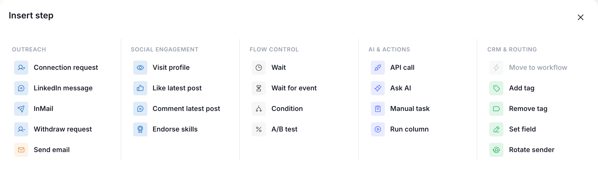
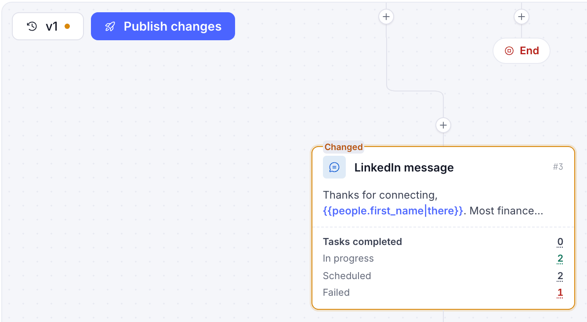

A workflow is the sequence a table's people go through: a connection request, a message, an email, the waits
between them and the branches that pick a path. You build it on a table, publish it, and start it.

<Tip>
**Give this to your AI assistant** once it is connected to GetSales ([how](/kb/ai/connect-your-ai-assistant)):

"In GetSales, in my table {TABLE}, create a draft workflow named {NAME}. Add a source from my saved view
{VIEW} with auto-add on, and my sender profile {SENDER}. The steps, in order: a Connection request whose note
uses the person's first name and stays under 300 characters, then a Wait for event on the accepted connection
with a 14 day time limit and an End on its time limit branch, then a LinkedIn message, a Wait of 3 days and a
Send email to the work email. Validate the draft and list every error and warning. Do not publish it and do
not start it."
</Tip>

## How does a GetSales workflow run?

A GetSales workflow moves each person through its steps one at a time, from the sender profile picked for them,
inside the workflow's sending window and that sender profile's daily limits. What happens, in order:

1. A source enrolls the person. Their journey starts on the workflow's published version and stays on it until a
   restart.
2. The workflow picks the person's sender profile by its rotation and pins it: only a **Rotate sender** step, a
   restart or that sender profile's deletion gives them another.
3. When the person reaches a step, GetSales plans that step as a task, with its text filled from the person's row.
4. A send leaves when it is due, inside the sending window and the sender profile's daily limits.
5. When the task is done or skipped, the person moves to the next step. A task that fails for good stops the
   journey there. A branch rejoins the chain below it unless it ends with an **End** step.
6. A reply from the person pauses them in every live workflow, unless the workflow is set to **Continue the
   sequence**.
7. The journey ends **Completed** (it reached the end of its path, an **End** step or a **Move to workflow** step),
   **Failed** (a step failed for good) or **Exited** (taken out of it: by hand, by a play such as **On a job
   change** that removes or moves them, by a move of the person to another table, by the person's removal from
   the [HubSpot segment](/kb/tables/add-people-and-companies#how-do-i-sync-a-hubspot-segment-into-a-table) that
   feeds the table, or by the workflow's deletion).

Four objects carry a workflow, and the API names them:

| In the app | API object | Sid | What it holds |
|---|---|---|---|
| The workflow | `workflows` | `wf_wf_` | The steps (a draft you edit, `draft_steps`, and the published versions that run), the sender profiles, the sending window, the priority and what a reply does. Status `draft`, `active`, `paused` or `archived` |
| A source | `workflow_sources` | `wf_sr_` | Who enters: a `view`, a `filter`, an `event` or `manual` adds |
| A person's workflow | `workflow_records` | `wf_rc_` | One person in one workflow: the version they entered on, their sender profile, the step they stand on, their state |
| A task | `workflow_tasks` | `wf_tk_` | One step for one person: planned when they reach it, then sent or run |

## What do you need before you build a workflow?

- A table with the people you want to reach. See [add people and companies](/kb/tables/add-people-and-companies).
- At least one sender profile: a LinkedIn account for LinkedIn steps, a mailbox for email steps. A mailbox connects
  once your plan has an email package, which the trial and the Free plan do not have. See
  [connect a LinkedIn account](/kb/sender-profiles/connect-linkedin) and [connect a mailbox](/kb/sender-profiles/connect-a-mailbox).
- The person's email in the table for an email step, and their LinkedIn profile for a LinkedIn step.

## How do you create a workflow?

To create a workflow in the app, open **Playtables**, open the table, click the **Workflows** tab, then **New
workflow**. The builder opens on a draft named **Untitled workflow** (with a number after it when that name is
taken), and nothing runs while it is a draft. Over the API,
[`create_workflow`](/api-reference/playtables/workflows/create-workflow) makes the same draft, and
[`update_workflow`](/api-reference/playtables/workflows/update-workflow) writes its steps and settings. A
workflow's name is unique in the workspace: `create_workflow` with a name already in use answers with that
workflow (`already_exists`) and creates nothing.

The builder reads top down: **Who enters this workflow**, then **Who sends**, then the steps. A workflow belongs to
one table and runs on that table's people.

## How do people enter a workflow?

People enter a workflow through its sources. Click the card **No one enters this workflow yet**, then **Add
source**, and pick **From a view**, **By filter** or **On an event**, or call
[`create_workflow_source`](/api-reference/playtables/workflow_sources/create-workflow-source). Manual adds come
from **Add to workflow**:

| Source | `type` | Who enters |
|---|---|---|
| **From a view** | `view` | Everyone in a saved view of the table. Edit the view's filter and the audience follows it. |
| **By filter** | `filter` | People who match conditions kept in the workflow itself, not tied to a view. |
| **On an event** | `event` | Whoever does the event, the moment it is recorded for them, from any workflow or sender profile of your team, while the workflow runs: **LinkedIn invite accepted**, **LinkedIn invite received**, **LinkedIn message replied**, **InMail replied**, **Email replied**, **Email opened**, **Email link clicked** or **Followed us on LinkedIn**. An event from before you start the workflow, or from while it is paused, enrolls no one. Over the API, `event` also takes the website facts `website_visited`, `website_key_page_visited` and `website_form_submitted`. |
| **Manual adds** | `manual` | People you pick by hand, once the workflow is published: on the table's **People** tab, select their rows, open **Actions** and choose **Add to workflow** ([`add_workflow_people`](/api-reference/playtables/workflows/add-people-to-workflow), 1 to 500 people a call). They enter through the workflow's manual source, which GetSales creates, named Hand-picked, when the workflow has none. |

Set the source up in the drawer, then click **Add source** at its foot to save it (**Save source** on a source you
edit).

## How do auto-add and a workflow source's limits work?

**Auto-add** on a view or filter source adds everyone who matches as soon as the workflow runs (when you start it,
publish a version or save the source), then checks again every 10 minutes, and at once when the saved view's
filter changes, when people are moved into the table (**Move to another table**, `move_person` or a bulk move), or
when a bulk run over the API changes their tags or a column's value. On a draft or paused workflow it adds no one
until you start or resume it. With auto-add off, the source stays and adds no one. A person who leaves the
view or stops matching later stays in the workflow: only people still waiting at the door drop out.

**Set limits** caps how many of one source's people are in flight at once: **People limit** (`active_limit`) for
the source as a whole, **Coworkers limit** (`coworkers_limit`) for people from the same company. The rest wait at
the door as **Waiting at limit** (`waiting_limit`) and enter as places free up, longest waiting first. People
paused (on a reply or by hand) or **Blocked** after entering keep their place under the limit until they finish or
exit. People held at the door take no place.

<Frame caption="Edit source on a View source: the view Finance decision makers, Auto-add on, and Set limits with People limit 50 and Coworkers limit 2.">
  
</Frame>

## Can a person enter the same workflow twice?

A person enters a workflow once. Every source skips people already in it, an event source fires once per person
per workflow, and auto-add never restarts someone who finished. **Add to workflow** leaves a person the workflow
already holds as they are, finished or not: to run a finished journey again, use **Restart from top** on that
workflow in the person's **Workflows** cell
([`restart_workflow_record`](/api-reference/playtables/workflow_records/restart-workflow-record-from-top)), or
over the API `add_workflow_people` with `restart` (`from_start` or `from_current`). A **Move to workflow** step of
another workflow, or a [play](/kb/signals/signals#which-plays-are-there) that adds or moves the person here
(**Congratulate**, **On a job change**, **On a website visit**, **Re-engage dormant people**, **Reach the
untouched**, or a People view saved with **Save as a play**), also runs their journey here again. A move and the
first three plays do so only until that journey has been run again 10 times: from then on they leave it as it is,
and the moving journey still ends **Completed**. A person on your
[stoplist](/kb/tables/tables#what-does-the-stoplist-block-and-how-do-i-add-to-it), or a row recognised as a copy of
another person, waits as **Blocked at entry** (`blocked`) and enters only if that changes.

## Which sender profile sends to each person?

Each person gets one sender profile when they enter a workflow, and every message of their journey comes from its
LinkedIn account and its mailboxes. Only a **Rotate sender** step, a restart, or the deletion of that sender profile
(their next send then goes to another one, by the rotation) gives them another. Add sender profiles on the
**Who sends** card: **Add a sender** for each one, then **Save changes**. **How people are shared among senders**
(`rotation_strategy`) picks who gets whom, on entry and on a restart, among the workflow's sender profiles that can
send:

| Option | `rotation_strategy` | What it does |
|---|---|---|
| **Fair balance** (default) | `fair` | Gives each person the sender profile with the fewest people in this workflow, so each one carries a similar share. |
| **A new sender** | `new_sender` | Each person gets a sender profile they have never heard from. When every one has engaged them, Fair balance picks. |
| **Prior engagement first** | `prior_engagement` | Each person stays with the sender profile they last engaged with, when there is one. Otherwise Fair balance picks. |
| **Random** | `random` | Any sender profile at random. The shares even out over time. |

Removing a sender profile from a workflow keeps it on the people it already has until they finish, and new people
go to the others. To hand people to another sender profile partway through, add a **Rotate sender** step. Each
sender profile sends within its own daily limits, shared by every workflow that uses it: see
[smart limits and warmup](/kb/sender-profiles/smart-limits-and-warmup).

## Which steps can a workflow have?

A workflow can have 23 steps in five groups: **Outreach** (Connection request, LinkedIn message, InMail, Withdraw
request, Send email), **Social engagement** (Visit profile, Like latest post, Comment latest post, Endorse skills),
**Flow control** (Wait, Wait for event, Condition, A/B test, End), **AI & actions** (API call, Ask AI, Manual task,
Run column) and **CRM & routing** (Move to workflow, Add tag, Remove tag, Set field, Rotate sender).

A workflow's steps come from the step picker, **Insert step**, which opens from the plus beside **Add your first
step** or the plus between two steps. It shows one column per group, a row per step, and each step's description on
hover. A step that cannot be set up in this workflow stays greyed and says why: **Move to workflow** needs another
workflow, and **Run column** an action column on the table's People tab. **End** shows only at the bottom of a
chain, where the path may stop. The `type` is the step's name in the API:

| Group | Step | `type` |
|---|---|---|
| **Outreach** | **Connection request** | `linkedin_send_connection_request` |
| | **LinkedIn message** | `linkedin_send_message` |
| | **InMail** | `linkedin_send_inmail` |
| | **Withdraw request** | `linkedin_withdraw_connection_request` |
| | **Send email** | `email_send` |
| **Social engagement** | **Visit profile**, **Like latest post**, **Comment latest post**, **Endorse skills** | `linkedin_visit_profile`, `linkedin_like_latest_post`, `linkedin_comment_latest_post`, `linkedin_endorse_skills` |
| **Flow control** | **Wait**, **Wait for event**, **Condition**, **A/B test**, **End** | `wait`, `wait_for_event`, `condition`, `ab_test`, `end` |
| **AI & actions** | **API call**, **Ask AI**, **Manual task**, **Run column** | `api_call`, `ask_ai`, `manual_task`, `run_column` |
| **CRM & routing** | **Move to workflow**, **Add tag**, **Remove tag**, **Set field**, **Rotate sender** | `move_to_workflow`, `add_tag`, `remove_tag`, `set_field`, `change_sender` |

Click a step on the canvas to set it up in the drawer on the right.

<Frame caption="Insert step in its five groups, opened where the path cannot stop, so End is not offered, and with Move to workflow greyed: there is no other workflow to move people to.">
  
</Frame>

## How does a step's text get filled in?

A step's text is filled in when the person reaches the step, from their row, and then frozen: a later change to
the person's row does not reach a task already planned. A change to the sender profile's own values (the variables
that start with `sender.`) does reach the tasks still **Scheduled**, unless someone rewrote the task's text, but not
an open **Manual task**. Until it goes out, the task waits as **Scheduled** in the step's task list and in
**Tasks** beside **Steps** in the builder's head, where **Send now** or **Skip** act on it. The app does not show
or edit a planned task's text, except a **Manual task**'s title and instructions, which are its task in Unibox.
Over the API, [`update_workflow_task`](/api-reference/playtables/workflow_tasks/update-workflow-task) rewrites it while the task
is scheduled.

Type `/` in a text to insert a column, such as the person's first name or their company's name, and give it a
fallback for the rows where it is empty (`{{people.first_name|there}}`).

## What does a step do when a value in its text is empty?

A workflow step whose text reads an empty value with no fallback does what its **When a value is empty** rule says
(`required_fields.on_missing`). The rule is applied when the task comes due, so a task planned while a value was
empty gets its text then if the value has been filled. **Require another column** adds values the text does not
name (`required_fields.refs`, up to 20).

- **Fail the step** (`fail`, what a step added in the app starts with): the task and the person's journey show as
  **Failed**, and **Retry** runs it once you fill the value.
- **Skip the step** (`skip`): the person moves on to the next step.
- **Send as is** (`required_fields` set to null): the text goes out with the value left blank. A step written over
  the API without `required_fields` sends as is.

## What do the LinkedIn steps need?

Each LinkedIn step acts from the LinkedIn account of the person's sender profile, with its own needs and limits
(**Visit profile** has nothing to set):

| Step | What it needs, and its limits |
|---|---|
| **Connection request** | The **Invite note** is optional: leave it empty to send a blank invite. A note holds 300 characters at most. People who are already connections, or who already have an invite from this sender profile waiting, skip the step. |
| **LinkedIn message** | Reaches the sender profile's 1st-degree connections only, 8,000 characters at most. Put a **Connection request** and a **Wait for event** on **Connection accepted** before it: people already connected pass both at once. |
| **InMail** | Reaches someone without connecting. It needs a Premium LinkedIn account and its InMail credits. Subject 200 characters, message 8,000. |
| **Like latest post**, **Comment latest post** | Act on the person's newest post of their own from the last 90 days: a repost with no words of theirs does not count. With no such post the step fails (`no_recent_post`), which stops the journey. A comment holds 1,250 characters at most, and a new **Comment latest post** starts empty: a comment is public, so you write it. |
| **Endorse skills** | Endorses as many of the person's top skills as **Skills to endorse** says (1 to 10, 3 on a new step), for 1st-degree connections only. With no skill left to endorse the step fails (`no_endorsable_skills`). |
| **Withdraw request** | Withdraws the invite this journey sent. With none sent, or one already accepted, withdrawn or expired, the step fails. |

## What does a Send email step need?

A **Send email** step sends from the sender profile's mailboxes in turn, to the address under **Send to**: the
**Work email**, the **Personal email**, or **Work email, then personal** (the default). A person with no such
address fails the step (`email_missing`). Its limits and options:

- Subject 255 characters. **Cc** and **Bcc** copy colleagues, up to 5 addresses each, never the person.
- Up to 5 files of 10 MB each (PDF, Office, images, text or zip). Files over 20 MB together fail the send
  (`attachment_too_large`), and a mail provider can refuse less.
- **Track opens** and **Track clicks** follow the mailbox unless the step turns them on or off, and need a verified
  tracking domain on the mailbox: turned on without one, the send fails.
- **Reply in the previous email thread** is on by default: the journey's next email answers in the thread of its
  previous one, from the same mailbox. Turn it off to start a new thread.

## How do waits, conditions and A/B tests decide the path?

Waits hold a person in a workflow for a time or an event, and conditions and A/B tests send them down one branch:

- **Wait** pauses the person for a number of minutes, hours or days, from 1 minute to 365 days (over the API, `for`
  reads `45m`, `12h` or `14d`).
- Most steps can also wait before they run: under **When it runs**, pick **After a delay** instead of **Right
  away** (over the API, the step's `delay`). The task is planned the moment the person arrives, with its text, and
  leaves after the delay. **Wait**, **Wait for event**, **Manual task** and **End** take no delay, and **Visit
  profile**, **Like latest post** and **Withdraw request** show no **When it runs** in the app: put a **Wait**
  before those.
- **Wait for event** holds the person until **Connection accepted**, **Email opened** or **Link clicked**, with a
  **Time limit** (**Give up after**, 14 days on a new step). The event branch and the time limit branch each take
  their own steps, then meet again under the wait. On a wait for **Connection accepted**, the time limit branch
  holds the people who did not accept, so a **LinkedIn message** or **Endorse skills** there fails for them: the
  builder warns, and still lets you publish. If such a step follows the wait, end the time limit branch with
  **End**.
- **Condition** checks the person's row when they reach it: 1 to 9 branches, the first match wins, and everyone
  else takes the **else** branch.
- **A/B test** splits people over 2 to 9 arms by weight. Each person keeps their arm, also on a re-run.

## When does a wait for Connection accepted decide?

A **Wait for event** on **Connection accepted** decides on the account's LinkedIn sync, because an accept reaches
GetSales only when the account syncs its connections, inside its sync hours. A person who accepts moves on at the
first sync after the accept. A person who does not takes the time limit branch only after the first sync that runs
once the time limit has passed, so that branch can start late. If the account does not sync its connections for
30 days after the time limit, the step fails with the reason `wait_expired`, and the journey with it. The step's
task shows when the decision is due. See [when a workflow does not send](/kb/workflows/troubleshooting).

## What does a Manual task step do?

A **Manual task** step gives your team a task and sends nothing: the person's journey waits on that step until the
task is closed. When the person reaches the step, GetSales fills its **Title** (required to publish, 255 characters
at most) and **Instructions** (4,000 at most) from their row, keeps them as they are from then on, and opens one task
in [Unibox](/kb/inbox/unibox):

- It is assigned to the **Assignee** of the person's sender profile, or to nobody when that sender profile has none.
- It lands on the person's newest thread: under **Tasks** in Unibox once they have replied, on their thread under
  **Sent** while nobody has, and nowhere in Unibox when you have no conversation with them. Such a task closes in
  the app only with **Skip** in the workflow, or over the API.
- It shows the title, **Manual task**, the instructions, and the person's name with their LinkedIn profile link when
  it is known. It is due 2 days after the person reached the step and expires a month after it opened: **Edit** on
  the task changes **Due** and **Expires**, and an empty **Expires** keeps it open for good.

While the task is open, the person shows **Active** on the step and the task **Pending**, counted under **In
progress** on the step. The step takes no delay and has no **When a value is empty** rule: an empty value with no
fallback stays blank in the task.

| To | Do | What the journey does |
|---|---|---|
| Finish the task | **Done** on the task in Unibox | The step counts as done, **Manual task completed** lands on the person's timeline, and they move on to the next step |
| Drop the task | **Cancel task** on the task in Unibox, or **Skip** in the row's menu of the step's task list or of **Tasks** in the builder | The step is skipped and they move on to the next step. **Skip** closes the task in Unibox too |
| Nothing | The task expires | The step is skipped and they move on to the next step |

A reply that pauses the person, or **Pause** on the workflow, leaves the task open, and a **Done** given meanwhile
moves them on once their journey runs again. A journey that ends first (an exit, a restart, the workflow's deletion)
closes the task in Unibox. Over the API,
[`search_workflow_tasks`](/api-reference/playtables/workflow_tasks/search-workflow-tasks) with `type` `manual_task`
and `status` `pending` lists the people waiting on a teammate, [`search_tasks`](/api-reference/unibox/tasks/search-tasks)
with `workflow_task_sid` finds the task in Unibox (`ub_tk_`), and
[`update_task`](/api-reference/unibox/tasks/answer-or-update-a-task) closes it: `state` `done` completes the step,
`canceled` skips it. [`cancel_workflow_task`](/api-reference/playtables/workflow_tasks/cancel-workflow-task) skips
it from the workflow's side.

## What are a workflow's limits?

<Warning>
A workflow holds at most **100 steps**, branches included, and branches go at most **3 levels** deep. An edit that
goes over either limit is not saved: the builder names the limit, the saved draft stays as it was, and no later
edit saves until the steps are back within it. A **Condition** has 1 to 9 branches plus **else** and an **A/B
test** 2 to 9 arms (**Add branch** and **Add arm** stop at 9). A wait or a delay runs from **1 minute** to **365
days**, and one outside that range is an error that blocks publishing.
</Warning>

## What do a workflow's settings decide?

A workflow's settings live behind the gear (**Workflow settings**) and apply as soon as you click **Save changes**,
with no publish: they are not part of a version. Over the API they are fields of
[`update_workflow`](/api-reference/playtables/workflows/update-workflow).

| Setting | Field | What it does |
|---|---|---|
| **Workflow name** | `name` | The name in the list and in Unibox filters. Unique in the workspace: a name already in use is refused. |
| **Sending window** | `schedule` | The days and hours sends go out: **Mon to Fri, 9 to 18**, **Every day, 8 to 20**, **Any time**, or your own hours, in a **Timezone** you pick. **Follow the person's timezone** reads the window in each person's own zone when it is known. A new workflow sends at **Any time**, paced by each account's own limits. |
| **Priority** | `priority` | **Low** (1), **Medium** (2, the default) or **High** (3): a workflow's share of a sender profile it shares with other workflows. High gets three actions for every one of low. It is never a queue: low still gets its share. |
| **After a reply** | `on_reply` | **Hand over to the AI SDR** (`ai_sdr`, the default), **Stop, I reply myself** (`stop`) or **Continue the sequence** (`continue`). The first two pause the person, the third keeps sending. |
| **AI SDR** | `agent_sid` | Which AI SDR answers the replies this workflow starts: the table's, unless you pick another. Active with **Hand over to the AI SDR** only. |

<Frame caption="Workflow settings: Sending window Mon to Fri, 09:00 to 18:00 in Europe/Amsterdam, Priority Medium, After a reply Hand over to the AI SDR, and AI SDR The table's: Acme SDR.">
  
</Frame>

## What happens when a person replies to a workflow?

A reply pauses the person in every live workflow they are in, not only the one that wrote to them, unless that
workflow's **After a reply** is **Continue the sequence**. The person shows **Paused on reply**
(`paused_on_reply`), and their next step waits in place. With **Hand over to the AI SDR**, the thread goes to the
AI SDR ([how it answers](/kb/inbox/ai-sdr)). With **Stop, I reply myself**, it is yours in [Unibox](/kb/inbox/unibox).

In a workflow whose **After a reply** pauses, GetSales reads the thread with the person before each **LinkedIn
message** and **InMail** goes out, so a reply the account has not synced yet still stops the send. To send someone
back to their workflows, use **Return to orchestration** in Unibox, or **Resume** on their workflow.

## How do you publish and start a workflow?

1. Read the check in the builder's head ([`validate_workflow`](/api-reference/playtables/workflows/validate-workflow)).
   The builder checks the draft when it opens and after every save: the check reads **Validate** until the first
   result comes back, then the count of errors and warnings, or **No issues**. Click it to list them. An error
   blocks publishing (a sending step with no sender profile under **Who sends** is one), a warning does not.
2. Click **Publish** ([`publish_workflow`](/api-reference/playtables/workflows/publish-workflow)). The draft becomes
   version 1: **Version 1 published: press Start to run it**.
3. Click **Start** ([`resume_workflow`](/api-reference/playtables/workflows/resume-workflow), which starts a draft
   and resumes a paused workflow). Start runs the published version, so it stays greyed out until the first publish.

The sources take in their people at once, and each sender profile works through its share within the sending
window and its daily limits.

## How do you check that a workflow runs?

- The **Who enters this workflow** card counts who **entered**, who is **waiting at limit**, who is **blocked** and
  who is **in the workflow** now. Under them it says how many sends are planned, how many days they take on how many
  sender profiles at the current limits, and the day they are done by. People waiting at a limit are not in that
  plan yet.
- Each step shows **Tasks completed**, **In progress** and a row for each status its other tasks are in
  (**Scheduled**, **Failed** and the like). A sending step lists under **Node conversions** what came back
  (accepted, replied, opened, clicked, bounced and more), each with its rate, or **Nothing back yet**. Click a
  number to see the people or the tasks behind it.
- **Tasks**, beside **Steps** in the head, lists what is planned day by day, with the minute each send leaves and
  the sender profile it leaves from.
- Over the API: [`search_workflow_records`](/api-reference/playtables/workflow_records/search-workflow-records)
  for each person's state, [`search_workflow_tasks`](/api-reference/playtables/workflow_tasks/search-workflow-tasks)
  for the tasks, [`get_workflow_records_metrics`](/api-reference/playtables/workflow_records/workflow-and-campaign-metrics)
  for the counts.

<Frame caption="The builder of Finance leaders outreach, Active with No issues: 7 entered, 1 waiting at limit, 0 blocked and 6 in the workflow, 2 sends planned on 2 sender profiles, Maya Chen and Daniel Okafor sending on Fair balance, then each step with its numbers.">
  
</Frame>

A person who waits, a step that skips or fails: see [when a workflow does not send](/kb/workflows/troubleshooting).

## How do you change a live workflow without moving the people already in it?

Edits to a live workflow go to a draft beside the live version, and the builder marks each step you touched **New**
or **Changed**. Click **Publish changes**: the new version takes the people who enter from then on, and everyone
already in finishes on the version they entered with. Every version is kept: open the version in the canvas corner
to see them, and **Restore to draft** to bring an older one back into the draft, then publish it.

<Frame caption="An edit to a live workflow: the version chip v1 carries a dot for unpublished changes, the edited LinkedIn message step is marked Changed, and Publish changes makes the edit live for the people who enter from then on.">
  
</Frame>

**Who sends**, the sources and the workflow's settings are not versioned: a change to them applies at once.

| To | Do | API |
|---|---|---|
| Stop sending for a while | **Pause**. Everyone keeps their place, sources add no one, and nothing goes out until **Resume**. People you add by hand meanwhile wait too. | [`pause_workflow`](/api-reference/playtables/workflows/pause-workflow) |
| Copy a workflow | **Duplicate workflow** in the menu: a draft with the same steps, sender profiles, settings (sending window, priority, **After a reply**, AI SDR) and notes, in this table or another one. The audience stays with the original. | [`duplicate_workflow`](/api-reference/playtables/workflows/duplicate-workflow) |
| Delete a workflow | Pause it first, then **Delete**. Journeys still running end as **Exited** and their planned steps are cancelled. The people stay in the table, and their journey history is kept. Over the API, the call asks for `acknowledge: ["cancel_active_records"]` while journeys still run. | [`delete_workflow`](/api-reference/playtables/workflows/delete-workflow) |

## What does a workflow spend?

A workflow's sending spends no credits: your sender profiles' LinkedIn accounts and email capacity cover it.

| Step | Credits |
|---|---|
| LinkedIn and email steps | None |
| **Wait**, **Wait for event**, **Condition**, **A/B test**, **End**, **API call**, **Manual task** and the **CRM & routing** steps | None |
| **Ask AI** | The model's rate for the tokens it uses, each time it runs for a person. **Web research** adds the cost of its searches |
| **Run column** | The column's own rate when the cell runs. A filled cell is skipped free unless **Re-run done cells** is on |
| The AI SDR's work on a reply | Its own credits, capped per thread: see [AI SDR](/kb/inbox/ai-sdr) |

## How do teams use workflows?

**Connect, then message the people who accept, then email the rest.** Steps: **Connection request**, **Wait for
event** on **Connection accepted** with a 7 day time limit, then under the event branch a **LinkedIn message**, and
under the time limit branch a **Send email** and an **End**. Result: people who accept get the LinkedIn message,
the others get the email, and nobody gets a LinkedIn message they cannot receive.

**Keep a newsletter-style nurture going after replies.** Set **After a reply** to **Continue the sequence** on the
nurture workflow. Result: a reply still pauses the person in their other workflows that pause on a reply, but not
in this one, and the AI SDR stays out of the threads this workflow starts.

**Test two openers.** Put an **A/B test** with two arms of weight 50 before the first message, with a different
**LinkedIn message** in each arm. Result: each person gets one version and keeps it, and each message step shows
its own reply rate.

## What does a workflow not do?

A workflow sends only what its steps, sending window and limits allow: it never sends a LinkedIn message to someone
who is not a connection, sends at an exact time, moves people already in to a new version, re-runs finished people
by itself, or sends to someone on your stoplist.

- A workflow does not send a LinkedIn message to someone who is not a connection of the sender profile: use a
  connection request first, or an email or an InMail.
- It does not send at an exact date and time: a send leaves when its step is due, inside the sending window and
  the sender profile's limits. **Send now** moves one planned send forward, still inside both.
- It does not move people already in to a new version: they finish on the version they entered with.
- It does not change a person's sender profile partway through on its own: only a **Rotate sender** step, a
  restart, or the deletion of that sender profile does.
- It does not restart people who finished: its sources and **Add to workflow** leave them as they are. A journey
  runs again only through **Restart from top**, `add_workflow_people` with `restart`, a **Move to workflow** step
  of another workflow that sends them back in, or a [play](/kb/signals/signals#which-plays-are-there) that adds or
  moves them into it (**Re-engage dormant
  people**, **Reach the untouched**, a play made with **Save as a play**, **Congratulate**, **On a website
  visit**, **On a job change**).
- It does not hold a person for a target that is not running: a **Move to workflow** step into a paused or draft
  workflow ends their journey here and enrolls them nowhere.
- It does not send anything for a **Manual task**: the person stays on that step until its task is closed in
  Unibox, skipped in the workflow, or expires a month after it opened.
- It does not let you edit a planned task's text in the app, and shows it in one place only (a **Manual task**
  aside, whose text is its task in Unibox): on **Signals**, an event other than a reply that woke a **Wait for
  event** step, such as **Connection accepted**, quotes the words of the step right after it. Over the API,
  `search_workflow_tasks` reads the text (`variables_snapshot`) and `update_workflow_task` rewrites it while the
  task is scheduled.
- It does not send to a person on your stoplist, or to a row recognised as a copy of another person: their step
  waits until that changes.

## Related

- [When a workflow does not send](/kb/workflows/troubleshooting)
- [Unibox](/kb/inbox/unibox)
- [AI SDR](/kb/inbox/ai-sdr)
- [Smart limits and warmup](/kb/sender-profiles/smart-limits-and-warmup)
- [Signals](/kb/signals/signals)
