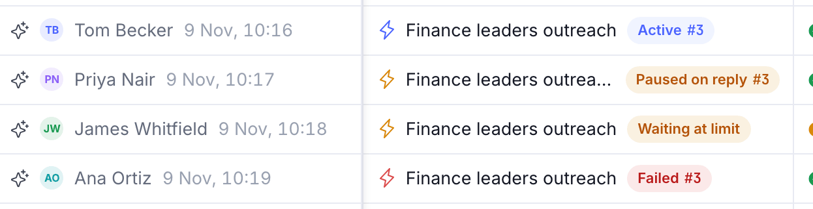
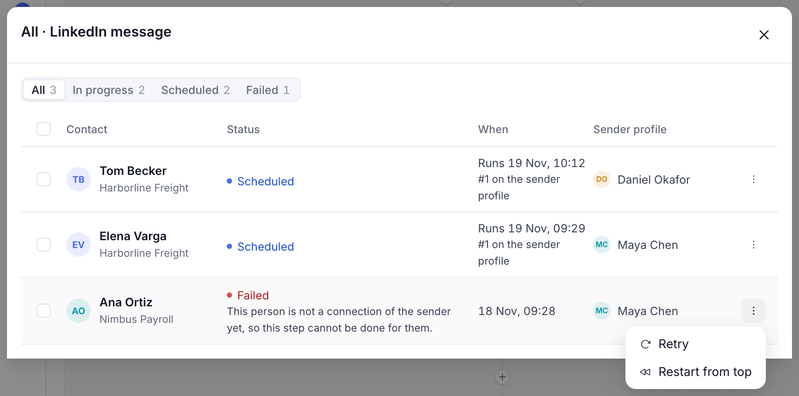

A GetSales workflow that sends nothing is almost always waiting for something it can name. The person's state in
the workflow and the step's task list say what. The checks below go in the order to try them, and name each state,
status and reason as the app and the API show them.

## Where do you see why a workflow is not sending?

Three places in the app say why a workflow is not sending to someone:

- **The person's workflows.** In the table, the **Workflows** column counts each person's workflows by state, or,
  with **Show** set to **Specific workflow**, shows their state in it and the step they stand on, by the number the
  builder shows on that step (`#3`). Click a cell to see each journey, with the reason of a stop.
- **The step's tasks.** In the builder, click a number on a step (**In progress**, a failed count) to list its
  tasks: each one with its status, the time it runs or ran, a planned send's place in its sender profile's line
  (**#1 on the sender profile**), the sender profile and, when it stopped, its reason.
- **The day's plan.** **Tasks**, beside **Steps** in the builder's head, lists what is planned day by day: each send
  with its sender profile, its place in that sender profile's line and the minute it leaves.

Over the API, [`search_workflow_records`](/api-reference/playtables/workflow_records/search-workflow-records)
returns each person's state with its `error_code`, and
[`search_workflow_tasks`](/api-reference/playtables/workflow_tasks/search-workflow-tasks) each task's status and
reason.

## What does a person's state in a workflow mean?

A person's state in a workflow (the record's `status` in the API) says whether their journey moves, waits or
stopped, and what moves it again:

| State | `status` | What it means | What moves it |
|---|---|---|---|
| **Active** | `active` | A step is due, going out, or waiting for an event or a person (**Wait for event**, **Manual task**) | The step itself |
| **Waiting** | `waiting` | Their next step has a later time: a **Wait**, a step's delay, or the next opening of the sending window | That time |
| **Waiting at limit** | `waiting_limit` | The source's **People limit** or **Coworkers limit** is full | A free place, longest waiting first |
| **Blocked at entry** | `blocked` | On the [stoplist](/kb/tables/tables#what-does-the-stoplist-block-and-how-do-i-add-to-it), or a copy of another person, before entering | Taking them off the stoplist, or making the row the primary one |
| **Paused** | `paused_manual` | Paused by hand, or by a play waiting for your answer | **Resume** |
| **Paused on reply** | `paused_on_reply` | They replied, and the workflow's **After a reply** pauses on a reply | **Resume**, or **Return to orchestration** in Unibox |
| **Blocked** | `paused_blocked` | Put on the stoplist, or found to be a copy, after entering | The same as **Blocked at entry**: the journey goes on from where it stood |
| **Failed** | `failed` | A step failed for good and the journey stopped | **Retry** on the failed task, or **Restart from top** |
| **Completed** | `completed` | Reached the end of their path, an **End** step or a **Move to workflow** step | Running them again: **Restart from top** on that workflow in the person's **Workflows** cell, `add_workflow_people` with `restart`, a **Move to workflow** step of another workflow, or a play that adds or moves them into this one |
| **Exited** | `exited` | Removed from the workflow | The same as **Completed** |

<Frame caption="The Workflows column showing one workflow: each person's state in it and the step they stand on, Active #3, Paused on reply #3, Waiting at limit (held at the door, so no step yet) and Failed #3.">
  
</Frame>

## What do a workflow step's task statuses mean?

Each step a person reaches becomes a task, and the task's status says where that step stands:

| Status | `status` | What it means |
|---|---|---|
| **Scheduled** | `scheduled` | Planned: it leaves at its time, inside the sending window and the sender profile's limits |
| **Pending** | `pending` | Waiting for an event (**Wait for event**) or for a person (**Manual task**) |
| **Sending** | `dispatched` | Handed off, waiting for the answer: a send from the sender profile's LinkedIn account or mailbox, or an **API call**, **Ask AI** or **Run column** step still running |
| **Done** | `done` | Sent, or done |
| **Skipped** | `skipped` | Nothing to do: the effect was there already, or the step's rule skips an empty value. The person moved on |
| **Failed** | `failed` | It did not work. The reason line says why and what to do |
| **Expired** | `expired` | It went out but was never confirmed |
| **Cancelled** | `cancelled` | Skipped by a person, or the journey ended before it ran |
| **Skipped on reply**, **Stoplisted** | `skipped_reply`, `skipped_stoplisted` | Older tasks only. A reply or a stoplist hit now leaves the step **Scheduled** and pauses or blocks the person instead |

## Why does nobody enter a workflow?

Nobody enters a workflow when it is not running, no source adds people, the view or filter matches nobody, people
wait at a source limit or are blocked at entry, or they were in it already. Check these in order:

1. **The workflow is not running.** The pill next to its name reads **Draft** or **Paused**. Click **Publish** if the
   draft was never published, then **Start** (or **Resume**). A draft runs nothing, and Start runs only the
   published version.
2. **It has no source, or auto-add is off.** The first card reads **No one enters this workflow yet**, or the source
   says auto-add off. Open the card and turn **Auto-add** on, or add a source.
3. **The view or the filter matches nobody.** Open the view in the table and count the rows. A person who comes to
   match later enters at the next check, every 10 minutes while the workflow runs.
4. **People wait at a limit.** The card counts the ones **waiting at limit**. Raise the source's **People limit** or
   **Coworkers limit**, or wait for people ahead of them to finish: people who are paused or **Blocked** keep their
   place until they finish or exit.
5. **People are blocked at entry.** The card counts the **blocked**: people on your
   [stoplist](/kb/tables/tables#what-does-the-stoplist-block-and-how-do-i-add-to-it), and rows that copy another
   person.
6. **They were in it already.** A person is in a workflow once. A source, an event and **Add to workflow** all skip a
   person the workflow holds already, finished or not. To run someone through again, open their **Workflows** cell
   and click **Restart from top**. Over the API,
   [`add_workflow_people`](/api-reference/playtables/workflows/add-people-to-workflow) runs them again only with
   `restart` (`from_start` or `from_current`). A **Move to workflow** step of another workflow, or a play that adds
   or moves them into this one, also runs them again, a move only until their journey here has been run again 10
   times: see [can a person enter the same workflow twice](/kb/workflows/build-a-workflow#can-a-person-enter-the-same-workflow-twice).

## Why do people sit in a workflow while nothing goes out?

People sit in a workflow with nothing going out when the sending window is closed, the workflow is paused, a step
waits on purpose, the sender profile's limits are used up or shared, an accept wait waits for the account's sync, a mailbox or a
LinkedIn account is not ready to send yet, or the workspace is suspended. Check these in order:

1. **It is outside the sending window.** The pill reads **Active** with a clock and the time sends resume. Hover it
   for **Out of schedule, sends resume**. Change the hours in **Workflow settings**, under **Sending window**. With
   **Follow the person's timezone** on, the pill shows no clock, since each person's window differs.
2. **The workflow is paused.** People already in still show **Active** or **Waiting**, and nothing goes out until
   **Resume**.
3. **A step waits on purpose.** A **Wait**, a step's delay (the "after 3 days" chip on a step) or a **Wait for
   event** holds the person until its time. Click the step's **In progress** number: every task says when it runs.
4. **The sender profile reached its daily limit.** The tasks stay **Scheduled** and go out as the limits allow, the
   next day if today's are used up. **Tasks** shows each send's place in the sender profile's line. See
   [smart limits and warmup](/kb/sender-profiles/smart-limits-and-warmup).
5. **Other workflows share the sender profile.** Workflows that send from one sender profile share its actions by
   their **Priority**: a high one takes three for every one of a low one, and a low one still gets its share.
6. **An accept wait waits for the account's sync.** A **Wait for event** on **Connection accepted** is decided on
   the account's LinkedIn syncs, so it can run past its time limit: see
   [why a wait for Connection accepted runs past its time limit](#why-does-a-wait-for-connection-accepted-run-past-its-time-limit).
7. **A mailbox is paused or still syncing.** A due **Send email** step waits while the mailboxes it could leave
   from read **Sending paused**, and goes out within the hour after **Resume sending**. It also waits for a mailbox
   that reads **Syncing** (its first sync after connecting), for up to 24 hours from the start of that sync, and
   after that the step fails with its own reason. The task reads **Scheduled** meanwhile, and the sender profile's
   LinkedIn steps keep going.
8. **The email holds an unsubscribe link and no tracking domain is verified.** The task reads **Scheduled** with
   **Waits for a verified tracking domain**. Verify a tracking domain on one of the sender profile's mailboxes and
   the email goes out within the hour: [Set up a tracking domain](/kb/sender-profiles/tracking-domains).
9. **The LinkedIn account is in its first sync.** Its steps wait and are tried again every half hour, so they go
   out once the sync is through.
10. **The workspace is suspended.** A workspace suspended for an unpaid renewal or a paused plan runs no step:
   everything planned stays **Scheduled** and goes on once the workspace is active again. See
   [plans, credits and billing](/kb/workspace/plans-credits-and-billing).

## Why does a wait for Connection accepted run past its time limit?

A **Wait for event** on **Connection accepted** runs past its time limit because GetSales decides it on the sender
profile's LinkedIn syncs: an accepted invite reaches GetSales only when the account syncs its connections, inside its
sync hours. A person who accepts moves on at the first sync after the accept, and one who does not takes the time
limit branch only after the first sync that runs once the time limit has passed. The task reads
**After the account's LinkedIn sync**, with the time the decision is due, or **Waits for the account** with the cause
when the account is disconnected, signed out or its browser is stopped.

<Warning>
A wait for **Connection accepted** whose account does not sync its connections for **30 days** after the wait's
time limit fails, and the journey with it (`wait_expired`): **The account did not sync its LinkedIn connections for
30 days after the wait ended, so the accept could not be checked. Retry once the account is back.** The task shows
the date it fails on: on hover, or on its line once the account has stopped syncing.
</Warning>

## What happens when a workflow's sender profile needs attention?

When a sender profile's LinkedIn account or mailboxes need attention (signed out, a browser that kept failing and
was stopped, no mailbox that can send), its steps on that channel fail as they come due, each with the account's
reason line, and the journey stops there. A sign-out fails the step at once, while a passing fault, such as a browser
that did not start, is tried again first. An action on hold for a limit waits instead, and so does an email whose mailbox is only paused or still in its
first sync. The sender profile's other channel keeps sending. The **Who sends** card says how many senders need attention: click it to see which one. Fix
the account in **Sender Profiles** ([when a sender profile needs attention](/kb/sender-profiles/troubleshooting)),
then **Retry** the failed tasks.

New people go to the workflow's sender profiles that can send, and people already on this one stay on it. When none
of the workflow's sender profiles can send (its only sender profile is signed out, say), a new person still enters
with no sender profile, and their first send fails (`sender_missing`): **The sender of this step no longer exists.
Choose another sender for the workflow and retry.** **Retry** fails the same way, since the step still has no sender
profile. Once a sender profile can send again, click **Restart from top** on them, which picks a sender profile again. When the
only thing in the way is a mailbox that reads **Sending paused** or **Syncing**, a new person's email waits instead,
and their LinkedIn steps go out from a sender profile of the workflow that has a LinkedIn account.

A new LinkedIn account sends nothing until its
[first sync](/kb/sender-profiles/connect-linkedin#what-does-the-first-sync-of-a-linkedin-account-do) is through: a
step that comes due before then waits and is tried again every half hour, so it goes out once the sync has
finished. Nothing fails, and the sender profile's mailboxes keep sending.

## Why was a workflow step skipped?

A workflow step is skipped when its effect is there already or its rule skips an empty value. A skip costs nothing,
and the person moves on to the next step:

| Reason on the task | `error_code` | What happened |
|---|---|---|
| **Already a connection of this account, so no invitation was needed.** | `already_connected` | **Connection request** found them among the account's connections. A wait for the accept behind it moves on at once. |
| **An invitation from this account is already waiting for this person, so no second one was sent.** | `already_invited` | An invite sent before, from a workflow or by hand on LinkedIn, is still pending. The wait for the accept waits on that one. |
| **A value the text needs is empty for this person. Fill it in and retry.** | `required_fields_missing` | The step's **When a value is empty** is **Skip the step**: the status reads **Skipped**, with the same reason line a failure would show. |
| **This person lists no skills the sender can endorse: none, or all endorsed already.** | `no_endorsable_skills` | **Endorse skills** found nothing to endorse. The step is skipped and the person moves on. |
| **This address is on the do-not-send list after an earlier bounce, unsubscribe or complaint, so nothing was sent.** | `recipient_suppressed` | A **Send email** step met an address that cannot be written to. The step is skipped and the journey goes on, so later LinkedIn steps still run. The do-not-send list blocks email only and is kept apart from your [stoplist](/kb/tables/tables#what-does-the-stoplist-block-and-how-do-i-add-to-it): taking the address off the stoplist does not clear it. |

A reply right before a send does not skip the step. In a workflow whose **After a reply** pauses, GetSales reads
the thread just before each **LinkedIn message** and **InMail** goes out, so a reply the account has not synced yet
still stops it. The person shows **Paused on reply**, and the step waits in place as **Scheduled**: it goes out,
checked again, only if the journey is resumed.

A stoplist hit does not skip the step either. A person put on your
[stoplist](/kb/tables/tables#what-does-the-stoplist-block-and-how-do-i-add-to-it) shows **Blocked** in their live
workflows right away, and their next step stays **Scheduled**: it goes out once they leave the stoplist.

## Why did a workflow step fail, and how do you fix it?

A failed workflow step names its reason on the task, and most reasons end with **press Retry**. When the failure is
a passing one, GetSales tries again by itself, up to **3 attempts** in all (at least 15, then 30 minutes apart),
before it shows the step as **Failed** and stops the journey there. A failure another attempt cannot fix, such as a
missing email or a sign-out, shows as **Failed** at once.

<Frame caption="The tasks of a LinkedIn message step: two Scheduled, each with the time it runs and #1 on the sender profile, and one Failed with its reason: This person is not a connection of the sender yet, so this step cannot be done for them. Its menu offers Retry and Restart from top.">
  
</Frame>

| Reason on the task | `error_code` | Fix |
|---|---|---|
| **This person is not a connection of the sender yet, so this step cannot be done for them.** | `not_connected` | A **LinkedIn message** and **Endorse skills** reach connections only. Put a **Connection request** and a **Wait for event** on **Connection accepted** before them, or reach the person by email or **InMail**. |
| **This person has no email address to send to. Add one and retry.** | `email_missing` | Fill the person's email, or find it: see [find emails and enrich](/kb/tables/find-emails-and-enrich). Then **Retry**. |
| **A value the text needs is empty for this person. Fill it in and retry.** | `required_fields_missing` | Fill the value in the table, or give the variable a fallback in the step, then **Retry**. |
| **The sender's LinkedIn account is signed out. Sign in again in Sender profiles, then press Retry.** | `browser_logged_out` | Sign in again, then **Retry**. Other account problems read the same way: see [when a sender profile needs attention](/kb/sender-profiles/troubleshooting). |
| **LinkedIn asked the sender's account to pass a security check.** | `captcha_required` | Pass it in the account's browser from **Sender Profiles**, then **Retry**. |
| **The sender has no LinkedIn account connected.** or **no mailbox connected** | `sender_profile_has_no_linkedin`, `sender_profile_has_no_mailbox` | Connect a LinkedIn account to the sender profile, then **Retry**. An email step fails this way when no mailbox of the sender profile can send: none is connected (on the trial none can be, since it comes with no email server), or each reads **Disconnected**, **Reconnect needed**, **Subscription needed** (no plan covers it, as on the Free plan, which holds no inboxes) or **Deleted**. A mailbox that reads **Sending paused** or **Syncing** does not fail the step: the email waits. With **Reply in the previous email thread** on, a follow-up fails this way when the mailbox of the earlier email is in one of these states, even while other mailboxes can send, and waits when that mailbox is paused or syncing: fix that mailbox, or **Detach** it so the follow-up starts a new thread from another one. Click **Reconnect** on a **Disconnected** or **Reconnect needed** mailbox, get a plan that covers it (see [plans, credits and billing](/kb/workspace/plans-credits-and-billing)), or connect another mailbox, then **Retry** once the mailbox reads **Active** (after a plan change that can take up to a day). A mailbox that is only at its daily limit makes the step wait instead. |
| **InMail needs a Premium LinkedIn account, and the sender's is not one.** | `inmail_requires_premium` | Send a **LinkedIn message** instead, or send from a Premium account. |
| **The sender's LinkedIn account has no InMail credits left.** | `no_inmail_credits` | **Retry** once LinkedIn renews them. |
| **This person has no recent post of their own, so there was nothing to like or comment on.** | `no_recent_post` | **Like latest post** and **Comment latest post** act only on a post the person wrote in the last 90 days: a repost with no words of theirs does not count. **Retry** once they have posted. |
| **This journey sent no invitation, so there was nothing to withdraw.** or **The invitation is gone already: it was accepted, withdrawn or expired, so there was nothing to withdraw.** | `nothing_to_withdraw`, or `target_not_found` on this step | **Withdraw request** withdraws only a pending invite that this journey's own **Connection request** sent, not one sent by hand or from another workflow. A **Retry** fails the same way. |
| **This person blocked the sender's LinkedIn account, so nothing can reach them from it.** | `target_blocked` | Choose another sender profile, or leave them. |
| **The sender's mailbox has been in its first sync for more than a day and cannot send yet, so this email was not sent.** | `mailbox_first_sync_unfinished` | A due email waits up to 24 hours for a mailbox that reads **Syncing**, then fails this way. **Retry** when the sync ends. If it does not end, detach the mailbox in **Sender Profiles** and connect it again. |
| **A file attached to this step is no longer in the library. Attach it again in the step, then press Retry.** | `attachment_missing` | Attach the file again in the step, publish, then **Retry**. |
| **The files attached to this step are too large together. Attach fewer or smaller files in the step, then press Retry.** | `attachment_too_large` | A step carries 20 MB of files at most: attach fewer or smaller ones, publish, then **Retry**. |
| **The email came out empty for this person. Write its text in the step, then press Retry.** | `empty_content` | Write the email's text in the step, publish, then **Retry**. |
| **The mailbox's tracking domain is not verified, so the email could not carry tracking.** | `tracking_domain_not_verified` | Only on a task that failed before 26 November 2026. Since then such an email goes out untracked instead of failing: **Retry** sends it. |
| **The sender's account is on hold: no subscription covers it right now.** | `subscription_required` | The plan no longer covers this sender profile's account, as on the Free plan after a trial or a plan ends: see [plans, credits and billing](/kb/workspace/plans-credits-and-billing). **Retry** once a plan covers it. |
| **The sending service did not answer. The fault is on our side: press Retry.** | | **Retry**. If it fails again, write to support. |

After the last attempt the task keeps that attempt's reason, and the attempt number beside its status lists the
earlier ones on hover. Other reason lines say their own fix.

## What does "it may have arrived already" mean on a workflow step?

"It may have arrived already" means GetSales could not confirm a send and will not send it again blindly. It checks
first: the conversation on LinkedIn, the Sent folder of the mailbox, the account's sent invitations, or the post for
a comment. The step goes out again only if the first one is not there, and the task reads **Checking whether the
last attempt arrived** while it looks.

If that stays unclear for a day, or the check finds no trace of the attempt at all (an invitation excepted), the step
stops (`send_unconfirmed`): **It may have reached the person: we could not confirm it within a day.** Look where the
reason says. **Retry** then asks you first (**This message to ... may have arrived already**), and **Send anyway**
sends it again, unless one more check finds the first one. Over the API,
[`retry_workflow_task`](/api-reference/playtables/workflow_tasks/retry-workflow-task) with `resend_unverified: true`
is **Send anyway**. Without it the new attempt checks again and stops the same way if it still cannot tell. An
**Expired** step (`task_expired`, **The step went out but was never confirmed.**) stops the journey the same way:
look first, then **Retry**.

## Why did a reply stop a workflow for a person?

A reply stops a person's workflows because it pauses them in **every** live workflow they are in, unless that
workflow's **After a reply** is **Continue the sequence**. A reply from before a journey began pauses nothing. They
show **Paused on reply** (`paused_on_reply`), and their next step waits in place. **Hand over to the AI SDR** gives
the thread to the AI SDR, **Stop, I reply myself** leaves it to you.

To send a person back to their workflows:

- In [Unibox](/kb/inbox/unibox) (**Messages** in the menu), open their thread and click **Return to orchestration**
  ([`return_conversation_to_orchestration`](/api-reference/unibox/conversations/return-conversation-to-orchestration)).
  Every journey the reply paused resumes, and the thread closes.
- Or click **Resume** on that workflow in the person's **Workflows** cell
  ([`resume_workflow_record`](/api-reference/playtables/workflow_records/resume-workflow-record)).

With **Hand over to the AI SDR**, the AI SDR can send them back itself when the reply's scenario ends that way: an
auto-reply does by default. See [AI SDR](/kb/inbox/ai-sdr).

## Which fix to use: Retry, Send now, Skip or Restart from top?

Use **Retry** to run a failed or expired step again, **Send now** to move a planned send forward, **Skip** to drop a
planned step and move the person on, and **Restart from top** to run the person's whole journey again. Each sits in
the row's menu in a step's task list and in **Tasks**, and a step's task list also runs **Retry** or
**Restart from top** on all the rows you select. **Send now** and **Skip** go one row at a time.

| Fix | On | What it does | API |
|---|---|---|---|
| **Retry** | **Failed**, **Expired** (and older **Stoplisted** tasks) | A new attempt, due now: a send leaves at the next moment the sending window and the limits allow. A journey that had failed comes back on this step. Refused once the person has moved on or left the workflow. | [`retry_workflow_task`](/api-reference/playtables/workflow_tasks/retry-workflow-task) |
| **Send now** | **Scheduled** | Moves a planned send to now. It still keeps to the sending window and the sender profile's limits. | [`update_workflow_task`](/api-reference/playtables/workflow_tasks/update-workflow-task) with `scheduled_at` |
| **Skip** | **Scheduled**, **Pending** | Cancels the task and moves the person to the next step. Not on a **Condition**, an **A/B test**, a **Wait for event** or a **Move to workflow** step. | [`cancel_workflow_task`](/api-reference/playtables/workflow_tasks/cancel-workflow-task) |
| **Restart from top** | Any task of a person's journey, except a person held at the door, **Blocked** or on your stoplist, and only on a published workflow that is not archived | Cancels the person's open steps and starts them again from the first step, on the workflow's current version, with a sender profile picked again. | [`restart_workflow_record`](/api-reference/playtables/workflow_records/restart-workflow-record-from-top) |

<Warning>
**Restart from top** runs every step again, including the messages the person already got. To run a failed or
expired step again, use **Retry** on its task. A step that is **Done** cannot be run again.
</Warning>

On the person, in the table's **Workflows** cell: **Pause**, **Resume**, **Restart from top** and **Exit workflow**
([`pause_workflow_record`](/api-reference/playtables/workflow_records/pause-workflow-record),
[`resume_workflow_record`](/api-reference/playtables/workflow_records/resume-workflow-record),
[`exit_workflow_record`](/api-reference/playtables/workflow_records/exit-workflow-record)). Exit cancels their open
steps, and the workflow stays in their history as exited.

## What does GetSales not do when a workflow step fails?

- GetSales does not send a message, an InMail, an invitation, an email or a comment again without first checking
  whether the first one arrived.
- It does not retry a failed step forever: after 3 attempts at most the step is **Failed** and waits for you.
- It does not let **Skip** pass a failed step: a failed journey moves again only through **Retry** on that step or
  by running the person again, such as with **Restart from top**.
- It does not skip a step because the person replied or is on the stoplist: the journey pauses or waits as
  **Blocked**, and the step waits.
- It does not move people off a sender profile that needs attention on its own: their steps fail until the account
  works and you **Retry** them. Only a deleted sender profile's due sends pick another sender profile.

## When should you write to support about a workflow?

Write to support when none of the above explains it, with the workflow's name, the person, the step and its reason
line. A screenshot of the step's task list with the task's attempts says the rest.

## Related

- [Build an outreach workflow](/kb/workflows/build-a-workflow)
- [When a sender profile needs attention](/kb/sender-profiles/troubleshooting)
- [Smart limits and warmup](/kb/sender-profiles/smart-limits-and-warmup)
- [Unibox](/kb/inbox/unibox)
